# 3. Modelo de datos

## 3.1 Convenciones

- **Nombres** en inglés, con las convenciones de Laravel: tablas en plural y `snake_case`, modelos en singular y `StudlyCase`, claves foráneas `<modelo>_id`, y tablas pivote con los dos modelos en singular y orden alfabético (`itinerary_stop`).
- **Motor y codificación:** InnoDB y `utf8mb4_unicode_ci`.
- **Clave primaria:** `id BIGINT UNSIGNED AUTO_INCREMENT` en todas las tablas, salvo las tablas de subtipo de solicitudes, cuya clave primaria es también clave foránea a `applications`.
- **Todas las tablas** tienen `created_at`, `updated_at` y `deleted_at`, con **borrado lógico** (`SoftDeletes`).
- **Excepción:** los mensajes de chat (`trip_messages` y `conversation_messages`) se borran **físicamente**. Conservan las columnas por uniformidad, pero `deleted_at` no se usa.
- **Unicidad y borrado lógico:** las claves únicas abarcan también las filas borradas. Si hay que volver a crear algo que se borró (un trabajador, una parada en un itinerario, un jefe, un chofer, un niño…), **se restaura** la fila existente en lugar de insertar otra. Así se conservan la unicidad y la historia.
- **Nomencladores:** tienen `name` (denominación, única), `description` (descripción) y `observation` (observación), más los campos propios que se indiquen.
- **Datos calculados que no se guardan:**
  - capacidad total del vehículo;
  - fecha de nacimiento de trabajadores y niños;
  - puntos de salida y regreso del viaje;
  - pasajeros esperados y sobresaturación;
  - cantidad de hijos con derecho a viajar;
  - estado "pendiente de reasignar" de un viaje (su chofer ya no tiene el rol).

## 3.2 Diagrama entidad-relación (conceptual)

```mermaid
erDiagram
    RANK ||--o{ WORKER : "clasifica"
    WORKER |o--o| ITINERARY_STOP : "viaja en"
    ITINERARY ||--|{ ITINERARY_STOP : "tiene"
    STOP ||--o{ ITINERARY_STOP : "forma parte de"
    WORKER ||--o{ ITINERARY_CHIEF : "es"
    ITINERARY ||--o{ ITINERARY_CHIEF : "es dirigido por"
    WORKER ||--o| DRIVER : "es"
    WORKER ||--o| TRANSPORT_CHIEF : "es"
    VEHICLE_TYPE ||--o{ VEHICLE : "clasifica"
    DRIVER |o--o{ VEHICLE : "conduce habitualmente"
    ITINERARY ||--o{ TRIP : "se realiza en"
    VEHICLE ||--o{ TRIP : "se usa en"
    DRIVER ||--o{ TRIP : "conduce"
    WORKER ||--o{ TRIP : "planifica"
    TRIP ||--o{ TRIP_COMPLETION : "se marca realizado"
    WORKER |o--o{ TRIP_COMPLETION : "marca"
    TRIP ||--o{ TRIP_LEG : "se divide en"
    TRIP_LEG ||--o{ TRIP_POSITION : "registra"
    WORKER ||--o{ TRIP_POSITION : "envía como sensor"
    TRIP_LEG ||--o{ TRIP_STOP_PASS : "pasa por"
    STOP ||--o{ TRIP_STOP_PASS : "es pasada"
    TRIP_LEG ||--o{ TRIP_BOARDING : "registra subidas"
    WORKER ||--o{ TRIP_BOARDING : "sube"
    TRIP ||--o{ TRIP_MESSAGE : "tiene chat"
    WORKER ||--o{ TRIP_MESSAGE : "escribe"
    WORKER ||--o{ CHILD : "declara"
    WORKER ||--o{ APPLICATION : "solicita"
    WORKER |o--o{ APPLICATION : "resuelve"
    APPLICATION ||--o| ITINERARY_APPLICATION : "detalla"
    APPLICATION ||--o| RANK_APPLICATION : "detalla"
    APPLICATION ||--o| CHILD_APPLICATION : "detalla"
    APPLICATION ||--o| ABSENCE_APPLICATION : "detalla"
    ITINERARY ||--o{ ITINERARY_APPLICATION : "es pedido en"
    STOP |o--o{ ITINERARY_APPLICATION : "es pedida en"
    RANK ||--o{ RANK_APPLICATION : "es pedida en"
    CHILD ||--o{ CHILD_APPLICATION : "es objeto de"
    ABSENCE_TYPE ||--o{ ABSENCE_APPLICATION : "clasifica"
    CONVERSATION_TOPIC ||--o{ CONVERSATION : "motiva"
    WORKER ||--o{ CONVERSATION : "abre"
    ITINERARY |o--o{ CONVERSATION : "dirigida a sus jefes"
    CONVERSATION ||--o{ CONVERSATION_MESSAGE : "contiene"
    WORKER ||--o{ CONVERSATION_MESSAGE : "escribe"
    WORKER ||--o{ NOTICE : "recibe"
    APPLICATION |o--o{ NOTICE : "origina"
    TRIP |o--o{ NOTICE : "origina"
    WORKER ||--o{ REFRESH_TOKEN : "posee"
    SETTING_DEFINITION ||--o{ SETTING_OPTION : "admite"
    SETTING_DEFINITION |o--o{ SETTING_DEFINITION : "fija el mínimo de"
    SETTING_DEFINITION ||--o| SETTING : "tiene valor global"
    SETTING_DEFINITION ||--o{ USER_SETTING : "tiene valor de usuario"
    WORKER ||--o{ USER_SETTING : "personaliza"
```

### Entidades

| Entidad | Descripción |
|---|---|
| `RANK` | Jerarquía (nomenclador) |
| `WORKER` | Trabajador y usuario de la app |
| `ITINERARY`, `STOP`, `ITINERARY_STOP` | Itinerario, parada y posición de la parada dentro del itinerario |
| `ITINERARY_CHIEF`, `DRIVER`, `TRANSPORT_CHIEF` | Roles vigentes |
| `VEHICLE_TYPE`, `VEHICLE` | Tipo de vehículo (nomenclador) y vehículo |
| `TRIP`, `TRIP_LEG` | Viaje y sus trayectos (salida y regreso) |
| `TRIP_POSITION`, `TRIP_STOP_PASS`, `TRIP_BOARDING`, `TRIP_COMPLETION` | Seguimiento: posiciones, paso por paradas, subidas y marcas de realizado |
| `TRIP_MESSAGE` | Chat del viaje |
| `CHILD` | Hijo declarado |
| `APPLICATION` y subtipos | Solicitudes, con su historial |
| `ABSENCE_TYPE`, `CONVERSATION_TOPIC` | Nomencladores |
| `CONVERSATION`, `CONVERSATION_MESSAGE` | Conversaciones con jefes o con el desarrollador |
| `NOTICE` | Avisos del servidor a un trabajador |
| `REFRESH_TOKEN` | Tokens de renovación (JWT) |
| `SETTING_DEFINITION`, `SETTING_OPTION`, `SETTING`, `USER_SETTING` | Ajustes |

## 3.3 Diagrama de tablas (físico)

Todas las tablas incluyen además `created_at`, `updated_at` y `deleted_at` (`timestamp NULL`). Se omiten en el diagrama para que se lea mejor.

```mermaid
erDiagram
    ranks {
        bigint id PK
        varchar name UK "100"
        text description "NULL"
        text observation "NULL"
        smallint precedence UK "1 = la más alta"
        varchar icon_path "NULL"
    }
    vehicle_types {
        bigint id PK
        varchar name UK "100"
        text description "NULL"
        text observation "NULL"
    }
    absence_types {
        bigint id PK
        varchar name UK "100"
        text description "NULL"
        text observation "NULL"
    }
    conversation_topics {
        bigint id PK
        varchar name "100, UK con recipient"
        text description "NULL"
        text observation "NULL"
        enum recipient "itinerary_chiefs, transport_chiefs, developer"
    }
    workers {
        bigint id PK
        varchar username UK "30, minúsculas"
        text card_number_encrypted "cifrado"
        char card_number_hash UK "64, HMAC-SHA256"
        varchar first_name "100"
        varchar last_name "150"
        enum sex "F, M"
        varchar password "bcrypt"
        bigint rank_id FK
        bigint itinerary_id FK "NULL"
        bigint stop_id FK "NULL"
        varchar photo_path "NULL"
        boolean is_admin "default false"
    }
    itineraries {
        bigint id PK
        varchar name UK "100"
        text description "NULL"
        text observation "NULL"
    }
    stops {
        bigint id PK
        varchar landmark "punto de referencia"
        varchar street
        varchar cross_street_1 "NULL"
        varchar cross_street_2 "NULL"
        decimal latitude "10,7"
        decimal longitude "10,7"
    }
    itinerary_stop {
        bigint id PK
        bigint itinerary_id FK "UK con stop_id"
        bigint stop_id FK
        smallint position "UK con itinerary_id"
    }
    itinerary_chiefs {
        bigint id PK
        bigint itinerary_id FK "UK con worker_id"
        bigint worker_id FK
    }
    drivers {
        bigint id PK
        bigint worker_id FK, UK
    }
    transport_chiefs {
        bigint id PK
        bigint worker_id FK, UK
    }
    vehicles {
        bigint id PK
        bigint vehicle_type_id FK
        varchar plate UK "20"
        smallint seats
        smallint standing_capacity
        bigint driver_id FK "NULL, chofer habitual"
    }
    trips {
        bigint id PK
        bigint itinerary_id FK
        bigint vehicle_id FK
        bigint driver_id FK
        datetime departs_at
        datetime returns_at "mayor que departs_at"
        enum status "unconfirmed, confirmed, completed, cancelled"
        bigint created_by FK "workers"
    }
    trip_completions {
        bigint id PK
        bigint trip_id FK "UK con worker_id"
        bigint worker_id FK "NULL = sistema"
        enum role "driver, itinerary_chief, transport_chief, administrator, system"
    }
    trip_legs {
        bigint id PK
        bigint trip_id FK "UK con direction"
        enum direction "outbound, return"
        datetime started_at
        bigint started_by FK "workers"
        datetime ended_at "NULL"
        bigint ended_by FK "NULL, workers"
        enum end_reason "NULL, last_stop, manual"
    }
    trip_positions {
        bigint id PK
        bigint trip_leg_id FK
        bigint worker_id FK "sensor"
        decimal latitude "10,7"
        decimal longitude "10,7"
        decimal accuracy_m "NULL"
        datetime recorded_at "precisión ms"
    }
    trip_stop_passes {
        bigint id PK
        bigint trip_leg_id FK "UK con stop_id"
        bigint stop_id FK
        datetime passed_at
    }
    trip_boardings {
        bigint id PK
        bigint trip_leg_id FK
        bigint worker_id FK "quien sube"
        enum method "automatic, self, qr, manual"
        bigint marked_by FK "NULL, workers"
        tinyint children_count
        datetime boarded_at
    }
    trip_messages {
        bigint id PK
        bigint trip_id FK
        bigint worker_id FK
        text body
    }
    children {
        bigint id PK
        bigint worker_id FK
        varchar first_name "100"
        varchar last_name "150"
        text card_number_encrypted "cifrado"
        char card_number_hash UK "64"
    }
    applications {
        bigint id PK
        bigint worker_id FK "solicitante"
        enum type "ver 3.5"
        enum status "pending, approved, rejected, cancelled"
        bigint resolved_by FK "NULL, workers"
        datetime resolved_at "NULL"
        text resolution_note "NULL"
    }
    itinerary_applications {
        bigint application_id PK, FK
        bigint itinerary_id FK
        bigint stop_id FK "NULL"
    }
    rank_applications {
        bigint application_id PK, FK
        bigint rank_id FK
    }
    child_applications {
        bigint application_id PK, FK
        bigint child_id FK
    }
    absence_applications {
        bigint application_id PK, FK
        bigint absence_type_id FK
        date starts_on
        date ends_on
        text observation "NULL"
    }
    conversations {
        bigint id PK
        bigint conversation_topic_id FK
        bigint opened_by FK "workers"
        bigint itinerary_id FK "NULL, solo para Jefes de itinerario"
    }
    conversation_messages {
        bigint id PK
        bigint conversation_id FK
        bigint worker_id FK
        text body
    }
    notices {
        bigint id PK
        bigint worker_id FK "destinatario"
        enum type "ver 3.5"
        bigint application_id FK "NULL"
        bigint trip_id FK "NULL"
        datetime read_at "NULL"
    }
    refresh_tokens {
        bigint id PK
        bigint worker_id FK
        char token_hash UK "64, SHA-256 del jti"
        varchar device_name "NULL"
        datetime expires_at
        datetime revoked_at "NULL"
        bigint replaced_by_id FK "NULL, refresh_tokens"
    }
    setting_definitions {
        bigint id PK
        varchar key UK "100"
        varchar name "100"
        text description "NULL"
        text observation "NULL"
        enum value_type "integer, boolean, string, time, option"
        varchar default_value "1000"
        int min_value "NULL"
        int max_value "NULL"
        bigint min_setting_definition_id FK "NULL, ajuste que fija su mínimo"
        enum editable_by "NULL, administrator, transport_chief"
        boolean user_overridable
    }
    setting_options {
        bigint id PK
        bigint setting_definition_id FK "UK con value"
        varchar value "100"
        varchar name "100"
    }
    settings {
        bigint id PK
        bigint setting_definition_id FK, UK
        varchar value "1000"
    }
    user_settings {
        bigint id PK
        bigint worker_id FK "UK con setting_definition_id"
        bigint setting_definition_id FK
        varchar value "1000"
    }

    ranks ||--o{ workers : rank_id
    itinerary_stop |o--o{ workers : "itinerary_id + stop_id"
    itineraries ||--|{ itinerary_stop : itinerary_id
    stops ||--o{ itinerary_stop : stop_id
    itineraries ||--o{ itinerary_chiefs : itinerary_id
    workers ||--o{ itinerary_chiefs : worker_id
    workers ||--o| drivers : worker_id
    workers ||--o| transport_chiefs : worker_id
    vehicle_types ||--o{ vehicles : vehicle_type_id
    drivers |o--o{ vehicles : driver_id
    itineraries ||--o{ trips : itinerary_id
    vehicles ||--o{ trips : vehicle_id
    drivers ||--o{ trips : driver_id
    workers ||--o{ trips : created_by
    trips ||--o{ trip_completions : trip_id
    workers |o--o{ trip_completions : worker_id
    trips ||--o{ trip_legs : trip_id
    workers ||--o{ trip_legs : started_by
    trip_legs ||--o{ trip_positions : trip_leg_id
    workers ||--o{ trip_positions : worker_id
    trip_legs ||--o{ trip_stop_passes : trip_leg_id
    stops ||--o{ trip_stop_passes : stop_id
    trip_legs ||--o{ trip_boardings : trip_leg_id
    workers ||--o{ trip_boardings : worker_id
    trips ||--o{ trip_messages : trip_id
    workers ||--o{ trip_messages : worker_id
    workers ||--o{ children : worker_id
    workers ||--o{ applications : worker_id
    workers |o--o{ applications : resolved_by
    applications ||--o| itinerary_applications : application_id
    applications ||--o| rank_applications : application_id
    applications ||--o| child_applications : application_id
    applications ||--o| absence_applications : application_id
    itineraries ||--o{ itinerary_applications : itinerary_id
    stops |o--o{ itinerary_applications : stop_id
    ranks ||--o{ rank_applications : rank_id
    children ||--o{ child_applications : child_id
    absence_types ||--o{ absence_applications : absence_type_id
    conversation_topics ||--o{ conversations : conversation_topic_id
    workers ||--o{ conversations : opened_by
    itineraries |o--o{ conversations : itinerary_id
    conversations ||--o{ conversation_messages : conversation_id
    workers ||--o{ conversation_messages : worker_id
    workers ||--o{ notices : worker_id
    applications |o--o{ notices : application_id
    trips |o--o{ notices : trip_id
    workers ||--o{ refresh_tokens : worker_id
    refresh_tokens |o--o| refresh_tokens : replaced_by_id
    setting_definitions |o--o{ setting_definitions : min_setting_definition_id
    setting_definitions ||--o{ setting_options : setting_definition_id
    setting_definitions ||--o| settings : setting_definition_id
    setting_definitions ||--o{ user_settings : setting_definition_id
    workers ||--o{ user_settings : worker_id
```

## 3.4 Detalle de restricciones

| Tabla | Restricción | Motivo |
|---|---|---|
| `workers` | FK compuesta `(itinerary_id, stop_id)` → `itinerary_stop(itinerary_id, stop_id)`. Las dos son nulas o ninguna lo es | La parada del trabajador tiene que pertenecer a su itinerario |
| `itinerary_applications` | FK compuesta `(itinerary_id, stop_id)` → `itinerary_stop(itinerary_id, stop_id)` cuando `stop_id` no es nulo | Igual que en `workers` |
| `itinerary_stop` | `UNIQUE(itinerary_id, stop_id)` y `UNIQUE(itinerary_id, position)` | Una parada aparece una sola vez por itinerario, y cada posición está ocupada por una sola parada |
| `trips` | `CHECK (returns_at > departs_at)` | El regreso es posterior a la salida |
| `vehicles` | `CHECK (seats >= 0 AND standing_capacity >= 0)` | — |
| `trip_boardings` | `CHECK (children_count >= 0)` | El máximo (niños con derecho) se valida en la API |
| `absence_applications` | `CHECK (ends_on >= starts_on)` | — |
| `conversations` | `itinerary_id` es obligatorio si y solo si el motivo es para `itinerary_chiefs` | Se valida en la API (MariaDB no permite `CHECK` entre tablas) |
| `trip_stop_passes` | `stop_id` debe pertenecer al itinerario del viaje | Se valida en la API |

**Índices adicionales** para las consultas frecuentes:

| Tabla | Índice | Uso |
|---|---|---|
| `trips` | `(vehicle_id, status, departs_at, returns_at)` y `(driver_id, status, departs_at, returns_at)` | Comprobar solapamientos |
| `trips` | `(itinerary_id, departs_at)` | Viajes de un itinerario |
| `trips` | `(updated_at)` | Sincronización incremental |
| `trip_positions` | `(trip_leg_id, recorded_at)` | Posiciones de un trayecto |
| `applications` | `(status, type)` y `(worker_id, created_at)` | Bandejas de aprobación e historial |
| `notices` | `(worker_id, read_at)` | Avisos pendientes |
| `conversation_messages` | `(conversation_id, created_at)` | Mensajes de una conversación |

## 3.5 Valores de los campos `enum`

Los estados y tipos de los que depende la lógica se guardan como `enum` fijos en la base de datos. Su texto en pantalla se traduce en la app.

**`applications.type`**

| Valor | Subtabla | Texto en la app |
|---|---|---|
| `itinerary_membership` | `itinerary_applications` (con parada) | Miembro de itinerario |
| `itinerary_chief` | `itinerary_applications` (con parada) | Jefe de itinerario |
| `driver` | — | Chofer |
| `transport_chief` | — | Jefe de Transporte |
| `rank_change` | `rank_applications` | Cambio de jerarquía |
| `child_addition` | `child_applications` | Declarar hijo |
| `child_removal` | `child_applications` | Quitar hijo |
| `absence` | `absence_applications` | Ausencia temporal |
| `itinerary_leave` | `itinerary_applications` (con parada) | Baja del itinerario |
| `itinerary_chief_leave` | `itinerary_applications` (sin parada) | Baja como Jefe de itinerario |
| `driver_leave` | — | Baja como chofer |
| `transport_chief_leave` | — | Baja como Jefe de Transporte |
| `itinerary_removal` | `itinerary_applications` (con parada) | Baja automática por inactividad (la genera el sistema) |

**`notices.type`**

| Valor | Significado |
|---|---|
| `application_received` | Hay una solicitud nueva que puedes resolver |
| `application_resolved` | Se resolvió tu solicitud |
| `resignation` | Alguien a tu cargo se dio de baja |
| `inactivity_warning` | Vas a perder tu plaza por inactividad |
| `inactivity_removal` | Perdiste tu plaza por inactividad |
| `trip_needs_reassignment` | Un viaje se quedó sin chofer |

## 3.6 Normalización

### Primera forma normal (1FN)

- Todos los atributos son **atómicos**:
  - la dirección de la parada está separada en punto de referencia, calle y dos entrecalles;
  - el nombre de la persona, en nombre y apellidos;
  - las coordenadas, en latitud y longitud.
- **No hay grupos repetidos:**
  - las paradas de un itinerario, los jefes, las marcas de realizado, las subidas y las opciones de un ajuste están en tablas propias, no en listas dentro de una columna;
  - no se usan columnas JSON.
- Toda tabla tiene clave primaria.

### Segunda forma normal (2FN)

- Todas las tablas tienen una clave primaria **simple** (`id` o `application_id`), así que no puede haber dependencias parciales de una parte de la clave.
- Las claves candidatas compuestas (por ejemplo, `(itinerary_id, stop_id)` en `itinerary_stop`, o `(worker_id, setting_definition_id)` en `user_settings`) tampoco tienen atributos que dependan solo de una parte:
  - `position` depende de la pareja itinerario–parada;
  - `value` depende de la pareja trabajador–ajuste.

### Tercera forma normal (3FN)

No hay dependencias transitivas entre atributos que no son clave. Las decisiones que lo garantizan:

| Riesgo de dependencia transitiva | Cómo se evita |
|---|---|
| Capacidad total = asientos + de pie | No se guarda; se calcula |
| Fecha de nacimiento ← carné | No se guarda; se calcula al descifrar el carné |
| Sexo ← carné | Se guarda, porque el carné es **clave candidata** (su huella es única). Una dependencia de una clave candidata no rompe la 3FN. Además, el carné está cifrado y la base de datos no puede calcular el sexo |
| Puntos de salida y regreso ← itinerario | No se guardan en `trips`; se obtienen de `itinerary_stop` |
| Paso por parada: itinerario ← trayecto ← viaje | `trip_stop_passes` guarda solo `stop_id`; el itinerario se llega a través del viaje |
| Datos que solo tienen sentido para algunos tipos de solicitud | Se separan en **tablas de subtipo** (`itinerary_applications`, `rank_applications`, `child_applications`, `absence_applications`), en lugar de columnas vacías en `applications` |
| Opciones de un ajuste | Tabla `setting_options`, no una lista en una columna |
| Mínimo de un ajuste de usuario fijado por otro ajuste global | Referencia `min_setting_definition_id` al ajuste global, no una copia de su valor |
| Viaje "pendiente de reasignar" ← su chofer ya no tiene el rol | No se guarda; se calcula viendo si la fila de `drivers` está borrada |
| Hijos con derecho ← fecha de nacimiento + `child_max_age` | No se guarda; se calcula |
| Estado "declarado" de un niño ← su solicitud | No se guarda en `children`; se obtiene de la última solicitud aprobada en `child_applications` |

**Itinerario y parada actuales en `workers`.** No es una redundancia de las solicitudes: la solicitud registra lo que **se pidió** y cuándo, y `workers` registra **dónde viaja ahora**. Son hechos distintos. Además, una baja o una baja automática cambian el itinerario actual sin crear una solicitud de alta.

## 3.7 Datos iniciales (*seeders*)

| Tabla | Contenido |
|---|---|
| `ranks` | Las 18 jerarquías, en orden: Coronel (1), Teniente coronel, Mayor, Funcionarios, Capitán, Primer teniente, Teniente, Subteniente, Primer suboficial, Segundo suboficial, Tercer suboficial, Suboficial, Sargento de primera, Sargento de segunda, Sargento de tercera, Cabo, Trabajador civil, Otra categoría (18) |
| `vehicle_types` | Guagua, Carro |
| `absence_types` | Vacaciones, Enfermedad, Licencia, Otra |
| `conversation_topics` | Para jefes (itinerario y Transporte): Reportar un problema, Reportar una queja, Solicitar información. Para el desarrollador: Dar ideas, Reportar un error, Solicitar información |
| `setting_definitions`, `setting_options` | Todos los ajustes de [06-ajustes.md](06-ajustes.md) |
