# 3. Modelo de datos

## 3.1 Convenciones

- **Nombres** en inglés, con las convenciones de Laravel: tablas en plural y `snake_case`, modelos en singular y `StudlyCase`, claves foráneas `<modelo>_id`, y tablas pivote con los dos modelos en singular y orden alfabético (`itinerary_stop`).
- **Motor y codificación:** InnoDB y `utf8mb4_unicode_ci`.
- **Clave primaria:** `id BIGINT UNSIGNED AUTO_INCREMENT` en todas las tablas, salvo las tablas de subtipo de solicitudes, cuya clave primaria es también clave foránea a `applications`.
- **Todas las tablas** tienen `created_at`, `updated_at` y `deleted_at`, con **borrado lógico** (`SoftDeletes`).
- **Excepción:** los mensajes de chat (`trip_messages` y `conversation_messages`) se borran **físicamente**. Conservan las columnas por uniformidad, pero `deleted_at` no se usa.
- **Excepción:** el historial de contraseñas (`password_histories`) también se borra físicamente al pasar de `password_history_count`.
- **Unicidad y borrado lógico:** las claves únicas abarcan también las filas borradas. Si hay que volver a crear algo que se borró (una parada en un itinerario, un jefe, un chofer…), **se restaura** la fila existente en lugar de insertar otra. Así se conservan la unicidad y la historia.
- **Entidades:** solo las tablas raíz (`workers`, `itineraries`, `stops`, `vehicles`) guardan `entity_id`; las demás llegan a la Entidad a través de ellas (un viaje, por su itinerario; una solicitud, por su trabajador). La API comprueba que todo lo relacionado sea de la misma Entidad.
- **Nomencladores:** tienen `name` (denominación, única), `description` (descripción) y `observation` (observación), más los campos propios que se indiquen.
- **Datos calculados que no se guardan:**
  - capacidad total del vehículo;
  - puntos de salida y regreso del viaje;
  - trabajadores esperados y nivel de ocupación (normal, saturado, sobresaturado);
  - caducidad de la contraseña (`password_changed_at` + `password_expiry_days`);
  - cantidad de hijos con derecho a viajar;
  - estado "pendiente de reasignar" de un viaje (su chofer ya no tiene el rol).

## 3.2 Diagrama entidad-relación (conceptual)

```mermaid
erDiagram
    ENTITY ||--o{ WORKER : "emplea"
    ENTITY ||--o{ ITINERARY : "tiene"
    ENTITY ||--o{ STOP : "tiene"
    ENTITY ||--o{ VEHICLE : "tiene"
    ENTITY ||--o{ ENTITY_SETTING : "personaliza"
    USER ||--o| WORKER : "es"
    USER ||--o{ PASSWORD_HISTORY : "usó"
    USER ||--o{ RELEASED_USERNAME : "dejó"
    USER ||--o{ ACTIVATION_CODE : "se activa con"
    USER ||--o{ REFRESH_TOKEN : "posee"
    USER ||--o{ USER_SETTING : "personaliza"
    USER ||--o{ NOTICE : "recibe"
    USER |o--o{ INSTALLATION : "usa"
    RANK ||--o{ WORKER : "clasifica"
    WORKER |o--o| ITINERARY_STOP : "viaja en"
    ITINERARY ||--|{ ITINERARY_STOP : "tiene"
    STOP ||--o{ ITINERARY_STOP : "forma parte de"
    WORKER ||--o{ ITINERARY_CHIEF : "es"
    ITINERARY ||--o{ ITINERARY_CHIEF : "es dirigido por"
    WORKER ||--o| DRIVER : "es"
    WORKER ||--o| TRANSPORT_CHIEF : "es"
    VEHICLE_TYPE ||--o{ VEHICLE : "clasifica"
    DRIVER |o--o{ VEHICLE : "conduce habitualmente"
    ITINERARY ||--o{ TRIP : "se realiza en"
    VEHICLE ||--o{ TRIP : "se usa en"
    DRIVER ||--o{ TRIP : "conduce"
    USER ||--o{ TRIP : "planifica"
    TRIP ||--o{ TRIP_COMPLETION : "se marca realizado"
    TRIP ||--o{ TRIP_LEG : "se divide en"
    TRIP_LEG ||--o{ TRIP_POSITION : "registra"
    WORKER ||--o{ TRIP_POSITION : "envía como sensor"
    TRIP_LEG ||--o{ TRIP_STOP_PASS : "pasa por"
    TRIP_LEG ||--o{ TRIP_BOARDING : "registra subidas"
    WORKER ||--o{ TRIP_BOARDING : "sube"
    TRIP ||--o{ TRIP_MESSAGE : "tiene chat"
    WORKER ||--o{ CHILD : "declara"
    WORKER ||--o{ APPLICATION : "es objeto de"
    USER |o--o{ APPLICATION : "crea o resuelve"
    APPLICATION ||--o| ITINERARY_APPLICATION : "detalla"
    APPLICATION ||--o| CHILD_APPLICATION : "detalla"
    APPLICATION ||--o| ABSENCE_APPLICATION : "detalla"
    CONVERSATION_TOPIC ||--o{ CONVERSATION : "motiva"
    USER |o--o{ CONVERSATION : "abre"
    INSTALLATION |o--o{ CONVERSATION : "abre sin cuenta"
    CONVERSATION ||--o{ CONVERSATION_MESSAGE : "contiene"
    INSTALLATION ||--o{ ACCESS_RECOVERY : "pide"
    WORKER |o--o{ ACCESS_RECOVERY : "coincide con"
    APP_VERSION ||--|{ APP_VERSION_FILE : "tiene un APK por procesador"
    SETTING_DEFINITION ||--o{ SETTING_OPTION : "admite"
    SETTING_DEFINITION ||--o| SETTING : "tiene valor de la app"
    SETTING_DEFINITION ||--o{ ENTITY_SETTING : "tiene valor de Entidad"
    SETTING_DEFINITION ||--o{ USER_SETTING : "tiene valor de usuario"
```

### Entidades

| Entidad | Descripción |
|---|---|
| `ENTITY` | Empresa que usa la app |
| `USER` | Cuenta: usuario, contraseña, nombres. El Administrador es una cuenta sin trabajador |
| `WORKER` | Trabajador de una Entidad, con su Pase |
| `PASSWORD_HISTORY`, `RELEASED_USERNAME`, `ACTIVATION_CODE` | Contraseñas anteriores, usuarios abandonados (bloqueados un tiempo) y códigos de activación |
| `INSTALLATION`, `ACCESS_RECOVERY` | Instalación de la app (para lo que se hace sin cuenta) y solicitudes "No puedo entrar" |
| `RANK`, `VEHICLE_TYPE`, `ABSENCE_TYPE`, `CONVERSATION_TOPIC`, `FORBIDDEN_WORD` | Nomencladores comunes |
| `ITINERARY`, `STOP`, `ITINERARY_STOP` | Itinerario, parada y posición de la parada dentro del itinerario |
| `ITINERARY_CHIEF`, `DRIVER`, `TRANSPORT_CHIEF` | Roles vigentes |
| `VEHICLE` | Vehículo |
| `TRIP`, `TRIP_LEG` | Viaje y sus trayectos (salida y regreso) |
| `TRIP_POSITION`, `TRIP_STOP_PASS`, `TRIP_BOARDING`, `TRIP_COMPLETION` | Seguimiento: posiciones, paso por paradas, subidas y marcas de realizado |
| `TRIP_MESSAGE`, `CONVERSATION`, `CONVERSATION_MESSAGE` | Chats |
| `CHILD` | Hijo declarado |
| `APPLICATION` y subtipos | Solicitudes y asignaciones, con su historial |
| `NOTICE` | Avisos del servidor a una cuenta |
| `REFRESH_TOKEN` | Tokens de renovación (JWT) |
| `APP_VERSION`, `APP_VERSION_FILE` | Versiones de la app y sus APK |
| `SETTING_DEFINITION`, `SETTING_OPTION`, `SETTING`, `ENTITY_SETTING`, `USER_SETTING` | Ajustes en tres niveles |

## 3.3 Diagrama de tablas (físico)

Todas las tablas incluyen además `created_at`, `updated_at` y `deleted_at` (`timestamp NULL`). Se omiten en el diagrama para que se lea mejor.

```mermaid
erDiagram
    entities {
        bigint id PK
        varchar abbreviation UK "15, mayúsculas"
        char number UK "4, NULL"
        varchar name "150"
        text description "NULL"
        text observation "NULL"
    }
    users {
        bigint id PK
        varchar username UK "20, NULL hasta activar"
        varchar password "bcrypt, NULL hasta activar"
        datetime password_changed_at "NULL"
        boolean must_change_password
        varchar first_name "50"
        varchar middle_name "50"
        varchar first_surname "50"
        varchar second_surname "50"
        varchar photo_path "NULL"
        boolean is_admin
        int app_version_code "NULL"
    }
    workers {
        bigint id PK
        bigint user_id FK,UK
        bigint entity_id FK
        int pass "UK con entity_id"
        enum sex "F, M"
        bigint rank_id FK
        bigint itinerary_id FK "NULL"
        bigint stop_id FK "NULL"
    }
    password_histories {
        bigint id PK
        bigint user_id FK
        varchar password_hash
    }
    released_usernames {
        bigint id PK
        bigint user_id FK
        varchar username "20"
        datetime released_at
    }
    activation_codes {
        bigint id PK
        bigint user_id FK
        char code_hash "64"
        tinyint failed_attempts
        datetime expires_at
        bigint created_by FK "users"
        datetime used_at "NULL"
    }
    installations {
        bigint id PK
        char secret_hash "64"
        varchar device_model "NULL"
        varchar android_version "NULL"
        int app_version_code "NULL"
        bigint user_id FK "NULL"
        datetime blocked_at "NULL"
    }
    access_recoveries {
        bigint id PK
        bigint installation_id FK
        boolean forgot_username
        boolean forgot_password
        varchar entity_abbreviation "15"
        int pass
        text phone_encrypted "NULL al cerrar"
        bigint worker_id FK "NULL"
        enum status
        bigint resolved_by FK "NULL, users"
        datetime resolved_at "NULL"
        datetime expires_at
        datetime completed_at "NULL"
    }
    ranks {
        bigint id PK
        varchar name UK "100"
        smallint sort_order
        varchar icon_path "NULL"
    }
    forbidden_words {
        bigint id PK
        varchar name UK "50"
    }
    itineraries {
        bigint id PK
        bigint entity_id FK
        varchar name "100, UK con entity_id"
    }
    stops {
        bigint id PK
        bigint entity_id FK
        varchar landmark
        varchar street
        varchar cross_street_1 "NULL"
        varchar cross_street_2 "NULL"
        decimal latitude
        decimal longitude
    }
    itinerary_stop {
        bigint id PK
        bigint itinerary_id FK
        bigint stop_id FK
        smallint position "NULL"
    }
    itinerary_chiefs {
        bigint id PK
        bigint itinerary_id FK
        bigint worker_id FK
    }
    drivers {
        bigint id PK
        bigint worker_id FK,UK
    }
    transport_chiefs {
        bigint id PK
        bigint worker_id FK,UK
    }
    vehicles {
        bigint id PK
        bigint entity_id FK
        bigint vehicle_type_id FK
        varchar plate "20, UK con entity_id"
        smallint seats
        smallint standing_capacity
        bigint driver_id FK "NULL"
    }
    trips {
        bigint id PK
        bigint itinerary_id FK
        bigint vehicle_id FK
        bigint driver_id FK
        datetime departs_at
        datetime returns_at
        enum status
        bigint created_by FK "users"
    }
    trip_completions {
        bigint id PK
        bigint trip_id FK
        bigint user_id FK "NULL = sistema"
        enum role
    }
    trip_legs {
        bigint id PK
        bigint trip_id FK
        enum direction
        datetime started_at
        bigint started_by FK "users"
        datetime ended_at "NULL"
        bigint ended_by FK "NULL, users"
        enum end_reason "NULL"
    }
    trip_positions {
        bigint id PK
        bigint trip_leg_id FK
        bigint worker_id FK "sensor"
        decimal latitude
        decimal longitude
        decimal accuracy_m "NULL"
        datetime recorded_at
    }
    trip_stop_passes {
        bigint id PK
        bigint trip_leg_id FK
        bigint stop_id FK
        datetime passed_at
    }
    trip_boardings {
        bigint id PK
        bigint trip_leg_id FK
        bigint worker_id FK
        enum method
        bigint marked_by FK "NULL, users"
        tinyint children_count
        datetime boarded_at
    }
    trip_messages {
        bigint id PK
        bigint trip_id FK
        bigint user_id FK
        text body
    }
    children {
        bigint id PK
        bigint worker_id FK
        varchar first_name "50"
        varchar middle_name "50"
        varchar first_surname "50"
        varchar second_surname "50"
        date birth_date "privada"
    }
    applications {
        bigint id PK
        bigint worker_id FK
        enum type
        enum status
        bigint created_by FK "NULL = sistema, users"
        bigint resolved_by FK "NULL, users"
        datetime resolved_at "NULL"
        text resolution_note "NULL"
    }
    itinerary_applications {
        bigint application_id PK,FK
        bigint itinerary_id FK
        bigint stop_id FK "NULL"
    }
    child_applications {
        bigint application_id PK,FK
        bigint child_id FK
    }
    absence_applications {
        bigint application_id PK,FK
        bigint absence_type_id FK
        date starts_on
        date ends_on
        text observation "NULL"
    }
    conversations {
        bigint id PK
        bigint conversation_topic_id FK
        bigint opened_by FK "NULL = sin cuenta, users"
        bigint installation_id FK "NULL"
        varchar guest_name "NULL"
        text guest_phone_encrypted "NULL"
        bigint itinerary_id FK "NULL"
        bigint entity_id FK "NULL"
        datetime closed_at "NULL"
    }
    conversation_messages {
        bigint id PK
        bigint conversation_id FK
        bigint user_id FK "NULL = sin cuenta"
        text body
    }
    notices {
        bigint id PK
        bigint user_id FK
        enum type
        bigint application_id FK "NULL"
        bigint trip_id FK "NULL"
        bigint access_recovery_id FK "NULL"
        datetime read_at "NULL"
    }
    refresh_tokens {
        bigint id PK
        bigint user_id FK
        char token_hash UK "64"
        varchar device_name "NULL"
        datetime expires_at
        datetime revoked_at "NULL"
        bigint replaced_by_id FK "NULL"
    }
    app_versions {
        bigint id PK
        varchar version_name
        int version_code UK
        text notes "NULL"
        boolean mandatory
        bigint published_by FK "users"
    }
    app_version_files {
        bigint id PK
        bigint app_version_id FK
        enum abi "arm64-v8a, armeabi-v7a, universal"
        varchar apk_path
        bigint size_bytes
        char sha256 "64"
    }
    setting_definitions {
        bigint id PK
        varchar key UK
        varchar name
        enum value_type
        varchar default_value
        int min_value "NULL"
        int max_value "NULL"
        bigint min_setting_definition_id FK "NULL"
        enum level "app, entity"
        boolean user_overridable
    }
    setting_options {
        bigint id PK
        bigint setting_definition_id FK
        varchar value
        varchar name
    }
    settings {
        bigint id PK
        bigint setting_definition_id FK,UK
        varchar value
    }
    entity_settings {
        bigint id PK
        bigint entity_id FK
        bigint setting_definition_id FK
        varchar value
    }
    user_settings {
        bigint id PK
        bigint user_id FK
        bigint setting_definition_id FK
        varchar value
    }

    entities ||--o{ workers : entity_id
    entities ||--o{ itineraries : entity_id
    entities ||--o{ stops : entity_id
    entities ||--o{ vehicles : entity_id
    entities ||--o{ entity_settings : entity_id
    users ||--o| workers : user_id
    users ||--o{ password_histories : user_id
    users ||--o{ released_usernames : user_id
    users ||--o{ activation_codes : user_id
    users |o--o{ installations : user_id
    installations ||--o{ access_recoveries : installation_id
    workers |o--o{ access_recoveries : worker_id
    ranks ||--o{ workers : rank_id
    itinerary_stop |o--o{ workers : "itinerary_id + stop_id"
    itineraries ||--|{ itinerary_stop : itinerary_id
    stops ||--o{ itinerary_stop : stop_id
    itineraries ||--o{ itinerary_chiefs : itinerary_id
    workers ||--o{ itinerary_chiefs : worker_id
    workers ||--o| drivers : worker_id
    workers ||--o| transport_chiefs : worker_id
    vehicle_types ||--o{ vehicles : vehicle_type_id
    drivers |o--o{ vehicles : driver_id
    itineraries ||--o{ trips : itinerary_id
    vehicles ||--o{ trips : vehicle_id
    drivers ||--o{ trips : driver_id
    users ||--o{ trips : created_by
    trips ||--o{ trip_completions : trip_id
    trips ||--o{ trip_legs : trip_id
    trip_legs ||--o{ trip_positions : trip_leg_id
    workers ||--o{ trip_positions : worker_id
    trip_legs ||--o{ trip_stop_passes : trip_leg_id
    trip_legs ||--o{ trip_boardings : trip_leg_id
    workers ||--o{ trip_boardings : worker_id
    trips ||--o{ trip_messages : trip_id
    users ||--o{ trip_messages : user_id
    workers ||--o{ children : worker_id
    workers ||--o{ applications : worker_id
    applications ||--o| itinerary_applications : application_id
    applications ||--o| child_applications : application_id
    applications ||--o| absence_applications : application_id
    children ||--o{ child_applications : child_id
    absence_types ||--o{ absence_applications : absence_type_id
    conversation_topics ||--o{ conversations : conversation_topic_id
    users |o--o{ conversations : opened_by
    installations |o--o{ conversations : installation_id
    conversations ||--o{ conversation_messages : conversation_id
    users ||--o{ notices : user_id
    users ||--o{ refresh_tokens : user_id
    app_versions ||--|{ app_version_files : app_version_id
    setting_definitions ||--o{ setting_options : setting_definition_id
    setting_definitions ||--o| settings : setting_definition_id
    setting_definitions ||--o{ entity_settings : setting_definition_id
    setting_definitions ||--o{ user_settings : setting_definition_id
    users ||--o{ user_settings : user_id
```

Los nomencladores `vehicle_types`, `absence_types` y `conversation_topics` (con `recipient`) tienen `name`, `description` y `observation`.

## 3.4 Detalle de restricciones

| Tabla | Restricción | Motivo |
|---|---|---|
| `entities` | `UNIQUE(abbreviation)` y `UNIQUE(number)` (número opcional) | Se identifican por la abreviatura |
| `users` | `UNIQUE(username)` | Único en toda la app (también entre inactivos) |
| `workers` | `UNIQUE(user_id)` y `UNIQUE(entity_id, pass)` | Una cuenta tiene como mucho un trabajador; el Pase es único en la Entidad |
| `workers` | FK compuesta `(itinerary_id, stop_id)` → `itinerary_stop(itinerary_id, stop_id)` | La parada del trabajador tiene que pertenecer a su itinerario |
| `itinerary_applications` | FK compuesta `(itinerary_id, stop_id)` → `itinerary_stop` cuando `stop_id` no es nulo | Igual que en `workers` |
| `itineraries` | `UNIQUE(entity_id, name)` | Nombre único dentro de la Entidad |
| `vehicles` | `UNIQUE(entity_id, plate)` | Matrícula única dentro de la Entidad |
| `itinerary_stop` | `UNIQUE(itinerary_id, stop_id)` y `UNIQUE(itinerary_id, position)` | Una parada aparece una sola vez por itinerario |
| `trips` | `CHECK (returns_at > departs_at)` | El regreso es posterior a la salida |
| `app_version_files` | `UNIQUE(app_version_id, abi)` | Un APK por tipo de procesador y versión |
| Varias | Lo relacionado tiene que ser de la misma Entidad (itinerario, parada, vehículo, chofer, trabajador) | Se valida en la API (`ENTITY_MISMATCH`) |
| `conversations` | `itinerary_id` solo para `itinerary_chiefs` y `entity_id` solo para `transport_chiefs` | Se valida en la API |

**Índices adicionales** para las consultas frecuentes:

| Tabla | Índice | Uso |
|---|---|---|
| `trips` | `(vehicle_id, status, departs_at, returns_at)` y `(driver_id, status, departs_at, returns_at)` | Comprobar solapamientos |
| `trips` | `(itinerary_id, departs_at)` y `(updated_at)` | Viajes de un itinerario y sincronización incremental |
| `trip_positions` | `(trip_leg_id, recorded_at)` | Posiciones de un trayecto |
| `applications` | `(status, type)` y `(worker_id, created_at)` | Bandejas de aprobación e historial |
| `notices` | `(user_id, read_at)` | Avisos pendientes |
| `released_usernames` | `(username, released_at)` | Usuarios bloqueados |
| `children` | `(birth_date, first_name, first_surname)` | Posibles duplicados |
| `access_recoveries` | `(installation_id, created_at)` | Límite de solicitudes por hora |

## 3.5 Valores de los campos `enum`

**`applications.type`**

| Valor | Subtabla | Texto en la app |
|---|---|---|
| `itinerary_membership` | `itinerary_applications` (con parada) | Itinerario y parada |
| `itinerary_chief` | `itinerary_applications` (con parada) | Jefe de itinerario |
| `driver` | — | Chofer |
| `transport_chief` | — | Jefe de Transporte |
| `child_addition` | `child_applications` | Declarar hijo |
| `child_removal` | `child_applications` | Quitar hijo |
| `absence` | `absence_applications` | Ausencia temporal |
| `itinerary_leave` | `itinerary_applications` (con parada) | Baja del itinerario |
| `itinerary_chief_leave` | `itinerary_applications` (sin parada) | Baja como Jefe de itinerario |
| `driver_leave` | — | Baja como chofer |
| `transport_chief_leave` | — | Baja como Jefe de Transporte |
| `itinerary_removal` | `itinerary_applications` (con parada) | Baja automática por inactividad (la genera el sistema) |

`created_by` distingue quién la creó: el propio trabajador, un **superior** (asignación o retirada directa) o nadie (el sistema).

**`notices.type`**

| Valor | Significado |
|---|---|
| `application_received` | Hay una solicitud nueva que puedes resolver |
| `application_resolved` | Se resolvió tu solicitud |
| `role_assigned` | Un superior te asignó un rol, un itinerario o una parada |
| `role_removed` | Un superior te quitó un rol o tu itinerario |
| `resignation` | Alguien a tu cargo se dio de baja |
| `inactivity_warning` | Vas a perder tu plaza por inactividad |
| `inactivity_removal` | Perdiste tu plaza por inactividad |
| `trip_needs_reassignment` | Un viaje se quedó sin chofer |
| `access_recovery_requested` | Alguien no puede entrar y pide ayuda (Administrador) |
| `password_expiring` | Tu contraseña caduca pronto |

**`access_recoveries.status`:** `pending`, `approved`, `rejected`, `completed`, `expired`.

## 3.6 Normalización

### Primera forma normal (1FN)

- Todos los atributos son **atómicos**:
  - la dirección de la parada está separada en punto de referencia, calle y dos entrecalles;
  - el nombre de la persona, en primer nombre, segundo nombre, primer apellido y segundo apellido;
  - las coordenadas, en latitud y longitud.
- **No hay grupos repetidos:**
  - las paradas de un itinerario, los jefes, las marcas de realizado, las subidas y las opciones de un ajuste están en tablas propias, no en listas dentro de una columna;
  - no se usan columnas JSON.
- Toda tabla tiene clave primaria.

### Segunda forma normal (2FN)

- Todas las tablas tienen una clave primaria **simple** (`id` o `application_id`), así que no puede haber dependencias parciales de una parte de la clave.
- Las claves candidatas compuestas (por ejemplo, `(itinerary_id, stop_id)` en `itinerary_stop`, o `(worker_id, setting_definition_id)` en `user_settings`) tampoco tienen atributos que dependan solo de una parte:
  - `position` depende de la pareja itinerario–parada;
  - `value` depende de la pareja trabajador–ajuste.

### Tercera forma normal (3FN)

No hay dependencias transitivas entre atributos que no son clave. Las decisiones que lo garantizan:

| Riesgo de dependencia transitiva | Cómo se evita |
|---|---|
| Capacidad total = asientos + de pie | No se guarda; se calcula |
| Entidad de un viaje, una solicitud, un hijo… | No se guarda: se llega por la tabla raíz (itinerario o trabajador) |
| Nombres del trabajador | Están solo en `users`; `workers` apunta a su cuenta |
| Caducidad de la contraseña | No se guarda; se calcula con `password_changed_at` y el ajuste |
| Puntos de salida y regreso ← itinerario | No se guardan en `trips`; se obtienen de `itinerary_stop` |
| Paso por parada: itinerario ← trayecto ← viaje | `trip_stop_passes` guarda solo `stop_id`; el itinerario se llega a través del viaje |
| Datos que solo tienen sentido para algunos tipos de solicitud | Se separan en **tablas de subtipo** (`itinerary_applications`, `child_applications`, `absence_applications`), en lugar de columnas vacías en `applications` |
| APK de cada tipo de procesador | Tabla `app_version_files`, no columnas repetidas en `app_versions` |
| Opciones de un ajuste | Tabla `setting_options`, no una lista en una columna |
| Mínimo de un ajuste de usuario fijado por otro ajuste de la app | Referencia `min_setting_definition_id`, no una copia de su valor |
| Valor de un ajuste en cada nivel | Tablas separadas: `settings` (app), `entity_settings` (Entidad) y `user_settings` (usuario) |
| Viaje "pendiente de reasignar" ← su chofer ya no tiene el rol | No se guarda; se calcula viendo si la fila de `drivers` está borrada |
| Hijos con derecho ← fecha de nacimiento + `child_max_age` | No se guarda; se calcula |
| Estado "declarado" de un niño ← su solicitud | No se guarda en `children`; se obtiene de la última solicitud aprobada en `child_applications` |

**Itinerario y parada actuales en `workers`.** No es una redundancia de las solicitudes: la solicitud registra lo que **se pidió** y cuándo, y `workers` registra **dónde viaja ahora**. Son hechos distintos. Además, una baja o una baja automática cambian el itinerario actual sin crear una solicitud de alta.

## 3.7 Datos iniciales (*seeders*)

| Tabla | Contenido |
|---|---|
| `ranks` | Las 18 jerarquías, en su orden de presentación: Coronel, Teniente coronel, Mayor, Funcionarios, Capitán, Primer teniente, Teniente, Subteniente, Primer suboficial, Segundo suboficial, Tercer suboficial, Suboficial, Sargento de primera, Sargento de segunda, Sargento de tercera, Cabo, Trabajador civil, Otra categoría |
| `forbidden_words` | Una lista inicial de groserías e insultos, que el Administrador amplía |
| `vehicle_types` | Guagua, Carro |
| `absence_types` | Vacaciones, Enfermedad, Licencia, Otra |
| `conversation_topics` | Para jefes (itinerario y Transporte): Reportar un problema, Reportar una queja, Solicitar información. Para el desarrollador: Dar ideas, Reportar un error, Solicitar información |
| `setting_definitions`, `setting_options` | Todos los ajustes de [06-ajustes.md](06-ajustes.md) |
