# 3. Modelo de datos (versión 3.0)

## 3.1 Convenciones

- **Nombres** en inglés, con las convenciones de Laravel: tablas en plural y `snake_case`, modelos en singular y `StudlyCase`, claves foráneas `<modelo>_id`, y tablas pivote con los dos modelos en singular y orden alfabético (`itinerary_stop`).
- **Motor y codificación:** InnoDB y `utf8mb4_unicode_ci`.
- **Clave primaria:** `id BIGINT UNSIGNED AUTO_INCREMENT` en todas las tablas.
- **Todas las tablas** tienen `created_at`, `updated_at` y `deleted_at`, con **borrado lógico** (`SoftDeletes`).
- **Excepciones de borrado físico:** los mensajes de chat (`trip_messages`, `conversation_messages`), el historial de contraseñas, los hijos de una subida al corregirla (`trip_boarding_children`, para liberar la clave única) y los códigos QR usados caducados (`qr_nonces`).
- **Unicidad y borrado lógico:** las claves únicas abarcan también las filas borradas. Si hay que volver a crear algo que se borró (una pertenencia, una parada en un itinerario…), **se restaura** la fila existente.
- **Versión nueva sin datos en producción:** los cambios de la 3.0 se hicieron en las migraciones originales (instalación limpia).
- **Entidades:** `workers`, `itineraries`, `stops` y `vehicles` guardan `entity_id`; lo demás llega a la Entidad a través de ellas. La API comprueba que todo lo relacionado sea de la misma Entidad.
- **Datos sensibles cifrados** con `Crypt` (APP_KEY): carné (`*_identity_card_encrypted`, con huella HMAC-SHA256 `*_identity_card_hash` para buscarlo), teléfonos y contraseña propuesta de «Olvidé algo», clave privada del servidor para los QR.
- **Datos calculados que no se guardan:** capacidad total del vehículo; puntos de salida y regreso del viaje; trabajadores esperados y nivel de ocupación; caducidad de la contraseña; derecho a viajar de cada hijo; viaje "pendiente de reasignar"; atraso de un viaje; permisos de cada persona.

## 3.2 Diagrama entidad-relación (conceptual)

```mermaid
erDiagram
    USER ||--o{ WORKER : "pertenece a Entidades"
    ENTITY ||--o{ WORKER : "tiene miembros"
    ENTITY ||--o{ ITINERARY : "tiene"
    ENTITY ||--o{ STOP : "tiene"
    ENTITY ||--o{ VEHICLE : "tiene"
    ENTITY ||--o{ ENTITY_SETTING : "personaliza"
    USER ||--o{ PASSWORD_HISTORY : "usó"
    USER ||--o{ RELEASED_USERNAME : "dejó"
    USER ||--o{ REFRESH_TOKEN : "posee"
    USER ||--o{ USER_SETTING : "personaliza"
    USER ||--o{ NOTICE : "recibe"
    USER |o--o{ INSTALLATION : "usa"
    USER ||--o{ CHILD_PARENT : "declara"
    CHILD ||--|{ CHILD_PARENT : "tiene padres"
    USER ||--o{ QR_NONCE : "gastó códigos QR"
    SERVER_KEY ||--o{ USER : "firma su QR"
    WORKER |o--o| ITINERARY_STOP : "viaja en"
    ITINERARY ||--|{ ITINERARY_STOP : "tiene"
    STOP ||--o{ ITINERARY_STOP : "forma parte de"
    WORKER ||--o{ WORKER_ROLE : "tiene"
    ROLE ||--o{ WORKER_ROLE : "se asigna"
    ITINERARY |o--o{ WORKER_ROLE : "si es por itinerario"
    ROLE ||--o{ ROLE_PERMISSION : "da operaciones"
    ROLE ||--o{ ROLE_APPROVER : "lo aprueban"
    WORKER ||--o{ ABSENCE : "declara"
    ABSENCE_TYPE ||--o{ ABSENCE : "clasifica"
    USER ||--o{ APPLICATION : "solicita"
    ENTITY |o--o{ APPLICATION : "en"
    ROLE |o--o{ APPLICATION : "pide"
    VEHICLE_TYPE ||--o{ VEHICLE : "clasifica"
    WORKER |o--o{ VEHICLE : "conduce habitualmente"
    ITINERARY ||--o{ TRIP : "se realiza en"
    VEHICLE ||--o{ TRIP : "se usa en"
    WORKER ||--o{ TRIP : "conduce"
    TRIP ||--o{ TRIP_COMPLETION : "se marca realizado"
    TRIP ||--o{ TRIP_LEG : "se divide en"
    TRIP_LEG ||--o{ TRIP_POSITION : "registra"
    TRIP_LEG ||--o{ TRIP_STOP_PASS : "pasa por"
    TRIP_LEG ||--o{ TRIP_LEG_INCIDENT : "registra incidencias"
    ITINERARY |o--o| TRIP_LEG : "toma como recorrido de referencia"
    TRIP_LEG ||--o{ TRIP_BOARDING : "registra subidas"
    WORKER ||--o{ TRIP_BOARDING : "sube"
    TRIP_BOARDING ||--o{ TRIP_BOARDING_CHILD : "con sus hijos"
    CHILD ||--o{ TRIP_BOARDING_CHILD : "sube"
    TRIP ||--o{ TRIP_MESSAGE : "tiene chat"
    CONVERSATION_TOPIC ||--o{ CONVERSATION : "motiva"
    ROLE |o--o{ CONVERSATION_TOPIC : "va dirigido a"
    CONVERSATION ||--o{ CONVERSATION_MESSAGE : "contiene"
    INSTALLATION ||--o{ ACCESS_RECOVERY : "pide"
    USER |o--o{ ACCESS_RECOVERY : "coincide con"
    APP_VERSION ||--|{ APP_VERSION_FILE : "tiene un APK por procesador"
    SETTING_DEFINITION ||--o{ SETTING_OPTION : "admite"
    SETTING_DEFINITION ||--o| SETTING : "valor de la app"
    SETTING_DEFINITION ||--o{ ENTITY_SETTING : "valor de Entidad"
    SETTING_DEFINITION ||--o{ ITINERARY_SETTING : "valor de itinerario"
    SETTING_DEFINITION ||--o{ ITINERARY_STOP_SETTING : "valor de parada del itinerario"
    SETTING_DEFINITION ||--o{ USER_SETTING : "valor de la persona"
```



### Entidades

| Entidad | Descripción |
|---|---|
| `ENTITY` | Empresa que usa la app (con imagen opcional) |
| `USER` | **La persona**: cuenta, nombres, carné (sexo y nacimiento calculados), foto, si tiene teléfono y versión de su QR impreso. Puede no pertenecer a ninguna Entidad |
| `WORKER` | **Pertenencia** de una persona a una Entidad: itinerario y parada (siempre juntos), desde cuándo, y sus roles. Una por persona y Entidad |
| `ROLE`, `ROLE_PERMISSION`, `ROLE_APPROVER`, `WORKER_ROLE` | Roles configurables, sus operaciones con ámbito, qué roles aprueban sus solicitudes y a quién se asignan (por Entidad, con itinerario si es por itinerario) |
| `APPLICATION` | Solicitudes: entrar en una Entidad, itinerario y parada, o un rol |
| `ABSENCE` | Ausencias declaradas sin aprobación |
| `CHILD`, `CHILD_PARENT` | Hijos (por carné) y quién los tiene declarados |
| `PASSWORD_HISTORY`, `RELEASED_USERNAME`, `REFRESH_TOKEN` | Contraseñas anteriores, usuarios abandonados y tokens de renovación |
| `INSTALLATION`, `ACCESS_RECOVERY` | Instalación de la app y solicitudes «Olvidé algo» |
| `VEHICLE_TYPE`, `ABSENCE_TYPE`, `CONVERSATION_TOPIC` | Nomencladores comunes (los motivos van dirigidos a un rol o al desarrollador) |
| `ITINERARY`, `STOP`, `ITINERARY_STOP` | Itinerario (con recorrido de referencia e imagen), parada (con imagen) y su posición en el itinerario |
| `VEHICLE` | Vehículo, con su chofer habitual (pertenencia) |
| `TRIP`, `TRIP_LEG`, `TRIP_COMPLETION` | Viaje, sus trayectos y marcas de realizado |
| `TRIP_POSITION`, `TRIP_STOP_PASS`, `TRIP_LEG_INCIDENT` | Recorrido: posiciones, paso por paradas e incidencias |
| `TRIP_BOARDING`, `TRIP_BOARDING_CHILD` | Subidas (una por persona y trayecto; `outsider` si es de otro itinerario o Entidad; `qr_kind`) y los hijos que subieron (cada niño, una vez por trayecto) |
| `SERVER_KEY`, `QR_NONCE` | Clave ECDSA P-256 del servidor para los QR y códigos dinámicos ya usados |
| `TRIP_MESSAGE`, `CONVERSATION`, `CONVERSATION_MESSAGE` | Chats |
| `NOTICE` | Avisos del servidor a una persona |
| `APP_VERSION`, `APP_VERSION_FILE` | Versiones de la app y sus APK |
| `SETTING_DEFINITION`, `SETTING_OPTION`, `SETTING`, `ENTITY_SETTING`, `ITINERARY_SETTING`, `ITINERARY_STOP_SETTING`, `USER_SETTING` | Ajustes en cinco niveles |

## 3.3 Diagrama de tablas (físico)

Generado de la base de datos que crean las migraciones. Todas las tablas incluyen además `created_at`, `updated_at` y `deleted_at`; se omiten para que se lea mejor. Las notas son la longitud, los valores del `enum`, `NULL` y el comentario de la columna.

```mermaid
erDiagram
    absences {
        bigint id PK
        bigint worker_id FK
        bigint absence_type_id FK
        date starts_on
        date ends_on "NULL, NULL = indefinida"
        boolean indefinite
        text note "NULL"
    }
    absence_types {
        bigint id PK
        varchar name UK "100"
        text description "NULL"
        text observation "NULL"
    }
    access_recoveries {
        bigint id PK
        bigint installation_id FK
        boolean forgot_username
        boolean forgot_password
        text identity_card_encrypted "NULL, Tal como lo escribió; se borra al cerrar la solicitud"
        char identity_card_hash "64, HMAC del carné escrito"
        text phone_encrypted "NULL, Se borra al cerrar la solicitud"
        bigint user_id FK "NULL, Persona con ese carné"
        enum status "pending,approved,rejected,completed,expired"
        bigint resolved_by FK "NULL"
        datetime resolved_at "NULL"
        text password_encrypted "NULL, Contraseña propuesta al aprobar; se borra al cerrar la solicitud"
        datetime expires_at
        datetime completed_at "NULL"
    }
    applications {
        bigint id PK
        bigint user_id FK "Persona a la que se refiere"
        bigint entity_id FK
        enum type "entity_membership,itinerary_membership,role"
        enum status "pending,approved,rejected,cancelled"
        bigint itinerary_id FK "NULL, itinerary_membership y roles por itinerario"
        bigint stop_id FK "NULL, itinerary_membership"
        bigint role_id FK "NULL, role"
        bigint created_by FK "NULL"
        bigint resolved_by FK "NULL"
        datetime resolved_at "NULL"
        text resolution_note "NULL"
    }
    app_versions {
        bigint id PK
        varchar version_name "20, Versión visible, p. ej. 1.3.0"
        int version_code UK "versionCode de Android; crece con cada versión"
        text notes "NULL, Novedades"
        boolean mandatory "Las versiones anteriores dejan de poder usarse"
        bigint published_by FK
    }
    app_version_files {
        bigint id PK
        bigint app_version_id FK
        enum abi "arm64-v8a,armeabi-v7a,universal, Tipo de procesador del APK"
        varchar apk_path "255"
        bigint size_bytes
        char sha256 "64"
    }
    children {
        bigint id PK
        text identity_card_encrypted
        char identity_card_hash UK "64, HMAC del carné"
        varchar first_name "50"
        varchar middle_name "50, NULL"
        varchar first_surname "50"
        varchar second_surname "50"
        enum sex "F,M, Sale del carné"
        date birth_date "Sale del carné"
        varchar photo_path "255, NULL"
        boolean active "Los padres lo pueden desactivar y reactivar"
    }
    child_parents {
        bigint id PK
        bigint child_id FK
        bigint user_id FK "Padre o madre que lo declaró"
    }
    conversations {
        bigint id PK
        bigint conversation_topic_id FK
        bigint opened_by FK "NULL, NULL = sin cuenta"
        bigint installation_id FK "NULL, Instalación desde la que se abrió sin cuenta"
        varchar guest_name "150, NULL, Solo sin cuenta"
        text guest_phone_encrypted "NULL, Solo sin cuenta; lo ve el Administrador"
        bigint itinerary_id FK "NULL, Si el rol destinatario es por itinerario"
        bigint entity_id FK "NULL, Entidad del rol destinatario"
        datetime closed_at "NULL"
    }
    conversation_messages {
        bigint id PK
        bigint conversation_id FK
        bigint user_id FK "NULL, NULL = lo escribió quien abrió la conversación sin cuenta"
        text body
    }
    conversation_topics {
        bigint id PK
        varchar name "100"
        text description "NULL"
        text observation "NULL"
        enum recipient "role,developer, role: a quienes tienen ese rol en la Entidad (o el itinerario)"
        bigint role_id FK "NULL"
    }
    entities {
        bigint id PK
        varchar abbreviation UK "15, En mayúsculas; única también entre inactivas; es lo que se muestra"
        char number UK "4, NULL, Opcional; 4 dígitos"
        varchar name "150"
        text description "NULL"
        text observation "NULL"
        varchar image_path "255, NULL, Imagen opcional (sin imagen se muestra un ícono)"
    }
    entity_settings {
        bigint id PK
        bigint entity_id FK
        bigint setting_definition_id FK
        varchar value "1000"
    }
    installations {
        bigint id PK
        char secret_hash "64, SHA-256 del secreto que guarda la app"
        varchar device_model "100, NULL"
        varchar android_version "20, NULL"
        int app_version_code "NULL"
        bigint user_id FK "NULL, Última cuenta que entró desde esta instalación"
        datetime blocked_at "NULL, Bloqueada por el Administrador: no puede escribir sin cuenta ni pedir recuperación"
    }
    itineraries {
        bigint id PK
        bigint entity_id FK
        varchar name "100"
        text description "NULL"
        text observation "NULL"
        bigint reference_outbound_leg_id FK "NULL, Viaje de ida realizado que sirve de recorrido de referencia"
        bigint reference_return_leg_id FK "NULL"
        varchar image_path "255, NULL, Imagen opcional"
    }
    itinerary_settings {
        bigint id PK
        bigint itinerary_id FK
        bigint setting_definition_id FK
        varchar value "1000"
    }
    itinerary_stop {
        bigint id PK
        bigint itinerary_id FK
        bigint stop_id FK
        smallint position "NULL, 1 = punto de salida; la última = punto de regreso; NULL si se quitó (borrada)"
    }
    itinerary_stop_settings {
        bigint id PK
        bigint itinerary_stop_id FK
        bigint setting_definition_id FK
        varchar value "1000"
    }
    notices {
        bigint id PK
        bigint user_id FK "Destinatario"
        enum type "application_received,application_resolved,role_assigned,role_removed,resignation,inactivity_warning,inactivity_removal,trip_needs_reassignment,access_recovery_requested,password_expiring,trip_started,trip_delayed,trip_incident,entity_added,entity_removed,itinerary_assigned,itinerary_removed"
        bigint application_id FK "NULL"
        bigint trip_id FK "NULL"
        bigint access_recovery_id FK "NULL"
        text payload "NULL, Datos del aviso en JSON (p. ej. sentido del viaje, minutos de atraso, parada)"
        datetime read_at "NULL"
    }
    password_histories {
        bigint id PK
        bigint user_id FK
        varchar password_hash "255, Hash bcrypt de una contraseña anterior"
    }
    qr_nonces {
        bigint id PK
        bigint user_id FK
        char nonce "16, 8 bytes en hexadecimal"
        varchar purpose "30, NULL, boarding o itinerary_assignment"
        bigint reference_id "NULL, Subida (trip_boardings) o pertenencia (workers) que lo usó"
        datetime expires_at "Hora del QR + 120 s + plazo de sincronización sin conexión"
    }
    refresh_tokens {
        bigint id PK
        bigint user_id FK
        char token_hash UK "64, SHA-256 del jti"
        varchar device_name "100, NULL"
        datetime expires_at
        datetime revoked_at "NULL"
        bigint replaced_by_id FK "NULL"
    }
    released_usernames {
        bigint id PK
        bigint user_id FK "Quien lo usaba"
        varchar username "50"
        datetime released_at "Bloqueado para los demás durante username_reuse_block_days"
    }
    roles {
        bigint id PK
        varchar name UK "100"
        varchar icon "100, NULL, Nombre de un ícono de Material"
        boolean requestable "Los trabajadores lo pueden solicitar"
        boolean is_default "Se asigna al aprobarse la entrada en una Entidad (como mucho uno)"
        boolean itinerary_scoped "Se asigna con un itinerario (p. ej. Jefe de itinerario)"
    }
    role_approvers {
        bigint id PK
        bigint role_id FK "Rol solicitado"
        bigint approver_role_id FK "Rol que aprueba sus solicitudes"
    }
    role_permissions {
        bigint id PK
        bigint role_id FK
        varchar operation "60, Clave del catálogo fijo App\\Support\\Operations"
        enum scope "own,itinerary,entity,all"
    }
    server_keys {
        bigint id PK
        varchar purpose UK "30"
        text public_key "SPKI DER en base64"
        text private_key_encrypted "Cifrada con Crypt (APP_KEY)"
    }
    settings {
        bigint id PK
        bigint setting_definition_id FK,UK
        varchar value "1000"
    }
    setting_definitions {
        bigint id PK
        varchar key UK "100"
        varchar name "150"
        text description "NULL"
        text observation "NULL"
        enum value_type "integer,boolean,string,time,option"
        varchar default_value "1000"
        int min_value "NULL, Para texto: longitud mínima"
        int max_value "NULL, Para texto: longitud máxima"
        bigint min_setting_definition_id FK "NULL, Ajuste de la app que fija el valor mínimo de este"
        bigint max_setting_definition_id FK "NULL, Ajuste de la app que fija el valor máximo de este"
        enum level "app,entity, app: solo el Administrador; entity: el Administrador fija el valor de la app y cada Jefe de Transporte el de su Entidad"
        boolean user_overridable
        boolean itinerary_level "Se puede cambiar por itinerario"
        boolean stop_level "Se puede cambiar por parada de un itinerario"
    }
    setting_options {
        bigint id PK
        bigint setting_definition_id FK
        varchar value "100"
        varchar name "150"
    }
    stops {
        bigint id PK
        bigint entity_id FK
        varchar landmark "255, Punto de referencia"
        varchar street "255"
        varchar cross_street_1 "255, NULL"
        varchar cross_street_2 "255, NULL"
        decimal latitude
        decimal longitude
        varchar image_path "255, NULL, Imagen opcional"
    }
    trips {
        bigint id PK
        bigint itinerary_id FK
        bigint vehicle_id FK
        bigint driver_id FK "Chofer: pertenencia con tracking.drive"
        datetime departs_at
        datetime returns_at
        enum status "unconfirmed,confirmed,completed,cancelled"
        bigint created_by FK
    }
    trip_boardings {
        bigint id PK
        bigint trip_leg_id FK
        bigint worker_id FK "Quien sube"
        enum method "automatic,self,qr,manual"
        bigint marked_by FK "NULL"
        tinyint children_count "Cantidad de trip_boarding_children"
        enum outsider "itinerary,entity, NULL, Subió alguien de otro itinerario o de otra Entidad (lo permitió quien escaneó)"
        enum qr_kind "dynamic,printed, NULL, QR escaneado: del teléfono o impreso"
        datetime boarded_at
    }
    trip_boarding_children {
        bigint id PK
        bigint trip_boarding_id FK
        bigint trip_leg_id FK
        bigint child_id FK
    }
    trip_completions {
        bigint id PK
        bigint trip_id FK
        bigint user_id FK "NULL, NULL = el sistema"
        enum role "driver,manager,administrator,system, driver = el chofer del viaje; manager = con trips.complete; system = automático"
    }
    trip_legs {
        bigint id PK
        bigint trip_id FK
        enum direction "outbound,return, outbound = salida (paradas en orden); return = regreso (orden inverso)"
        datetime started_at
        bigint started_by FK
        datetime ended_at "NULL"
        bigint ended_by FK "NULL"
        enum end_reason "last_stop,manual, NULL"
        decimal last_latitude "NULL, Última posición combinada (para la velocidad y los desvíos)"
        decimal last_longitude "NULL"
        datetime last_position_at "NULL"
        boolean deviating "Ahora mismo fuera del recorrido de referencia"
    }
    trip_leg_incidents {
        bigint id PK
        bigint trip_leg_id FK
        enum type "not_stopped,skipped,deviation, not_stopped = pasó de largo; skipped = se saltó la parada; deviation = se desvió del recorrido de referencia"
        bigint stop_id FK "NULL"
        decimal latitude "NULL"
        decimal longitude "NULL"
        int distance_m "NULL, Desvío: distancia máxima al recorrido de referencia"
        datetime started_at
        datetime ended_at "NULL, Desvío: cuando volvió al recorrido"
    }
    trip_messages {
        bigint id PK
        bigint trip_id FK
        bigint user_id FK
        text body
    }
    trip_positions {
        bigint id PK
        bigint trip_leg_id FK
        bigint worker_id FK "Sensor"
        decimal latitude
        decimal longitude
        decimal accuracy_m "NULL"
        datetime recorded_at
    }
    trip_stop_passes {
        bigint id PK
        bigint trip_leg_id FK
        bigint stop_id FK
        datetime passed_at "Llegada a la parada (o cuando se detectó que se la saltó)"
        datetime left_at "NULL, Salida del radio de la parada"
        decimal min_speed_kmh "NULL, Velocidad mínima dentro del radio"
        enum status "arrived,stopped,not_stopped,skipped, arrived = está en la parada; stopped = se detuvo; not_stopped = pasó de largo; skipped = se la saltó"
    }
    users {
        bigint id PK
        varchar username UK "50, En minúsculas"
        varchar password "255, Hash bcrypt"
        datetime password_changed_at "NULL, Para la caducidad anual"
        boolean must_change_password
        varchar first_name "50"
        varchar middle_name "50, NULL"
        varchar first_surname "50"
        varchar second_surname "50"
        text identity_card_encrypted "Carné de identidad cifrado (Crypt)"
        char identity_card_hash UK "64, HMAC del carné: para buscarlo y que no se repita"
        enum sex "F,M, Sale del carné"
        date birth_date "Sale del carné"
        varchar photo_path "255, NULL"
        boolean is_admin
        boolean has_phone "Sin teléfono usa el QR impreso"
        int printed_qr_version "Subirla anula el QR impreso"
        int app_version_code "NULL, Versión de la app instalada (la envía la app en cada petición)"
    }
    user_settings {
        bigint id PK
        bigint user_id FK
        bigint setting_definition_id FK
        varchar value "1000"
    }
    vehicles {
        bigint id PK
        bigint entity_id FK
        bigint vehicle_type_id FK
        varchar plate "20, Matrícula"
        smallint seats "Sin contar el del chofer"
        smallint standing_capacity
        bigint driver_id FK "NULL, Chofer habitual: pertenencia con tracking.drive"
    }
    vehicle_types {
        bigint id PK
        varchar name UK "100"
        text description "NULL"
        text observation "NULL"
    }
    workers {
        bigint id PK
        bigint user_id FK
        bigint entity_id FK
        bigint itinerary_id FK "NULL, Siempre junto con la parada"
        bigint stop_id FK "NULL"
        datetime itinerary_assigned_at "NULL, Desde cuándo está en su itinerario (inactividad)"
    }
    worker_roles {
        bigint id PK
        bigint worker_id FK "Pertenencia: el rol es por Entidad"
        bigint role_id FK
        bigint itinerary_id FK "NULL, Solo si el rol es por itinerario"
    }
    absence_types ||--o{ absences : absence_type_id
    access_recoveries ||--o{ notices : access_recovery_id
    app_versions ||--o{ app_version_files : app_version_id
    applications ||--o{ notices : application_id
    children ||--o{ child_parents : child_id
    children ||--o{ trip_boarding_children : child_id
    conversation_topics ||--o{ conversations : conversation_topic_id
    conversations ||--o{ conversation_messages : conversation_id
    entities ||--o{ applications : entity_id
    entities ||--o{ conversations : entity_id
    entities ||--o{ entity_settings : entity_id
    entities ||--o{ itineraries : entity_id
    entities ||--o{ stops : entity_id
    entities ||--o{ vehicles : entity_id
    entities ||--o{ workers : entity_id
    installations ||--o{ access_recoveries : installation_id
    installations ||--o{ conversations : installation_id
    itineraries ||--o{ applications : itinerary_id
    itineraries ||--o{ conversations : itinerary_id
    itineraries ||--o{ itinerary_settings : itinerary_id
    itineraries ||--o{ itinerary_stop : itinerary_id
    itineraries ||--o{ trips : itinerary_id
    itineraries ||--o{ worker_roles : itinerary_id
    itinerary_stop ||--o{ itinerary_stop_settings : itinerary_stop_id
    itinerary_stop ||--o{ workers : itinerary_id
    itinerary_stop ||--o{ workers : stop_id
    refresh_tokens ||--o{ refresh_tokens : replaced_by_id
    roles ||--o{ applications : role_id
    roles ||--o{ conversation_topics : role_id
    roles ||--o{ role_approvers : approver_role_id
    roles ||--o{ role_approvers : role_id
    roles ||--o{ role_permissions : role_id
    roles ||--o{ worker_roles : role_id
    setting_definitions ||--o{ entity_settings : setting_definition_id
    setting_definitions ||--o{ itinerary_settings : setting_definition_id
    setting_definitions ||--o{ itinerary_stop_settings : setting_definition_id
    setting_definitions ||--o{ setting_definitions : max_setting_definition_id
    setting_definitions ||--o{ setting_definitions : min_setting_definition_id
    setting_definitions ||--o{ setting_options : setting_definition_id
    setting_definitions ||--o{ settings : setting_definition_id
    setting_definitions ||--o{ user_settings : setting_definition_id
    stops ||--o{ applications : stop_id
    stops ||--o{ itinerary_stop : stop_id
    stops ||--o{ trip_leg_incidents : stop_id
    stops ||--o{ trip_stop_passes : stop_id
    trip_boardings ||--o{ trip_boarding_children : trip_boarding_id
    trip_legs ||--o{ itineraries : reference_outbound_leg_id
    trip_legs ||--o{ itineraries : reference_return_leg_id
    trip_legs ||--o{ trip_boarding_children : trip_leg_id
    trip_legs ||--o{ trip_boardings : trip_leg_id
    trip_legs ||--o{ trip_leg_incidents : trip_leg_id
    trip_legs ||--o{ trip_positions : trip_leg_id
    trip_legs ||--o{ trip_stop_passes : trip_leg_id
    trips ||--o{ notices : trip_id
    trips ||--o{ trip_completions : trip_id
    trips ||--o{ trip_legs : trip_id
    trips ||--o{ trip_messages : trip_id
    users ||--o{ access_recoveries : resolved_by
    users ||--o{ access_recoveries : user_id
    users ||--o{ app_versions : published_by
    users ||--o{ applications : created_by
    users ||--o{ applications : resolved_by
    users ||--o{ applications : user_id
    users ||--o{ child_parents : user_id
    users ||--o{ conversation_messages : user_id
    users ||--o{ conversations : opened_by
    users ||--o{ installations : user_id
    users ||--o{ notices : user_id
    users ||--o{ password_histories : user_id
    users ||--o{ qr_nonces : user_id
    users ||--o{ refresh_tokens : user_id
    users ||--o{ released_usernames : user_id
    users ||--o{ trip_boardings : marked_by
    users ||--o{ trip_completions : user_id
    users ||--o{ trip_legs : ended_by
    users ||--o{ trip_legs : started_by
    users ||--o{ trip_messages : user_id
    users ||--o{ trips : created_by
    users ||--o{ user_settings : user_id
    users ||--o{ workers : user_id
    vehicle_types ||--o{ vehicles : vehicle_type_id
    vehicles ||--o{ trips : vehicle_id
    workers ||--o{ absences : worker_id
    workers ||--o{ trip_boardings : worker_id
    workers ||--o{ trip_positions : worker_id
    workers ||--o{ trips : driver_id
    workers ||--o{ vehicles : driver_id
    workers ||--o{ worker_roles : worker_id
```

## 3.4 Detalle de restricciones

**Claves únicas:**

| Tabla | Restricción |
|---|---|
| `absence_types` | `UNIQUE(name)` |
| `app_versions` | `UNIQUE(version_code)` |
| `app_version_files` | `UNIQUE(app_version_id, abi)` |
| `children` | `UNIQUE(identity_card_hash)` |
| `child_parents` | `UNIQUE(child_id, user_id)` |
| `conversation_topics` | `UNIQUE(name, recipient, role_id)` |
| `entities` | `UNIQUE(abbreviation)` |
| `entities` | `UNIQUE(number)` |
| `entity_settings` | `UNIQUE(entity_id, setting_definition_id)` |
| `itineraries` | `UNIQUE(entity_id, name)` |
| `itinerary_settings` | `UNIQUE(itinerary_id, setting_definition_id)` |
| `itinerary_stop` | `UNIQUE(itinerary_id, position)` |
| `itinerary_stop` | `UNIQUE(itinerary_id, stop_id)` |
| `itinerary_stop_settings` | `UNIQUE(itinerary_stop_id, setting_definition_id)` |
| `qr_nonces` | `UNIQUE(user_id, nonce)` |
| `refresh_tokens` | `UNIQUE(token_hash)` |
| `roles` | `UNIQUE(name)` |
| `role_approvers` | `UNIQUE(role_id, approver_role_id)` |
| `role_permissions` | `UNIQUE(role_id, operation)` |
| `server_keys` | `UNIQUE(purpose)` |
| `settings` | `UNIQUE(setting_definition_id)` |
| `setting_definitions` | `UNIQUE(key)` |
| `setting_options` | `UNIQUE(setting_definition_id, value)` |
| `trip_boarding_children` | `UNIQUE(trip_leg_id, child_id)` |
| `trip_completions` | `UNIQUE(trip_id, user_id)` |
| `trip_legs` | `UNIQUE(trip_id, direction)` |
| `trip_stop_passes` | `UNIQUE(trip_leg_id, stop_id)` |
| `users` | `UNIQUE(identity_card_hash)` |
| `users` | `UNIQUE(username)` |
| `user_settings` | `UNIQUE(user_id, setting_definition_id)` |
| `vehicles` | `UNIQUE(entity_id, plate)` |
| `vehicle_types` | `UNIQUE(name)` |
| `workers` | `UNIQUE(user_id, entity_id)` |
| `worker_roles` | `UNIQUE(worker_id, role_id)` |

**Otras reglas:**

| Tabla | Regla | Dónde |
|---|---|---|
| `workers` | FK compuesta `(itinerary_id, stop_id)` → `itinerary_stop`; itinerario y parada los dos nulos o los dos con valor | Base de datos y API |
| `workers` | Una por persona y Entidad: al volver a una Entidad se restaura la misma fila | Base de datos |
| `worker_roles` | `UNIQUE(worker_id, role_id)`: un Jefe de itinerario lo es de un solo itinerario por Entidad; `itinerary_id` solo si el rol es `itinerary_scoped` | Base de datos y API |
| `roles` | Como mucho uno con `is_default`; el Administrador no es una fila (es `users.is_admin`) | API |
| `role_permissions` | `scope` dentro de los ámbitos posibles de la operación (catálogo `App\Support\Operations`) | API (`SCOPE_NOT_ALLOWED`) |
| `users`, `children` | `identity_card_hash` único: un carné por persona y por niño en toda la app | Base de datos |
| `users` | Siempre al menos un Administrador activo | API (`LAST_ADMIN`) |
| `trip_boardings` | Una por persona y trayecto (con cualquiera de sus pertenencias) | API (`ALREADY_BOARDED`) |
| `trip_boarding_children` | `UNIQUE(trip_leg_id, child_id)`: cada niño cuenta una vez por trayecto | Base de datos (`CHILD_ALREADY_BOARDED`) |
| `qr_nonces` | `UNIQUE(user_id, nonce)`: cada código dinámico, un solo uso; `expires_at` = hora del QR + 120 s + 7 días | Base de datos |
| `trips` | El regreso es posterior a la salida | API |
| Varias | Lo relacionado tiene que ser de la misma Entidad | API (`ENTITY_MISMATCH`) |

## 3.5 Valores de los campos `enum`

**`applications.type`:** `entity_membership` (entrar en una Entidad), `itinerary_membership` (itinerario y parada), `role` (un rol). **`applications.status`:** `pending`, `approved`, `rejected`, `cancelled`.

**`role_permissions.scope`:** `own` (lo suyo), `itinerary` (su itinerario), `entity` (su Entidad), `all` (todas).

**`trip_boardings.method`:** `automatic`, `self` («Ya subí»), `qr`, `manual`. **`trip_boardings.outsider`:** `NULL`, `itinerary` (de otro itinerario de la Entidad), `entity` (de otra Entidad). **`trip_boardings.qr_kind`:** `NULL`, `dynamic` (QR del teléfono), `printed` (QR impreso).

**`trip_completions.role`:** `driver`, `manager` (tiene `trips.complete`), `administrator`, `system`.

**`conversation_topics.recipient`:** `role` (con `role_id`), `developer`.

**`notices.type`**

| Valor | Significado |
|---|---|
| `application_received` | Hay una solicitud nueva que usted puede resolver |
| `application_resolved` | Se resolvió su solicitud (con quién y, si se rechazó, el motivo) |
| `role_assigned`, `role_removed` | Le asignaron o le quitaron un rol (también al eliminarse el rol) |
| `resignation` | Alguien renunció a un rol que usted puede asignar |
| `entity_added`, `entity_removed` | Le añadieron a una Entidad o le dieron de baja de ella |
| `itinerary_assigned`, `itinerary_removed` | Le asignaron itinerario y parada (también con el QR) o se los quitaron |
| `inactivity_warning`, `inactivity_removal` | Va a perder o perdió su itinerario por inactividad |
| `trip_needs_reassignment` | Un viaje se quedó sin chofer |
| `access_recovery_requested` | Alguien pide ayuda con «Olvidé algo» |
| `password_expiring` | Su contraseña caduca pronto |
| `trip_started`, `trip_delayed`, `trip_incident` | Recorrido. `payload`: `direction`, `delayMinutes`, `scheduledAt`, `type`, `stop` |

**`trip_stop_passes.status`:** `arrived`, `stopped`, `not_stopped`, `skipped`. **`trip_leg_incidents.type`:** `not_stopped`, `skipped`, `deviation`. **`access_recoveries.status`:** `pending`, `approved`, `rejected`, `completed`, `expired`.

## 3.6 Normalización

### Primera forma normal (1FN)

- Todos los atributos son **atómicos**:
  - la dirección de la parada está separada en punto de referencia, calle y dos entrecalles;
  - el nombre de la persona, en primer nombre, segundo nombre, primer apellido y segundo apellido;
  - las coordenadas, en latitud y longitud.
- **No hay grupos repetidos:**
  - las paradas de un itinerario, los roles y sus permisos, los padres de cada hijo, los hijos de cada subida, las marcas de realizado y las opciones de un ajuste están en tablas propias, no en listas dentro de una columna;
  - no se usan columnas JSON, salvo `notices.payload`: son datos de presentación del aviso (sentido, minutos de atraso, parada), que no se consultan ni se relacionan.
- Toda tabla tiene clave primaria.

### Segunda forma normal (2FN)

- Todas las tablas tienen una clave primaria **simple** (`id`), así que no puede haber dependencias parciales de una parte de la clave.
- Las claves candidatas compuestas (por ejemplo, `(itinerary_id, stop_id)` en `itinerary_stop`, o `(user_id, setting_definition_id)` en `user_settings`) tampoco tienen atributos que dependan solo de una parte:
  - `position` depende de la pareja itinerario–parada;
  - `value` depende de la pareja persona–ajuste.

### Tercera forma normal (3FN)

No hay dependencias transitivas entre atributos que no son clave. Las decisiones que lo garantizan:

| Riesgo de dependencia transitiva | Cómo se evita |
|---|---|
| Capacidad total = asientos + de pie | No se guarda; se calcula |
| Nombres, carné, hijos y QR de la persona | Están solo en `users` (y `children`); `workers` es solo la pertenencia a una Entidad |
| Entidad de un viaje o de un rol | No se guarda: se llega por el itinerario o por la pertenencia |
| Sexo y fecha de nacimiento ← carné | Se guardan calculados para poder consultar por ellos (`users.sex`, `users.birth_date`, `children.*`), pero solo los escribe la API a partir del carné; nunca se editan sueltos |
| Permisos de una persona ← sus roles | No se guardan por persona: `worker_roles` + `role_permissions` |
| Viaje "pendiente de reasignar" ← su chofer ya no puede conducir | No se guarda; se calcula con los permisos (`tracking.drive`) |
| Niños de una subida | Tabla `trip_boarding_children` (única por trayecto y niño); `trip_boardings.children_count` es un total que se mantiene al guardar, para las listas |
| Caducidad de la contraseña | No se guarda; se calcula con `password_changed_at` y el ajuste |
| Puntos de salida y regreso ← itinerario | No se guardan en `trips`; se obtienen de `itinerary_stop` |
| Paso por parada: itinerario ← trayecto ← viaje | `trip_stop_passes` guarda solo `stop_id`; el itinerario se llega a través del viaje |
| APK de cada tipo de procesador | Tabla `app_version_files`, no columnas repetidas en `app_versions` |
| Opciones de un ajuste | Tabla `setting_options`, no una lista en una columna |
| Mínimo o máximo de un ajuste de usuario fijado por otro ajuste de la app | Referencias `min_setting_definition_id` y `max_setting_definition_id`, no una copia de su valor |
| Atraso de un viaje ← hora planificada, tolerancia y comienzo real | No se guarda; se calcula (`trips.departs_at`/`returns_at`, `trip_delay_tolerance_minutes` y `trip_legs.started_at`) |
| Incidencia de parada ← paso por parada | `trip_stop_passes.status` describe el paso; `trip_leg_incidents` guarda el hecho (cuándo se detectó y se avisó) y además los desvíos, que no son de ninguna parada |
| Valor de un ajuste en cada nivel | Tablas separadas: `settings` (app), `entity_settings` (Entidad) y `user_settings` (usuario) |
| Hijos con derecho ← fecha de nacimiento + `child_max_age` | No se guarda; se calcula |

**Itinerario y parada actuales en `workers`.** No es una redundancia de las solicitudes: la solicitud registra lo que **se pidió** y cuándo, y `workers` registra **dónde viaja ahora** en esa Entidad. Una baja, una asignación directa o un alta con el QR cambian el itinerario sin solicitud.

## 3.7 Datos iniciales (*seeders*)

| Tabla | Contenido |
|---|---|
| `roles`, `role_permissions`, `role_approvers` | Si no hay roles: Trabajador (por defecto), Chofer (lo aprueba el Jefe de Transporte), Jefe de itinerario (por itinerario) y Jefe de Transporte, con las operaciones de docs/11 §11.15 |
| `vehicle_types` | Guagua, Carro |
| `absence_types` | Vacaciones, Enfermedad, Licencia, Otra |
| `conversation_topics` | Al rol Jefe de itinerario y al Jefe de Transporte: Reportar un problema, Reportar una queja, Solicitar información. Al desarrollador: Dar ideas, Reportar un error, Solicitar información |
| `setting_definitions`, `setting_options` | Todos los ajustes de [06-ajustes.md](06-ajustes.md), con `itinerary_level` y `stop_level`. Borra los retirados (`activation_code_ttl_days`, `rank_icon_max_kb`, `boarding_pass_ttl_seconds`…) |

La clave del servidor para los QR (`server_keys`) no se siembra: se crea la primera vez que se necesita.

## 3.8 Cambios de la versión 3.0

| Tabla | Cambio |
|---|---|
| `users` | Es **la persona**: + `identity_card_encrypted`, `identity_card_hash` (único), `sex`, `birth_date` (del carné), `has_phone`, `printed_qr_version`; usuario de 2 a 50 caracteres y obligatorio |
| `workers` | Pertenencia persona–Entidad: sin Pase ni jerarquía; `user_id` deja de ser único (único `user_id, entity_id`); + `itinerary_assigned_at` |
| `roles`, `role_permissions`, `role_approvers`, `worker_roles` | **Nuevas:** roles configurables |
| `applications` | Plana: `entity_membership`, `itinerary_membership`, `role`, con `entity_id`, `itinerary_id`, `stop_id`, `role_id` |
| `absences` | **Nueva:** ausencias sin aprobación |
| `children`, `child_parents` | Hijos de la persona, por carné (único), con foto y `active`; varios padres |
| `entities`, `itineraries`, `stops` | + `image_path` |
| `setting_definitions` | + `itinerary_level`, `stop_level`; **nuevas** `itinerary_settings`, `itinerary_stop_settings` |
| `vehicles.driver_id`, `trips.driver_id` | Apuntan a `workers` |
| `trip_completions.role` | `driver`, `manager`, `administrator`, `system` |
| `trip_boardings` | + `outsider`, `qr_kind`; **nueva** `trip_boarding_children` |
| `server_keys`, `qr_nonces` | **Nuevas:** QR de la persona |
| `conversation_topics` | `recipient` = `role` (+ `role_id`) o `developer` |
| `access_recoveries` | Carné (cifrado + huella), `user_id`, `password_encrypted` |
| `notices.type` | + `entity_added`, `entity_removed`, `itinerary_assigned`, `itinerary_removed` |
| **Eliminadas** | `ranks`, `activation_codes`, `drivers`, `transport_chiefs`, `itinerary_chiefs`, `itinerary_applications`, `child_applications`, `absence_applications` |
