# 7. Algoritmos

Diagramas de flujo de los algoritmos que van más allá de crear, leer, modificar o borrar filas. Están ordenados por área.

**Dónde se ejecuta cada uno:**

| Algoritmo | API | App | Tarea programada |
|---|:-:|:-:|:-:|
| 7.1 Usuario y contraseña | ✔ | ✔ | |
| 7.2 Registro, carné y primer Administrador | ✔ | ✔ | |
| 7.3 Inicio de sesión | ✔ | | |
| 7.4 Renovación de tokens con rotación | ✔ | | |
| 7.5 Valor efectivo de un ajuste | ✔ | ✔ | |
| 7.6 Permisos por roles y permiso para resolver una solicitud | ✔ | ✔ | |
| 7.7 Efectos de aprobar una solicitud | ✔ | | |
| 7.8 Bajas | ✔ | | |
| 7.9 Derecho a viajar de un niño | ✔ | ✔ | |
| 7.10 Copia de un viaje a un rango de fechas | ✔ | ✔ | |
| 7.11 Cambio de estado de un viaje | ✔ | | |
| 7.12 Solapamiento de viajes | ✔ | | |
| 7.13 Trabajadores esperados y ocupación | ✔ | ✔ | |
| 7.14 Marcar un viaje como realizado | ✔ | | ✔ |
| 7.15 Sincronización y detección de cambios | | ✔ | |
| 7.16 Programación de avisos de viaje de ida y de regreso | | ✔ | |
| 7.17 Combinación de sensores | ✔ | | |
| 7.18 Paso por paradas, paradas no realizadas y fin del trayecto | ✔ | | |
| 7.19 Eventos del recorrido: voz y lista de la próxima parada | | ✔ | |
| 7.20 Avisos de paso por paradas | | ✔ | |
| 7.21 Lista de pasajeros | ✔ | | |
| 7.22 Registro de subida | ✔ | | |
| 7.23 Subida automática | ✔ | | |
| 7.24 Parada automática del sensor | | ✔ | |
| 7.25 Línea con hitos proporcional | | ✔ | |
| 7.26 Baja automática por inactividad | | | ✔ |
| 7.27 Borrado de chats | | | ✔ |
| 7.28 Periodo de una estadística | ✔ | ✔ | |
| 7.29 Olvidé algo | ✔ | ✔ | ✔ |
| 7.30 Ámbito de los permisos (antes, compartimentación por Entidad) | ✔ | | |
| 7.31 Viajes atrasados y aviso de comienzo | ✔ | ✔ | ✔ |
| 7.32 Recordar contraseña | | ✔ | |
| 7.33 Desvío del recorrido de referencia | ✔ | | |
| 7.34 Lectura de la versión del APK y comprobación de actualizaciones | ✔ | ✔ | |
| 7.35 Aviso diario de caducidad de la contraseña | | | ✔ |
| 7.36 Código QR de la persona | ✔ | ✔ | ✔ |
| 7.37 Carné de identidad | ✔ | ✔ | |

---

## 7.1 Usuario y contraseña

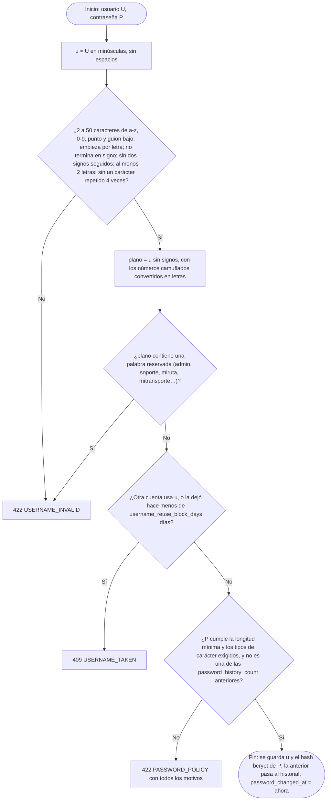

**Usuario propuesto** (`GET /username-suggestion`, docs/11 §11.4): se prueban, en minúsculas, sin tildes y con la ñ como n, `primer nombre` → `+.segundo nombre` (si tiene) → `+.primer apellido` → `+.segundo apellido` → `+.2`, `.3`… y se devuelve el primero que es válido y está libre. **Contraseña propuesta** (`GET /password-suggestion`): aleatoria y conforme a la política.

**Contraseña puesta por otro** (registro por el Administrador, «Olvidé algo»): `must_change_password = true`; hasta cambiarla, la API solo permite el perfil propio (`PASSWORD_CHANGE_REQUIRED`). Lo mismo cuando caduca (`password_expiry_days`; aviso diario en 7.35).

## 7.2 Registro, carné y primer Administrador

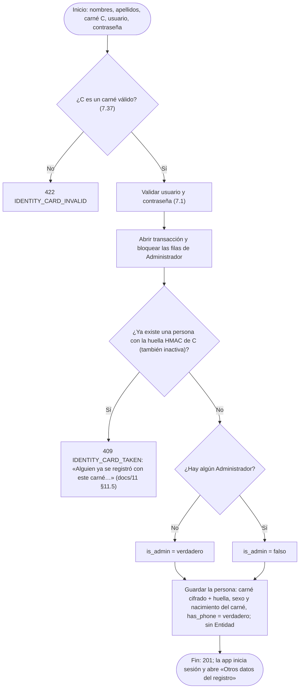

`GET /registration-status` → `{adminExists}` para que la app diga si quien se registra será el Administrador.

**Después del registro**, todo se pide dentro de la app: entrar en una Entidad (solicitud `entity_membership`, la aprueba quien tenga `entities.approve_membership`: por defecto, el Administrador; al aprobarse se le asigna el rol por defecto), itinerario y parada (`itinerary_membership`), roles (`role`) e hijos (directo, 7.9). El Administrador entra en Entidades sin solicitud (`POST /me/entities`).

**Registro por el Administrador** (`POST /workers`, `workers.register`): nombres, apellidos, carné, Entidad, `hasPhone` y, opcionales, usuario y contraseña (si faltan se proponen). Si el carné **no existe**, crea la persona con `must_change_password = true` y la pertenencia ya aprobada (con el rol por defecto) y devuelve, solo en esa respuesta, usuario y contraseña. Si **ya existe**, no crea otra cuenta: le añade esa Entidad, aprobada (aviso `entity_added` si tiene teléfono). Sin teléfono, se le genera el QR impreso (7.36).

## 7.3 Inicio de sesión

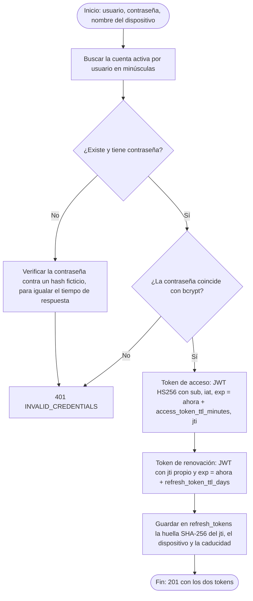

Si la petición trae `X-Installation`, la instalación pasa a ser de esa cuenta, y sus conversaciones sin cuenta, también.

**Primer inicio de sesión con teléfono:** si la persona tenía `has_phone = falso` (la registró el Administrador sin teléfono), pasa a `verdadero` y `printed_qr_version` sube en 1: su QR impreso queda anulado y usa el del teléfono (7.36).

## 7.4 Renovación de tokens con rotación

Si alguien reutiliza un token de renovación ya usado, es señal de que fue robado: se revocan **todos** los tokens de la cuenta.

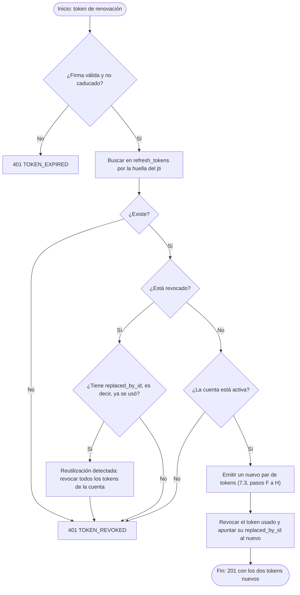

## 7.5 Valor efectivo de un ajuste

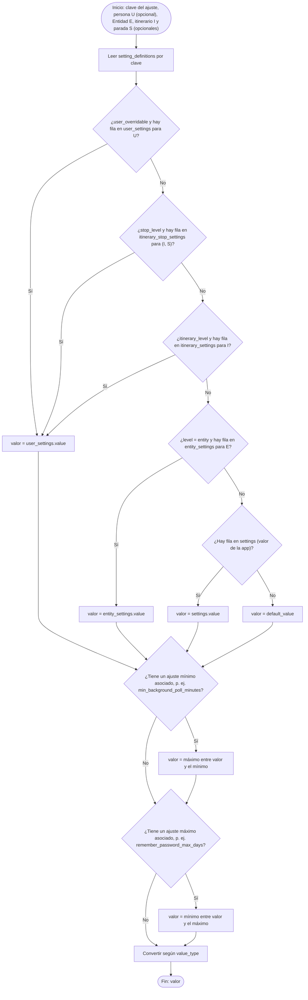

**Al guardar un ajuste** se valida que el valor sea del tipo correcto y esté entre `min_value` y `max_value` (o en `setting_options`); si tiene ajuste máximo asociado, tampoco puede superar su valor actual. Gana el más concreto: persona → parada del itinerario → itinerario → Entidad → app. Permisos: `settings.app`, `settings.entity`, `settings.itinerary` (itinerario y parada) y `settings.worker` (los de otra persona, `/users/{id}/settings`). Si no, `SETTING_OUT_OF_RANGE` o `FORBIDDEN`.

## 7.6 Permisos por roles y permiso para resolver una solicitud

**Comprobar una operación** (`Permissions::can(persona, operación, Entidad?, itinerario?)`):

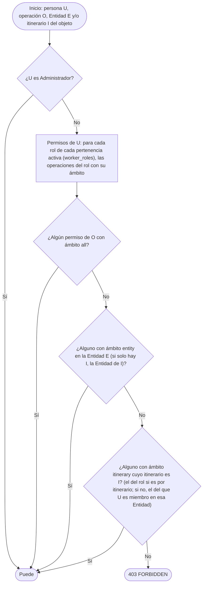

El ámbito `own` no cuenta aquí: lo propio (sus viajes con `trips.view own`, lo suyo en general) se comprueba aparte. Los permisos se leen una vez por petición. Las listas se filtran con el mismo criterio (`Permissions::restrict`).

**Resolver una solicitud:**
- Nadie resuelve la suya (`403 SELF_APPROVAL`); debe estar pendiente (`409 APPLICATION_NOT_PENDING`).
- `entity_membership`: `entities.approve_membership` en esa Entidad.
- `itinerary_membership`: `members.approve` sobre el itinerario pedido.
- `role`: el Administrador, o quien tenga `roles.approve` en la Entidad **y** tenga allí uno de los roles aprobadores de ese rol (`role_approvers`).

La bandeja (`filter[toResolve]=true`) aplica este mismo criterio. Al crear una solicitud se avisa (`application_received`) a todos los que pueden resolverla.

## 7.7 Efectos de aprobar una solicitud

Todo se hace dentro de una transacción.

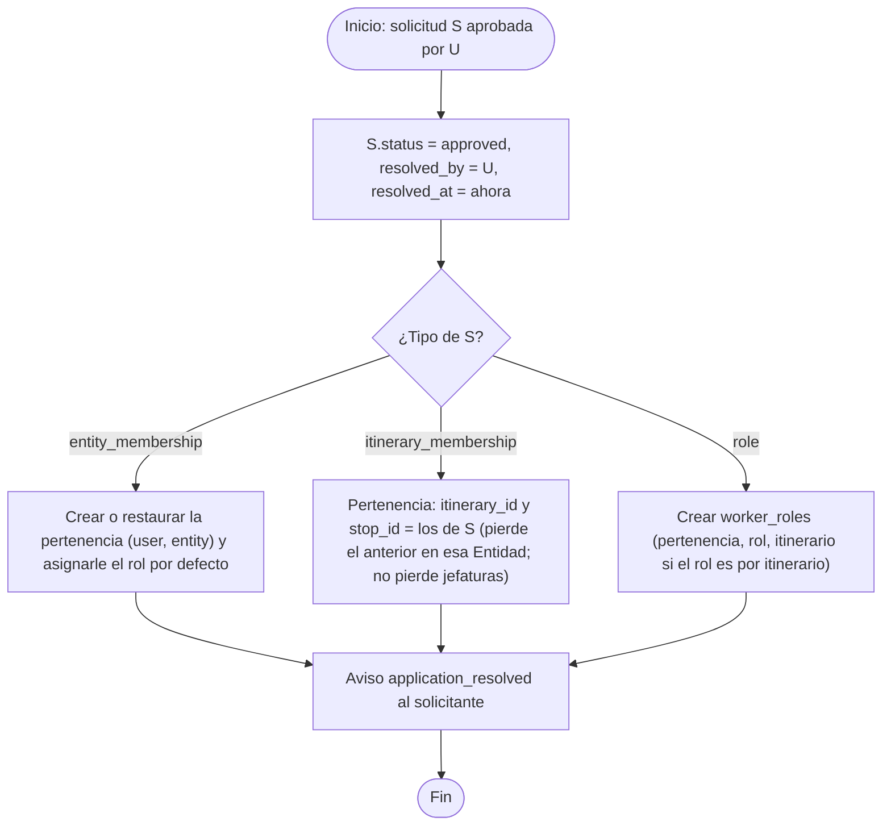

**Al rechazar:** el motivo (`resolution_note`) es obligatorio y se avisa al solicitante con él. **Al cancelar** (solo el solicitante): se cambia el estado.

**Asignaciones directas** (sin solicitud): itinerario y parada (`members.assign`, o con el QR: `members.assign_by_qr`, 7.36), roles (`roles.assign` + ser rol aprobador), Entidad (`entities.assign_members`). Se avisa con `itinerary_assigned`, `role_assigned` o `entity_added`.

## 7.8 Bajas

Las bajas son acciones directas (no dejan solicitud):

| Baja | Quién | Efectos |
|---|---|---|
| De una Entidad (`DELETE /me/entities/{id}` o `DELETE /workers/{id}`) | La persona o `entities.assign_members` | Borrado lógico de la pertenencia; se borran su itinerario, su parada y sus roles allí; se cancelan sus solicitudes pendientes de esa Entidad; si era chofer habitual deja de serlo y sus viajes futuros avisan `trip_needs_reassignment`. Para volver, lo solicita de nuevo |
| Del itinerario (`DELETE /workers/{id}/itinerary`) | La persona o `members.assign` | itinerario y parada = vacíos (aviso `itinerary_removed` si lo hizo otro) |
| De un rol (`DELETE /worker-roles/{id}`) | La persona (aviso `resignation` a quien puede asignarlo) o quien puede asignarlo (aviso `role_removed`) | Borrado lógico del rol; si conducía y pierde `tracking.drive`, como en la baja de la Entidad |
| Desactivar la pertenencia (`PATCH /workers/{id}` `active`) | `workers.deactivate` | Conserva itinerario y roles |
| Eliminar la cuenta (`PATCH /users/{id}` `active`) | `workers.delete` | Borrado lógico de la persona (`409 LAST_ADMIN` si es el último Administrador) |

## 7.9 Derecho a viajar de un niño

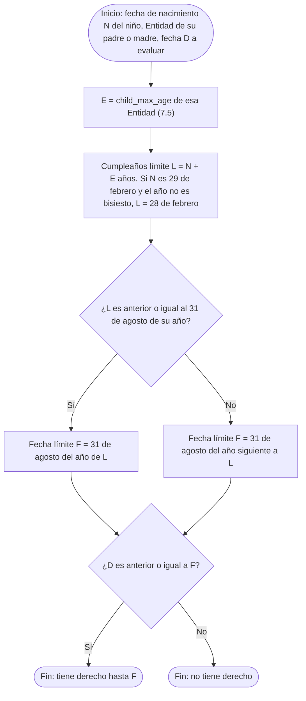

**Ejemplos con E = 16:**
- Nacido el 10/03/2011 → L = 10/03/2027 → F = 31/08/2027.
- Nacido el 15/10/2011 → L = 15/10/2027 → F = 31/08/2028.

**Entidad de referencia:** la de sus padres si todos pertenecen a una sola; si no, el valor de la app.

**Al añadir un hijo** (`POST /children`, directo, sin solicitud):
1. Carné válido (7.37); de él salen el nacimiento y el sexo.
2. Se comprueba el derecho con D = hoy. Si no lo tiene: `422 CHILD_NOT_ELIGIBLE` (con la fecha).
3. Si el carné ya existe, no se crea otro niño: se vincula al nuevo padre (`child_parents`) y la respuesta lo avisa (`meta.alreadyDeclared`). Si ya era suyo: `409 CHILD_ALREADY_DECLARED`.
4. Eliminar = desvincular del padre; sin padres, borrado lógico. Desactivado o sin derecho, deja de mostrarse y no puede subir.

## 7.10 Copia de un viaje a un rango de fechas

La app genera las operaciones y la API las ejecuta todas o ninguna.


La comprobación **dentro del mismo lote** importa cuando la duración supera un día: las copias de días consecutivos podrían solaparse entre sí.

## 7.11 Cambio de estado de un viaje


## 7.12 Solapamiento de viajes

Dos intervalos `[S1, R1]` y `[S2, R2]` se solapan si **S1 < R2** y **S2 < R1**.

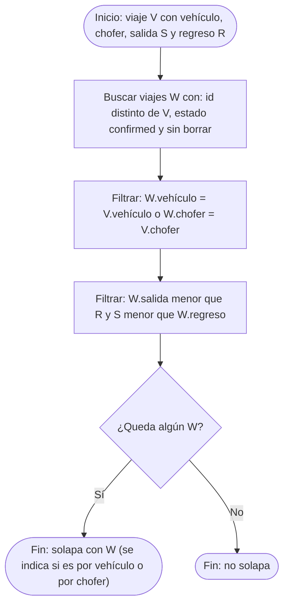

Se ejecuta con una sola consulta, apoyada en los índices `(vehicle_id, status, departs_at, returns_at)` y `(driver_id, status, departs_at, returns_at)`.

## 7.13 Trabajadores esperados y ocupación

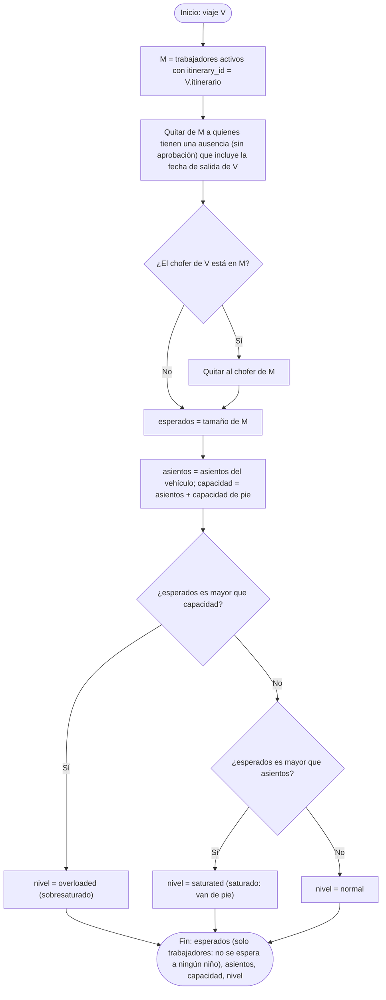

**Avisos de saturación (app):** al sincronizar, para cada viaje pendiente y futuro del alcance elegido (los suyos, o los que gestiona), si el nivel alcanza el elegido (`overloaded`, o también `saturated`): con "al cambiar", se muestra un aviso cuando el nivel cambia respecto al guardado en el teléfono; con "antes de la salida", se programa uno `saturation_notice_minutes_before` minutos antes. Si deja de cumplirse, el aviso programado se cancela.

## 7.14 Marcar un viaje como realizado

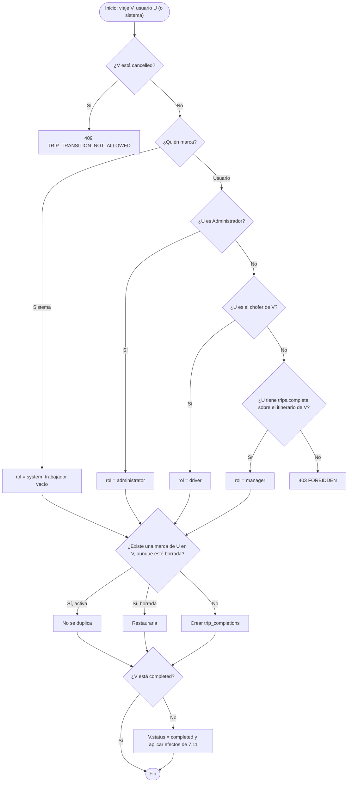

**Tarea `trips:auto-complete`** (cada minuto): busca los viajes `confirmed` con `returns_at + trip_auto_complete_delay_minutes` anterior o igual a ahora, y aplica este algoritmo con quien marca = sistema.

## 7.15 Sincronización y detección de cambios (app)


Se usa la **hora del servidor** y no la del teléfono, para no perder cambios si el reloj del teléfono está mal.

## 7.16 Programación de avisos de viaje de ida y de regreso (app)

Se ejecuta para cada viaje confirmado, una vez para el viaje de ida y otra para el de regreso.

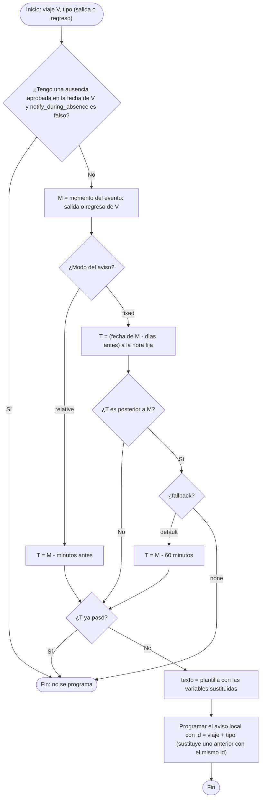

## 7.17 Combinación de sensores

Se calcula cada vez que llega una posición y cuando alguien consulta la posición actual de un trayecto.

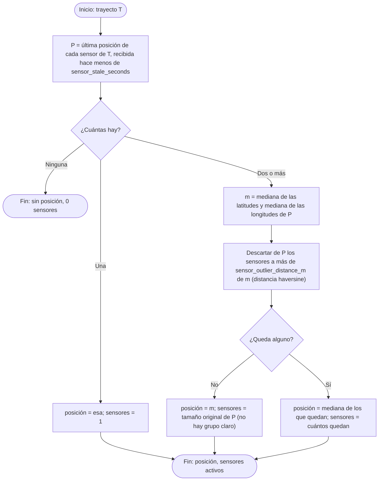

Se usa la **mediana** y no la media porque un teléfono con mala señal no desplaza el resultado.

## 7.18 Paso por paradas, paradas no realizadas y fin del trayecto

Se ejecuta en la API cada vez que cambia la posición combinada p de un trayecto activo. Antes se calcula la **velocidad** v desde la última posición combinada guardada en el trayecto (`last_latitude`, `last_longitude`, `last_position_at`): distancia haversine / segundos × 3,6. Los umbrales son ajustes de la Entidad: N = `stop_min_dwell_seconds`, V = `stop_pass_speed_kmh`.

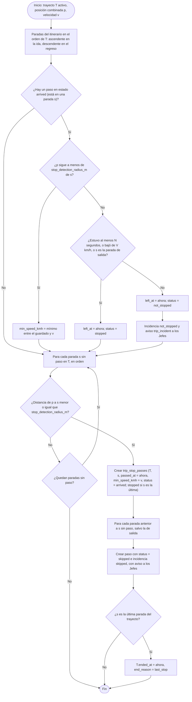

- Se recorren **todas** las paradas sin paso, no solo la siguiente: si el vehículo se salta una parada, se detecta la siguiente y la saltada queda marcada como `skipped`.
- **La parada de salida** no genera incidencias: se da por detenida aunque arranque sin parar, y nunca se marca como saltada. La última se da por detenida al llegar, porque ahí termina el trayecto.
- **Incidencia:** se crea una fila en `trip_leg_incidents` (tipo, parada, coordenadas, `started_at`) y un aviso `trip_incident` (con `payload` `direction`, `type` y `stop`) para quienes tienen `trips.edit` sobre el itinerario. A los pasajeros no se les avisa.
- Después se comprueba el desvío (7.33) y se guarda p como última posición del trayecto.
- **Finalizar a mano** (`PATCH /trip-legs/{id}` con `endedAt`) pone `end_reason = manual`. Gana lo que ocurra primero.

## 7.19 Eventos del recorrido: voz y lista de la próxima parada (app)

La app compara cada nueva posición combinada con la anterior y genera estos eventos. En la voz y en la lista, "ida" y "regreso" son el viaje de ida y el viaje de regreso.

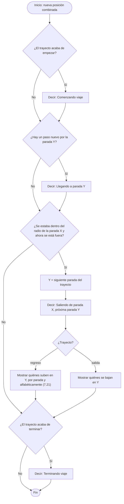

**La voz** solo se usa si el usuario es chofer, Jefe de itinerario, Jefe de Transporte o Administrador, y tiene `tts_enabled` activado. **La lista** solo la ven el chofer y los jefes.

## 7.20 Avisos de paso por paradas (app del trabajador)

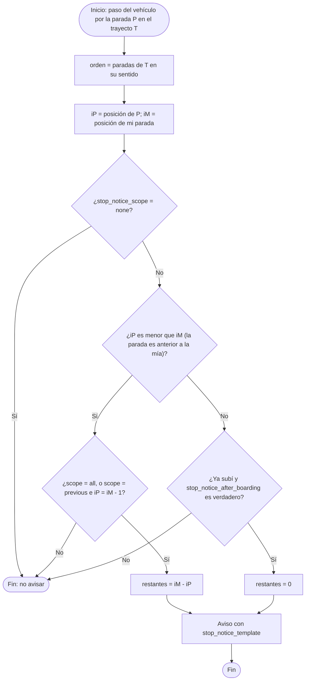

## 7.21 Lista de pasajeros

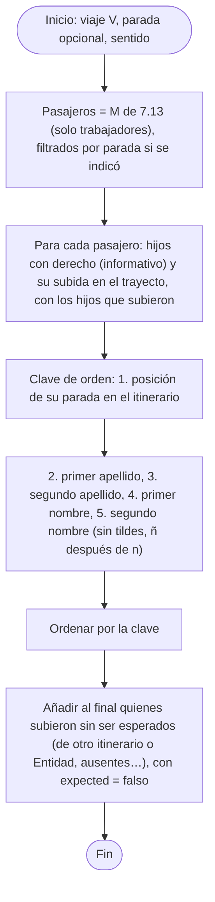

## 7.22 Registro de subida

Una sola subida por persona y trayecto; con QR, ver también 7.36.

```mermaid
flowchart TD
    A(["Inicio: trayecto T del viaje V, persona P, método, hijos H, quien registra U, hora h (del escaneo o ahora)"]) --> B{"¿T está activo, o h cae dentro de T (±2 min), o U tiene tracking.fix_passengers?"}
    B -->|No| X1["409 LEG_NOT_ACTIVE"]
    B -->|Sí| C{"¿Método?"}
    C -->|self| C1["P = U"]
    C -->|"qr o manual"| C2{"¿U es el chofer de V o tiene tracking.scan_boarding sobre su itinerario?"}
    C2 -->|No| X2["403 FORBIDDEN"]
    C2 -->|Sí| C3["qr: P = persona del QR (7.36); manual: P = la de la pertenencia indicada"]
    C1 --> D
    C3 --> D["Pertenencia W de P en la Entidad de V"]
    D --> E{"¿W existe y su itinerario es el de V?"}
    E -->|Sí| G["outsider = null"]
    E -->|"W existe, otro itinerario"| F1["outsider = itinerary"]
    E -->|"No pertenece a la Entidad"| F2{"¿P pertenece a alguna Entidad?"}
    F2 -->|No| X3["422 NOT_A_WORKER"]
    F2 -->|Sí| F3["outsider = entity; W = una de sus pertenencias"]
    F1 --> O{"¿Método self?"}
    F3 --> O
    O -->|Sí| X4["422 NOT_A_PASSENGER"]
    O -->|No| O2{"¿U tiene tracking.allow_outsiders sobre el itinerario de V?"}
    O2 -->|No| X5["403 OUTSIDER_NOT_ALLOWED"]
    O2 -->|Sí| O3{"¿allowOutsider = verdadero?"}
    O3 -->|No| X6["409 OUTSIDER_CONFIRMATION_REQUIRED (meta.outsider): la app pregunta a quien escanea"]
    O3 -->|Sí| G
    G --> K{"¿P ya tiene una subida en T?"}
    K -->|"Sí, escaneada (qr o manual) y ahora se escanea"| X7["409 ALREADY_BOARDED (QR impreso: «puede ser una copia»)"]
    K -->|"Sí, automática o self"| K2["Se actualiza: pasa a escaneada (método, quien la marcó, outsider)"]
    K -->|No| K3["Crear trip_boardings (T, W, método, marked_by, outsider, qr_kind, boarded_at = h)"]
    K2 --> L
    K3 --> L{"¿Cada hijo de H es hijo activo de P con derecho en la fecha de V (7.9)?"}
    L -->|No| X8["422 CHILD_NOT_ELIGIBLE"]
    L -->|Sí| M{"¿Alguno ya subió en T con otra persona?"}
    M -->|Sí| X9["409 CHILD_ALREADY_BOARDED"]
    M -->|No| N["trip_boarding_children = H (único por trayecto y niño); children_count = |H|"]
    N --> Z(["Fin: con QR dinámico, se gasta el código en la misma transacción"])
```

**Corrección de pasajeros** (`tracking.fix_passengers`): cambiar los hijos de una subida (`PATCH`), quitarla (`DELETE`) o registrarla con el trayecto ya terminado. Mientras el trayecto está en curso, quien escanea y la propia persona también pueden cambiar los hijos.

## 7.23 Subida automática

Solo funciona si el trabajador comparte su ubicación.

```mermaid
flowchart TD
    A(["Inicio: llega una posición del sensor W en el trayecto T"]) --> B{"¿W ya tiene un registro de subida en T?"}
    B -->|Sí| Z0(["Fin"])
    B -->|No| C["Tomar las últimas auto_boarding_samples posiciones de W y la posición combinada en cada momento"]
    C --> D{"¿Hay suficientes muestras?"}
    D -->|No| Z0
    D -->|Sí| E{"¿Todas están a menos de auto_boarding_distance_m de la posición combinada?"}
    E -->|No| Z0
    E -->|Sí| F{"¿La posición combinada se movió más de auto_boarding_distance_m entre la primera y la última muestra?"}
    F -->|No| Z0
    F -->|Sí| G["Registrar subida automática (7.22), sin hijos: los marca quien escanea o la persona"]
    G --> Z(["Fin"])
```

Exigir que el vehículo **se esté moviendo** evita marcar como subido a quien solo está esperando en la parada junto al vehículo detenido.

## 7.24 Parada automática del sensor (app)

```mermaid
flowchart TD
    A(["Inicio: el teléfono comparte ubicación en el trayecto T"]) --> B{"¿Soy el chofer del viaje?"}
    B -->|Sí| C{"¿Terminó el trayecto?"}
    B -->|No| D{"¿T es de salida y el vehículo ya pasó por mi parada?"}
    D -->|Sí| E["Dejar de compartir: me bajé"]
    D -->|No| C
    C -->|Sí| F["Dejar de compartir y quitar la notificación fija"]
    C -->|No| G["Seguir enviando cada location_interval_seconds"]
    E --> F
    F --> Z(["Fin"])
    G --> Z
```

## 7.25 Línea con hitos proporcional (app)

```mermaid
flowchart TD
    A(["Inicio: itinerario, sentido del trayecto, alto de la línea en pantalla H"]) --> B["Paradas s0, s1, … sn en el orden del trayecto"]
    B --> C["Para cada tramo de si a si+1"]
    C --> D{"¿Hay trayectos realizados de este itinerario en este sentido?"}
    D -->|Sí| E["d_i = media de la distancia recorrida entre si y si+1 en los últimos trayectos"]
    D -->|No| F["d_i = distancia haversine en línea recta entre si y si+1"]
    E --> G{"¿Quedan tramos?"}
    F --> G
    G -->|Sí| C
    G -->|No| H["acumulado_0 = 0; acumulado_i = suma de d hasta i; total = acumulado_n"]
    H --> I["Posición en pantalla de si = acumulado_i / total × H"]
    I --> J["Vehículo: k = última parada pasada; avance = distancia de sk a la posición actual, con máximo d_k"]
    J --> K["Posición en pantalla del vehículo = (acumulado_k + avance) / total × H"]
    K --> Z(["Fin"])
```

## 7.26 Baja automática por inactividad

**Tarea `workers:inactivity`**, una vez al día.

```mermaid
flowchart TD
    A(["Inicio: tarea diaria"]) --> B["Para cada trabajador activo W con itinerario I"]
    B --> C["N = inactivity_days y Av = inactivity_warning_days de la Entidad de W"]
    C --> D["desde = la más reciente entre: su última subida en un viaje realizado de I, el último viaje realizado que condujo, y la fecha en que entró en I"]
    D --> E["días contados = días entre desde y hoy en los que I tuvo al menos un viaje realizado, W no tenía ausencia declarada y no condujo un viaje realizado"]
    E --> F{"¿días contados es mayor o igual que N?"}
    F -->|Sí| G["Quitarle el itinerario (sin solicitud)"]
    G --> H["W: itinerary_id, stop_id e itinerary_assigned_at = vacíos"]
    H --> I2["notice inactivity_removal para W, y avisar a quienes tienen members.approve sobre I"]
    F -->|No| J{"¿días contados = N - Av y no se le avisó ya en este periodo?"}
    J -->|Sí| K["notice inactivity_warning para W"]
    J -->|No| L
    I2 --> L{"¿Quedan trabajadores?"}
    K --> L
    L -->|Sí| C
    L -->|No| Z(["Fin"])
```

**"La fecha en que entró en I"** es `workers.itinerary_assigned_at` (se pone al asignarle el itinerario, por solicitud, directamente o con el QR). Así, un trabajador recién llegado no pierde la plaza por los días anteriores.

## 7.27 Borrado de chats y avisos

```mermaid
flowchart TD
    A(["Inicio"]) --> B{"¿Qué tarea?"}
    B -->|"chats:purge-trips, cada minuto"| C["Viajes en cancelled o completed cuyo regreso fue hace más de trip_chat_retention_days días"]
    C --> D["Borrar físicamente sus trip_messages"]
    B -->|"chats:purge-expired, diaria"| E["R = conversation_retention_days; Rs = guest_conversation_retention_days"]
    E --> F["Conversaciones con cuenta con el último mensaje de hace más de R días, y sin cuenta con el último de hace más de Rs"]
    F --> G["Borrar físicamente sus conversation_messages"]
    G --> H["Borrado lógico de la conversación"]
    H --> I["Borrado lógico de los avisos leídos hace más de read_notice_retention_days días"]
    D --> Z(["Fin"])
    I --> Z
```

Con `trip_chat_retention_days = 0` el borrado de `trip_messages` también se hace en el momento del cambio de estado (7.11); la tarea cada minuto es una red de seguridad. Todas las caducidades son ajustes de la app.

## 7.28 Periodo de una estadística

```mermaid
flowchart TD
    A(["Inicio: filtros de la petición"]) --> B{"¿Cuántos tipos de periodo vienen?"}
    B -->|"Más de uno"| X["400: solo un tipo de periodo"]
    B -->|Ninguno| C["Periodo = últimos 30 días"]
    B -->|Uno| D{"¿Cuál?"}
    D -->|"from y to"| E{"¿from es anterior o igual a to?"}
    E -->|No| X2["400: rango inválido"]
    E -->|Sí| F["Días = de from a to"]
    D -->|dates| G["Días = la lista, sin repetidos y ordenada"]
    D -->|"last = N + unidad"| H{"¿Unidad?"}
    H -->|d| H1["desde = hoy - N días + 1"]
    H -->|w| H2["desde = hoy - N semanas + 1 día"]
    H -->|m| H3["desde = hoy - N meses + 1 día"]
    H -->|y| H4["desde = hoy - N años + 1 día"]
    H1 --> I["Días = de desde a hoy"]
    H2 --> I
    H3 --> I
    H4 --> I
    C --> J
    F --> J
    G --> J
    I --> J["Aplicar las restricciones del rol: itinerarios, choferes o el propio trabajador"]
    J --> Z(["Fin: conjunto de días y filtros efectivos"])
```

## 7.29 Olvidé algo

```mermaid
flowchart TD
    A(["Inicio: instalación I, qué olvidó, carné, teléfono"]) --> B{"¿I está bloqueada?"}
    B -->|Sí| X1["403 INSTALLATION_BLOCKED"]
    B -->|No| C{"¿I hizo access_recovery_max_per_hour solicitudes en la última hora?"}
    C -->|Sí| X2["429 TOO_MANY_REQUESTS"]
    C -->|No| D["Buscar la persona por la huella del carné"]
    D --> E["Cerrar las solicitudes abiertas de I"]
    E --> F["Crear la solicitud pendiente: carné y teléfono cifrados, persona encontrada o vacía, caduca en access_recovery_ttl_hours"]
    F --> G["Avisar a quien tiene access_recoveries.manage (access_recovery_requested)"]
    G --> Z1(["201: la misma respuesta coincidan o no los datos"])
    Z1 --> H(["El Administrador verifica a la persona por su cuenta"])
    H --> J{"¿Aprueba?"}
    J -->|No| K["rejected; se borra el teléfono"]
    J -->|Sí, y hay persona| L["approved"]
    L --> M{"¿Olvidó la contraseña?"}
    M -->|Sí| O["Contraseña nueva propuesta (7.1), must_change_password = verdadero, se cierran sus sesiones"]
    M -->|No| N
    O --> N["Se comunica solo lo pedido (usuario y/o contraseña) por la tercera vía o a la instalación, que lo lee una vez y la solicitud termina"]
```

La tarea `access-recoveries:expire` cierra cada hora las caducadas y borra su teléfono.

## 7.30 Ámbito de los permisos

Desde la 3.0 no hay «una Entidad por persona»: cada persona pertenece a 0..n Entidades y lo que ve y hace lo deciden sus permisos (7.6).

```mermaid
flowchart TD
    A(["Inicio: petición de U sobre el recurso R (de la Entidad E, itinerario I)"]) --> B{"¿Es suyo (su persona, sus hijos, sus ausencias, sus solicitudes, sus ajustes, su QR)?"}
    B -->|Sí| OK(["Puede"])
    B -->|No| C{"¿Tiene la operación con ámbito que cubra E o I (7.6)?"}
    C -->|Sí| OK
    C -->|No| D{"¿Puede verlo?"}
    D -->|No| X1["404, como si no existiera"]
    D -->|Sí| X2["403 FORBIDDEN"]
```

Al crear o modificar, lo relacionado debe ser de la misma Entidad (`422 ENTITY_MISMATCH`). Sin Entidad, las listas salen vacías.

## 7.31 Viajes atrasados y aviso de comienzo

Servicio `TripTimeliness`. H = hora planificada del tramo (`departs_at` para la ida, `returns_at` para el regreso); tol = `trip_delay_tolerance_minutes` de la Entidad del itinerario.

```mermaid
flowchart TD
    A(["Inicio: viaje V, sentido S, ahora"]) --> B{"¿V está confirmed?"}
    B -->|No| N0(["No atrasado"])
    B -->|Sí| C{"¿Ya hay trip_legs de V en el sentido S (comenzó)?"}
    C -->|Sí| D["atraso = minutos entre H y started_at"]
    D --> E{"¿atraso > tol?"}
    E -->|Sí| F(["Comenzó con atraso: delayMinutes = atraso"])
    E -->|No| G(["Comenzó a tiempo: delayMinutes = NULL"])
    C -->|No| H{"¿ahora > H + tol?"}
    H -->|No| N0
    H -->|Sí| I(["Atrasado: delayed = verdadero, delayMinutes = minutos desde H hasta ahora"])
```

La API lo expone en cada viaje como `outboundDelayed`, `returnDelayed`, `outboundDelayMinutes` y `returnDelayMinutes`; no se guarda.

**Aviso de atraso** (tarea `trips:notify-delays`, cada minuto):

```mermaid
flowchart TD
    A(["Inicio: tarea cada minuto"]) --> B["Viajes confirmed con salida entre hace 2 días y ahora"]
    B --> C["Para cada viaje V y cada sentido S"]
    C --> D{"¿V está atrasado en S?"}
    D -->|No| K
    D -->|Sí| E{"¿Ya hay un notice trip_delayed de V con direction = S?"}
    E -->|Sí| K
    E -->|No| F["Destinatarios: pasajeros esperados, chofer y Jefes del itinerario"]
    F --> G["Quitar a quien tiene trip_delay_notice_enabled desactivado, y a quien tiene ausencia ese día sin notify_during_absence"]
    G --> H["notice trip_delayed con payload direction y scheduledAt"]
    H --> K{"¿Quedan?"}
    K -->|Sí| C
    K -->|No| Z(["Fin"])
```

**Aviso de comienzo:** al iniciar un trayecto (`POST /trip-legs`) se calcula su atraso y se envía `trip_started` (payload `direction` y `delayMinutes`) a los mismos destinatarios, filtrados por `trip_start_notice_enabled`, salvo a quien lo inició. Texto: *"Comenzó el viaje de ida de Ruta Este a tiempo."* o *"… (12 min de atraso)."*

## 7.32 Recordar contraseña (app)

Sustituye al PIN propio de la app. **La contraseña nunca se guarda**: solo la fecha en que se escribió por última vez en el teléfono.

```mermaid
flowchart TD
    A(["Inicio: se abre la app con una sesión guardada"]) --> B{"¿remember_password está activado?"}
    B -->|No| P["Pedir la contraseña (estado locked; la sesión sigue y los avisos llegan)"]
    B -->|Sí| C{"¿Hay fecha de la última vez que se escribió?"}
    C -->|No| D["Guardar ahora como fecha (sesiones de versiones anteriores)"]
    D --> OK(["Entrar sin pedirla"])
    C -->|Sí| E{"¿Pasaron más de remember_password_days días? (como mucho remember_password_max_days, 7.5)"}
    E -->|No| OK
    E -->|Sí| P
    P --> F{"¿La contraseña es correcta (POST /tokens)?"}
    F -->|Sí| G["Guardar ahora como fecha de la última vez"]
    G --> OK
    F -->|No| P
```

Al iniciar sesión también se guarda la fecha; al cerrar sesión se borra. Por defecto: activado, 7 días; el Administrador fija el máximo (30).

## 7.33 Desvío del recorrido de referencia

Se ejecuta en la API tras el paso por paradas (7.18), con cada posición combinada p de un trayecto activo T. La referencia R es el trayecto que el itinerario tiene como `reference_outbound_leg_id` o `reference_return_leg_id`, según el sentido de T.

```mermaid
flowchart TD
    A(["Inicio: trayecto T, posición combinada p"]) --> B{"¿El itinerario tiene recorrido de referencia R en ese sentido y R no es T?"}
    B -->|No| Z(["Fin"])
    B -->|Sí| C["L = posiciones de R en orden, reducidas a unos 1000 puntos (polilínea)"]
    C --> D{"¿L tiene al menos 2 puntos?"}
    D -->|No| Z
    D -->|Sí| E["d = distancia de p a la polilínea L"]
    E --> F{"¿d > route_deviation_m?"}
    F -->|Sí| G{"¿T.deviating?"}
    G -->|Sí| H["Incidencia abierta: distance_m = máximo entre la guardada y d"]
    G -->|No| I["T.deviating = verdadero; incidencia deviation (coordenadas de p, distance_m = d) y aviso trip_incident a los Jefes del itinerario y de Transporte"]
    F -->|No| J{"¿T.deviating?"}
    J -->|Sí| K["T.deviating = falso; ended_at de la incidencia abierta = ahora"]
    J -->|No| Z
    H --> Z
    I --> Z
    K --> Z
```

**Distancia a la polilínea** (`Geo::distanceToPolyline`): se proyectan los puntos en un plano local equirectangular centrado en p (x = Δlongitud · cos(latitud) · R⊕, y = Δlatitud · R⊕), y para cada segmento AB se calcula la distancia de p al punto más cercano del segmento (proyección t = −(A·AB)/|AB|², limitada a [0, 1]). El resultado es la menor de todas. Es suficiente a escala de ciudad.

**Marcar la referencia:** el Jefe del itinerario o un Jefe de Transporte elige un trayecto **terminado** de un viaje de ese itinerario y del mismo sentido; si no lo es, `422 INVALID_REFERENCE_LEG`. Mientras no haya referencia no se vigilan desvíos.

## 7.34 Lectura de la versión del APK y comprobación de actualizaciones

**En la API, al publicar una versión** (`POST /app-versions`), sin extensiones de PHP (`ApkInfo`):

```mermaid
flowchart TD
    A(["Inicio: APK subidos (64 bits, 32 bits, universal), versión escrita a mano (opcional)"]) --> B["Para cada APK"]
    B --> C["Buscar el fin del directorio central del ZIP (firma PK 05 06) y en él la entrada AndroidManifest.xml"]
    C --> D["Extraerla (almacenada o deflate)"]
    D --> E["Leer el XML binario de Android: tabla de cadenas y atributos versionName y versionCode del elemento manifest"]
    E --> F{"¿Se pudo leer?"}
    F -->|No| H
    F -->|Sí| G{"¿Coincide con lo leído de los APK anteriores y con lo escrito a mano?"}
    G -->|No| X1["422 APK_VERSION_MISMATCH"]
    G -->|Sí| H{"¿Quedan APK?"}
    H -->|Sí| B
    H -->|No| I{"¿Hay versión y código?"}
    I -->|No| X2["422 VALIDATION_ERROR: no se pudo leer la versión; escríbala a mano"]
    I -->|Sí| J{"¿versionCode es mayor que el de la última versión?"}
    J -->|No| X3["422 VERSION_CODE_TOO_LOW"]
    J -->|Sí| Z(["Fin: se guarda la versión"])
```

**En la app, comprobación periódica:** la sincronización en segundo plano (`workmanager`) consulta `GET /app-versions/latest` cada `update_check_hours` horas (24 por defecto). Si hay una versión con `versionCode` mayor que la instalada y aún no se avisó de ella, muestra una notificación; al tocarla se abre la pantalla de actualización. Si es obligatoria, al abrir la app no se puede seguir sin instalarla. Además se comprueba al abrir la app y desde Ajustes.

## 7.35 Aviso diario de caducidad de la contraseña

**Tarea `passwords:warn-expiry`**, una vez al día.

```mermaid
flowchart TD
    A(["Inicio: tarea diaria"]) --> B["Para cada cuenta U con password_changed_at"]
    B --> C["caduca = password_changed_at + password_expiry_days; N = password_expiry_notice_days de U (7.5)"]
    C --> D{"¿N > 0 y ahora < caduca ≤ ahora + N días?"}
    D -->|No| K
    D -->|Sí| E{"¿Ya tiene hoy un notice password_expiring?"}
    E -->|Sí| K
    E -->|No| F["Crear notice password_expiring: Su contraseña caduca el sáb. 14/03/26. Cámbiela en Mi perfil."]
    F --> K{"¿Quedan cuentas?"}
    K -->|Sí| B
    K -->|No| Z(["Fin"])
```

Antes era un único aviso a los 15 días (ajuste de la app `password_expiry_warning_days`); ahora es uno por día durante los últimos N días, y N es un ajuste de cada usuario (15 por defecto; 0 = sin avisos).

## 7.36 Código QR de la persona

Un solo QR por persona para toda la app (docs/11 §11.8 y §11.9). Servicios `QrCodes` (formato y firmas) y `QrScans` (usos). **Todas las firmas son ECDSA P-256 con SHA-256, en formato DER (ASN.1 `SEQUENCE {r, s}`)**, sobre los **bytes JSON** exactamente como se transmiten (los que resultan de decodificar el segmento base64url). base64url sin relleno (`=`); las claves públicas, SPKI DER en base64 **estándar** (con `+`, `/` y relleno).

| Pieza | Formato |
|---|---|
| Clave del servidor | `server_keys` (purpose `qr`): pública SPKI DER base64; privada PEM cifrada con `Crypt` (APP_KEY). Se crea la primera vez que se necesita. `GET /qr-public-key` |
| Certificado del teléfono | `base64url(J) "." base64url(firma_servidor(J))`, J = `{"u":<userId>,"k":"<SPKI base64 del teléfono>","e":<caducidad unix>,"v":1}`. 30 días (`POST /me/qr-devices`) |
| QR dinámico | `MR1.<certificado>.<base64url(P)>.<base64url(firma_teléfono(P))>`, P = `{"u":<userId>,"t":<unix segundos>,"n":"<8 bytes en hex, 16 caracteres>"}`. 5 segmentos separados por `.` |
| QR impreso | `MRP1.<base64url(J)>.<base64url(firma_servidor(J))>`, J = `{"u":<userId>,"v":<printed_qr_version>}`. 3 segmentos |

**Verificación** (igual en el servidor y, sin conexión, en el teléfono que escanea; h = hora del escaneo):

```mermaid
flowchart TD
    A(["Inicio: texto Q, hora h"]) --> B{"¿Empieza por MR1. y tiene 5 segmentos, o por MRP1. y tiene 3?"}
    B -->|No| X1["QR_INVALID"]
    B -->|MR1| C["J = b64url⁻¹(seg1); P = b64url⁻¹(seg3)"]
    C --> D{"¿firma seg2 válida sobre J con la clave del servidor?"}
    D -->|No| X2["QR_CERTIFICATE_INVALID"]
    D -->|Sí| E{"¿J.u = P.u?"}
    E -->|No| X2
    E -->|Sí| F{"¿J.e ≥ h?"}
    F -->|No| X3["QR_CERTIFICATE_EXPIRED"]
    F -->|Sí| G{"¿firma seg4 válida sobre P con la clave J.k?"}
    G -->|No| X4["QR_SIGNATURE_INVALID"]
    G -->|Sí| H{"¿abs(P.t − h) ≤ 120 s?"}
    H -->|No| X5["QR_EXPIRED"]
    H -->|Sí| I{"¿(P.u, P.n) ya usado? (qr_nonces; en el teléfono, su lista local)"}
    I -->|Sí| X6["409 QR_ALREADY_USED"]
    I -->|No| OK(["Persona P.u"])
    B -->|MRP1| K{"¿firma seg2 válida sobre J con la clave del servidor?"}
    K -->|No| X4
    K -->|Sí| L{"¿La persona J.u no tiene teléfono y su printed_qr_version = J.v? (sin conexión: printedQrVersion de la lista)"}
    L -->|No| X7["QR_REVOKED"]
    L -->|Sí| OK
```

- **Un solo uso:** el código dinámico se gasta al registrar la subida o el alta (no al comprobarlo con `POST /qr-scans`). `qr_nonces` guarda (persona, nonce, uso, registro) hasta P.t + 120 s + 7 días; la tarea `qr:purge-nonces` (cada hora) borra los caducados. Un reintento del mismo uso (misma subida o mismo alta) devuelve el registro anterior (`repeated`).
- **Sin conexión:** el teléfono que escanea guarda la clave del servidor y la lista de la Entidad (`GET /entities/{id}/scan-roster`), comprueba como arriba con su hora, lleva su propia lista de nonces usados y guarda el escaneo con su hora local. Al sincronizar (`POST /offline-scans` o `POST /trip-boardings` con `scannedAt`), el servidor revalida todo con h = `scannedAt` (no posterior a ahora + 2 min ni anterior a 7 días: `QR_SCAN_TIME_INVALID`, `QR_SCAN_TOO_OLD`) y descarta los nonces repetidos.
- **QR impreso:** `GET /workers/{id}/printed-qr` (`workers.printed_qr`); anular = `printed_qr_version + 1` (`POST …/revoke`). Al entrar por primera vez con teléfono (inicio de sesión o certificado del teléfono) se anula solo (7.3). Una sola subida por trayecto: si el mismo QR se usa dos veces en el mismo viaje, `409 ALREADY_BOARDED` con aviso de posible copia.
- **Alta directa** (`POST /itinerary-assignments`, `members.assign_by_qr` sobre el itinerario): la persona debe pertenecer a la Entidad del itinerario (`422 NOT_A_MEMBER`); se le cambian itinerario y parada (pierde el anterior en esa Entidad, conserva sus jefaturas) y se le avisa.
- **De fuera:** ver 7.22 (`tracking.allow_outsiders` y confirmación).

## 7.37 Carné de identidad

Clase `App\Support\IdentityCard` (docs/11 §11.2).

```mermaid
flowchart TD
    A(["Inicio: carné C"]) --> B{"¿11 dígitos?"}
    B -->|No| X["422 IDENTITY_CARD_INVALID"]
    B -->|Sí| C["AA = C[0..1], MM = C[2..3], DD = C[4..5]; siglo por C[6]: 9 → 1800, 0–5 → 1900, 6–8 → 2000"]
    C --> D{"¿AAAA-MM-DD es una fecha válida y no futura?"}
    D -->|No| X
    D -->|Sí| E["sexo = M si C[9] (penúltimo) es par; F si es impar"]
    E --> Z(["Fin: nacimiento, sexo; se guarda cifrado (Crypt) y con huella HMAC-SHA256 (APP_KEY) única"])
```

Se busca y se comprueba que no se repite por la huella; el carné en claro solo lo ven la propia persona, el Administrador y quien tenga `workers.view_identity_card` en su ámbito (también sobre quien solicita entrar en su itinerario). Los hijos usan la misma regla (huella única en `children`).
