# 7. Algoritmos

Diagramas de flujo de los algoritmos que van más allá de crear, leer, modificar o borrar filas. Están ordenados por área.

**Dónde se ejecuta cada uno:**

| Algoritmo | API | App | Tarea programada |
|---|:-:|:-:|:-:|
| 7.1 Validación del carné | ✔ | ✔ | |
| 7.2 Registro | ✔ | | |
| 7.3 Inicio de sesión | ✔ | | |
| 7.4 Renovación de tokens con rotación | ✔ | | |
| 7.5 Valor efectivo de un ajuste | ✔ | ✔ | |
| 7.6 Permiso para resolver una solicitud | ✔ | | |
| 7.7 Efectos de aprobar una solicitud | ✔ | | |
| 7.8 Bajas voluntarias | ✔ | | |
| 7.9 Derecho a viajar de un niño | ✔ | ✔ | |
| 7.10 Copia de un viaje a un rango de fechas | ✔ | ✔ | |
| 7.11 Cambio de estado de un viaje | ✔ | | |
| 7.12 Solapamiento de viajes | ✔ | | |
| 7.13 Pasajeros esperados y sobresaturación | ✔ | | |
| 7.14 Marcar un viaje como realizado | ✔ | | ✔ |
| 7.15 Sincronización y detección de cambios | | ✔ | |
| 7.16 Programación de avisos de salida y regreso | | ✔ | |
| 7.17 Combinación de sensores | ✔ | | |
| 7.18 Paso por paradas y fin del trayecto | ✔ | | |
| 7.19 Eventos del recorrido: voz y lista de la próxima parada | | ✔ | |
| 7.20 Avisos de paso por paradas | | ✔ | |
| 7.21 Orden de subida | ✔ | | |
| 7.22 Registro de subida | ✔ | | |
| 7.23 Subida automática | ✔ | | |
| 7.24 Parada automática del sensor | | ✔ | |
| 7.25 Línea con hitos proporcional | | ✔ | |
| 7.26 Baja automática por inactividad | | | ✔ |
| 7.27 Borrado de chats | | | ✔ |
| 7.28 Periodo de una estadística | ✔ | ✔ | |

---

## 7.1 Validación del carné y datos derivados

Se usa en el registro y al declarar un hijo. Devuelve si el carné es válido, el sexo y la fecha de nacimiento.

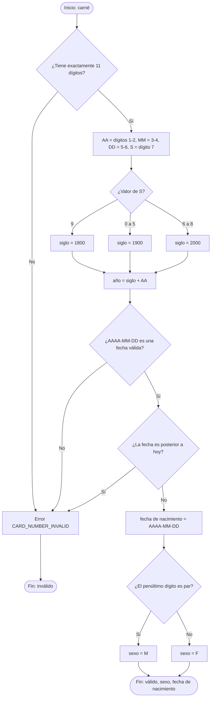

## 7.2 Registro

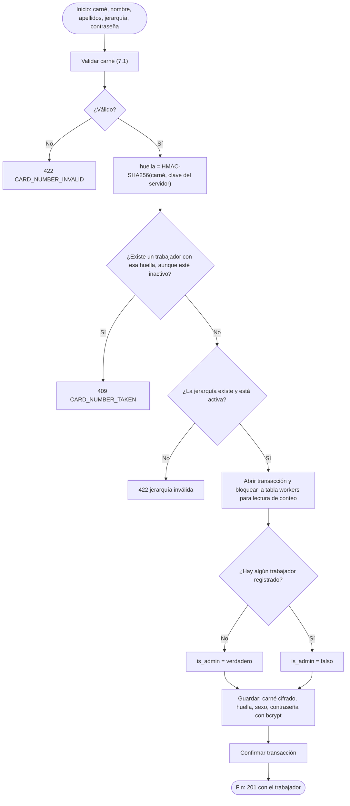

El bloqueo garantiza que, si dos personas se registran a la vez en un sistema vacío, solo una sea Administrador.

## 7.3 Inicio de sesión

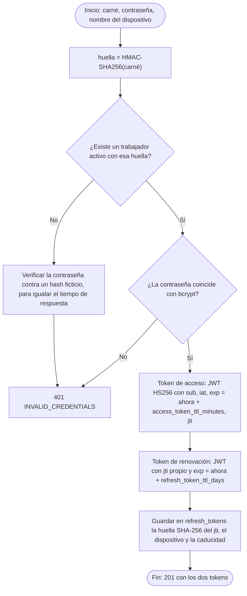

## 7.4 Renovación de tokens con rotación

Si alguien reutiliza un token de renovación ya usado, es señal de que fue robado: se revocan **todos** los tokens del trabajador.

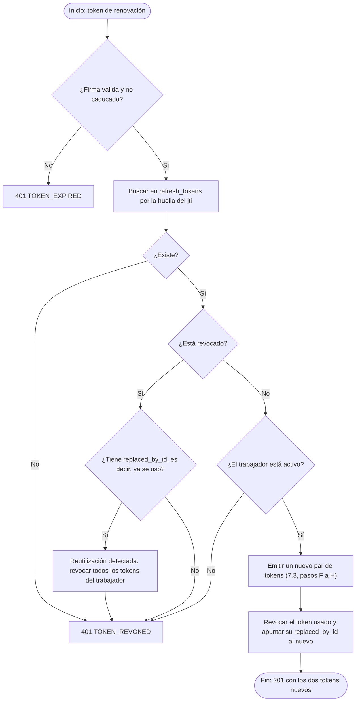

## 7.5 Valor efectivo de un ajuste

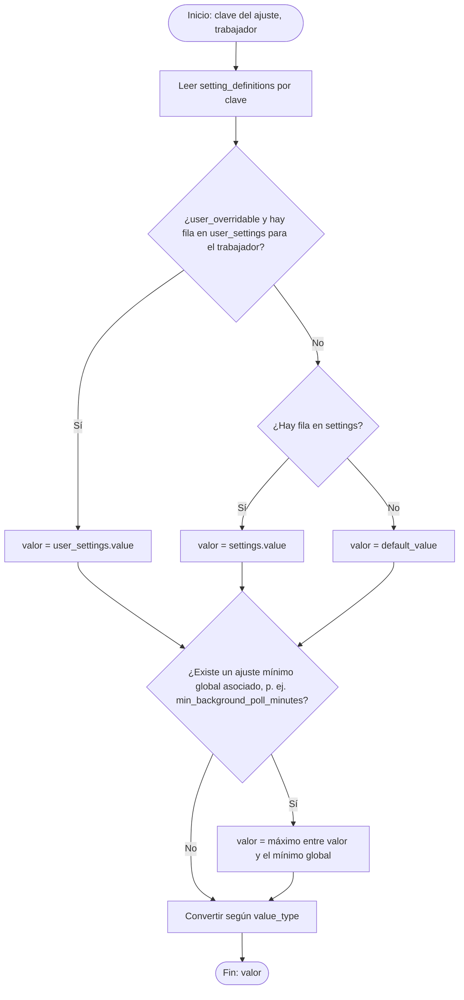

**Al guardar un ajuste** se valida que el valor sea del tipo correcto, que esté entre `min_value` y `max_value` (o en `setting_options`) y que quien lo cambia esté autorizado según `editable_by`. Si no, `SETTING_OUT_OF_RANGE` o `FORBIDDEN`.

## 7.6 Permiso para resolver una solicitud

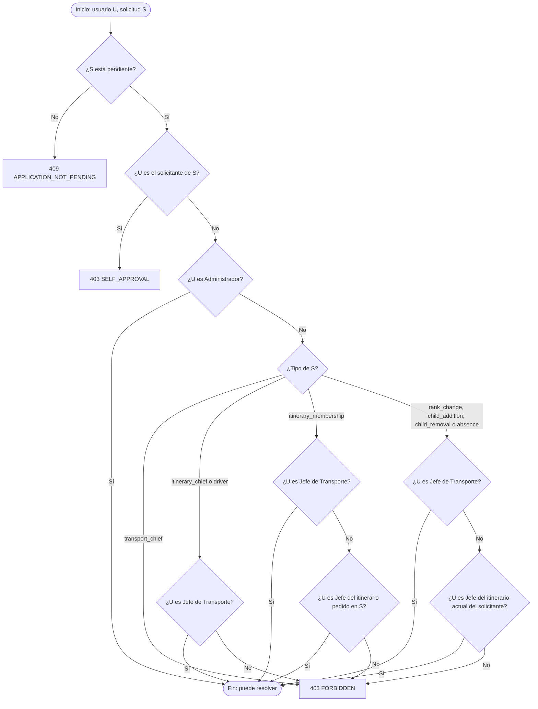

La **bandeja de solicitudes** (`filter[toResolve]=true`) aplica este mismo algoritmo como filtro de la consulta.

## 7.7 Efectos de aprobar una solicitud

Todo se hace dentro de una transacción. Si algún paso falla, no se aplica nada.

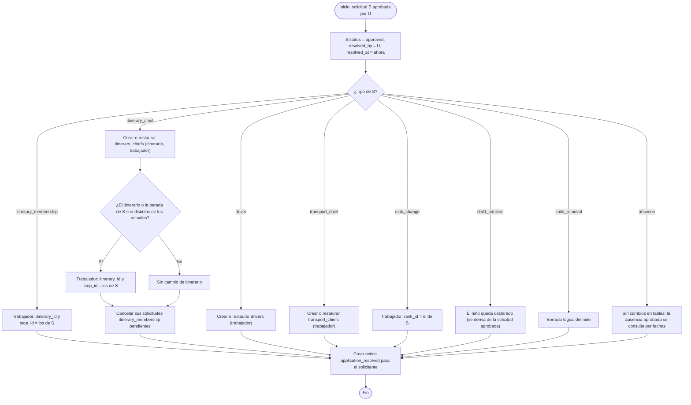

**Al rechazar:** solo se cambia el estado y se avisa al solicitante. **Al cancelar:** solo se cambia el estado. Una solicitud `child_addition` rechazada o cancelada aplica además borrado lógico al niño, para que pueda volver a declararse.

**Al crear una solicitud** se buscan todos los usuarios que podrían resolverla (7.6) y se crea un `notice` `application_received` para cada uno.

## 7.8 Bajas voluntarias

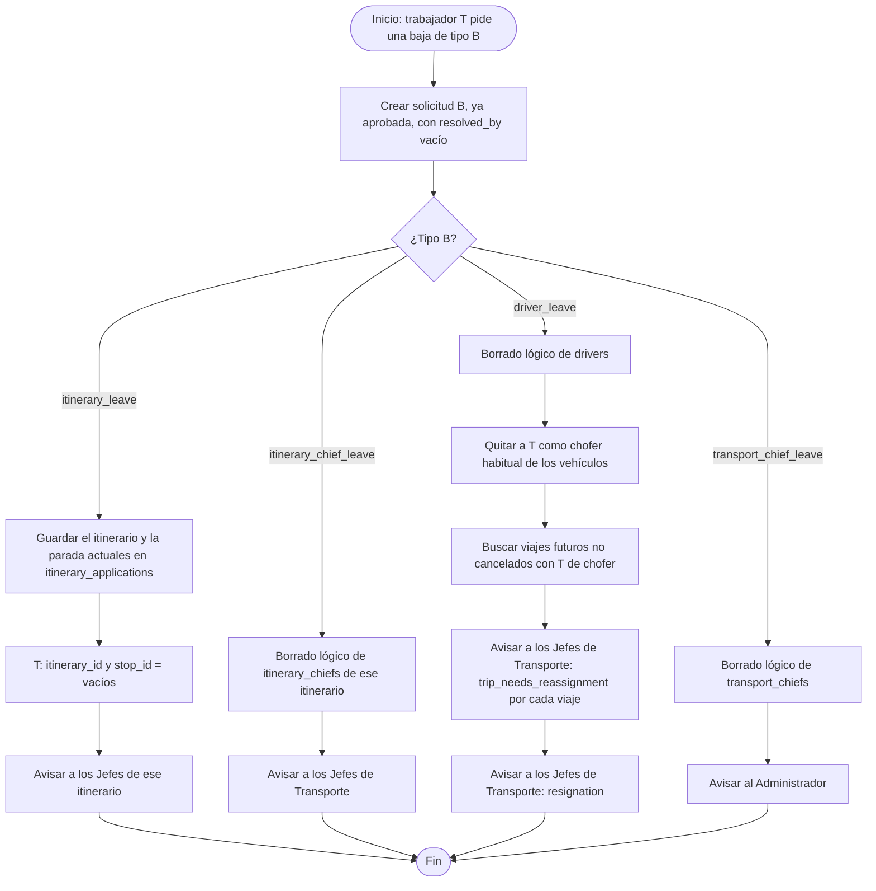

## 7.9 Derecho a viajar de un niño

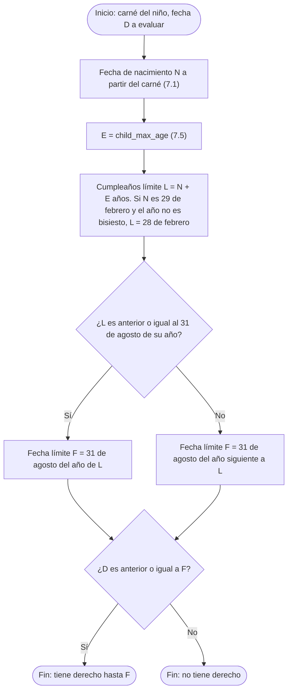

**Ejemplos con E = 16:**
- Nacido el 10/03/2011 → L = 10/03/2027 → F = 31/08/2027.
- Nacido el 15/10/2011 → L = 15/10/2027 → F = 31/08/2028.

**Al declarar un hijo:**
1. Se valida el carné (7.1).
2. Se comprueba el derecho con D = hoy. Si no lo tiene: `CHILD_NOT_ELIGIBLE`.
3. Se busca la huella del carné en `children`:
   - si existe un niño **declarado**: `CHILD_ALREADY_DECLARED`;
   - si existe uno **borrado**: se restaura y se asigna a este trabajador.

## 7.10 Copia de un viaje a un rango de fechas

La app genera las operaciones y la API las ejecuta todas o ninguna.

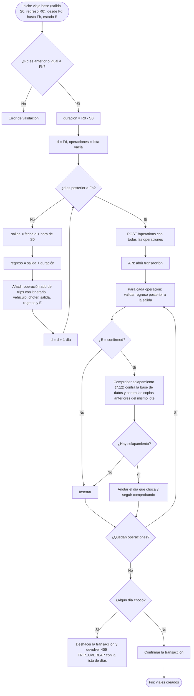

La comprobación **dentro del mismo lote** importa cuando la duración supera un día: las copias de días consecutivos podrían solaparse entre sí.

## 7.11 Cambio de estado de un viaje

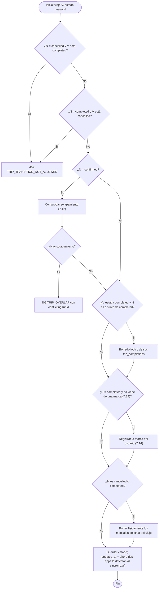

## 7.12 Solapamiento de viajes

Dos intervalos `[S1, R1]` y `[S2, R2]` se solapan si **S1 < R2** y **S2 < R1**.


Se ejecuta con una sola consulta, apoyada en los índices `(vehicle_id, status, departs_at, returns_at)` y `(driver_id, status, departs_at, returns_at)`.

## 7.13 Pasajeros esperados y sobresaturación

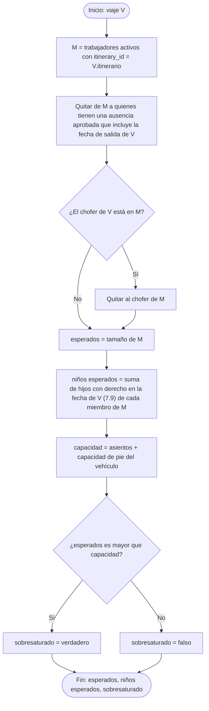

Los niños no cuentan para la capacidad, porque viajan en las piernas.

## 7.14 Marcar un viaje como realizado


**Tarea `trips:auto-complete`** (cada minuto): busca los viajes `confirmed` con `returns_at + trip_auto_complete_delay_minutes` anterior o igual a ahora, y aplica este algoritmo con quien marca = sistema.

## 7.15 Sincronización y detección de cambios (app)


Se usa la **hora del servidor** y no la del teléfono, para no perder cambios si el reloj del teléfono está mal.

## 7.16 Programación de avisos de salida y regreso (app)

Se ejecuta para cada viaje confirmado, una vez para la salida y otra para el regreso.


## 7.17 Combinación de sensores

Se calcula cada vez que llega una posición y cuando alguien consulta la posición actual de un trayecto.


Se usa la **mediana** y no la media porque un teléfono con mala señal no desplaza el resultado.

## 7.18 Paso por paradas y fin del trayecto

Se ejecuta en la API cada vez que cambia la posición combinada de un trayecto activo.

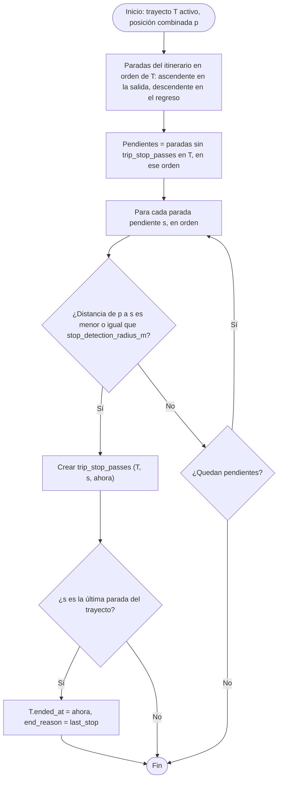

- Se recorren **todas** las pendientes, no solo la siguiente. Así, si el vehículo se salta una parada (por ejemplo, porque nadie sube), se detecta igualmente la siguiente.
- **Finalizar a mano** (`PATCH /trip-legs/{id}` con `endedAt`) pone `end_reason = manual`. Gana lo que ocurra primero.

## 7.19 Eventos del recorrido: voz y lista de la próxima parada (app)

La app compara cada nueva posición combinada con la anterior y genera estos eventos.


**La voz** solo se usa si el usuario es chofer, Jefe de itinerario, Jefe de Transporte o Administrador, y tiene `tts_enabled` activado. **La lista** solo la ven el chofer y los jefes.

## 7.20 Avisos de paso por paradas (app del trabajador)


## 7.21 Orden de subida

```mermaid
flowchart TD
    A(["Inicio: viaje V, parada opcional"]) --> B["Pasajeros = M de 7.13, filtrados por parada si se indicó"]
    B --> C["Para cada pasajero: niños = hijos con derecho en la fecha de V (7.9)"]
    C --> D["Clave de orden de cada pasajero, en este orden de prioridad:"]
    D --> E["1. 0 si niños es mayor que 0, si no 1"]
    E --> F["2. 0 si sexo = F, 1 si sexo = M"]
    F --> G["3. precedence de su jerarquía (1 = la más alta)"]
    G --> H["4. apellidos, alfabético"]
    H --> I["5. nombre, alfabético"]
    I --> J["Ordenar de menor a mayor por la clave"]
    J --> K["boardingOrder = posición en la lista"]
    K --> Z(["Fin: lista ordenada"])
```

El orden alfabético usa la intercalación `utf8mb4_unicode_ci`, que ordena bien las tildes y la ñ.

## 7.22 Registro de subida

```mermaid
flowchart TD
    A(["Inicio: trayecto T, trabajador W, método, niños n, quien registra U"]) --> B{"¿T está activo?"}
    B -->|No| X1["409: el trayecto no está en curso"]
    B -->|Sí| C{"¿Método?"}
    C -->|self| D{"¿U = W?"}
    D -->|No| X2["403 FORBIDDEN"]
    C -->|manual| E{"¿U es el chofer, un Jefe del itinerario, un Jefe de Transporte o el Administrador?"}
    E -->|No| X2
    C -->|qr| F{"¿U tiene uno de esos roles?"}
    F -->|No| X2
    F -->|Sí| G["Verificar la firma y la caducidad del token del QR"]
    G --> H{"¿Válido y emitido para T?"}
    H -->|No| X3["422 BOARDING_PASS_INVALID"]
    H -->|Sí| I["W = trabajador del token"]
    C -->|automatic| J["Lo genera el servidor (7.23)"]
    D -->|Sí| K
    E -->|Sí| K
    I --> K
    J --> K{"¿W es pasajero esperado del viaje?"}
    K -->|No| X4["422: no es miembro del itinerario"]
    K -->|Sí| L["máximo = hijos con derecho de W en la fecha del viaje (7.9)"]
    L --> M{"¿n es mayor que máximo?"}
    M -->|Sí| X5["422 CHILDREN_COUNT_EXCEEDED"]
    M -->|No| N["Crear trip_boardings (T, W, método, marked_by = U, n, ahora)"]
    N --> Z(["Fin"])
```

**Token del QR** (`POST /boarding-passes`): un JWT firmado con `sub` (trabajador), `leg` (trayecto) y `exp` = ahora + `boarding_pass_ttl_seconds`. No se guarda en la base de datos y no contiene el carné. La app lo renueva antes de que caduque mientras se muestra el QR.

**Niños de la subida:** si hay varios registros del mismo trabajador en el mismo trayecto, vale `children_count` del más reciente.

## 7.23 Subida automática

Solo funciona si el trabajador comparte su ubicación.

```mermaid
flowchart TD
    A(["Inicio: llega una posición del sensor W en el trayecto T"]) --> B{"¿W ya tiene un registro de subida en T?"}
    B -->|Sí| Z0(["Fin"])
    B -->|No| C["Tomar las últimas auto_boarding_samples posiciones de W y la posición combinada en cada momento"]
    C --> D{"¿Hay suficientes muestras?"}
    D -->|No| Z0
    D -->|Sí| E{"¿Todas están a menos de auto_boarding_distance_m de la posición combinada?"}
    E -->|No| Z0
    E -->|Sí| F{"¿La posición combinada se movió más de auto_boarding_distance_m entre la primera y la última muestra?"}
    F -->|No| Z0
    F -->|Sí| G["Registrar subida automática (7.22) con niños = todos los que tiene con derecho"]
    G --> Z(["Fin"])
```

Exigir que el vehículo **se esté moviendo** evita marcar como subido a quien solo está esperando en la parada junto al vehículo detenido.

## 7.24 Parada automática del sensor (app)

```mermaid
flowchart TD
    A(["Inicio: el teléfono comparte ubicación en el trayecto T"]) --> B{"¿Soy el chofer del viaje?"}
    B -->|Sí| C{"¿Terminó el trayecto?"}
    B -->|No| D{"¿T es de salida y el vehículo ya pasó por mi parada?"}
    D -->|Sí| E["Dejar de compartir: me bajé"]
    D -->|No| C
    C -->|Sí| F["Dejar de compartir y quitar la notificación fija"]
    C -->|No| G["Seguir enviando cada location_interval_seconds"]
    E --> F
    F --> Z(["Fin"])
    G --> Z
```

## 7.25 Línea con hitos proporcional (app)

```mermaid
flowchart TD
    A(["Inicio: itinerario, sentido del trayecto, alto de la línea en pantalla H"]) --> B["Paradas s0, s1, … sn en el orden del trayecto"]
    B --> C["Para cada tramo de si a si+1"]
    C --> D{"¿Hay trayectos realizados de este itinerario en este sentido?"}
    D -->|Sí| E["d_i = media de la distancia recorrida entre si y si+1 en los últimos trayectos"]
    D -->|No| F["d_i = distancia haversine en línea recta entre si y si+1"]
    E --> G{"¿Quedan tramos?"}
    F --> G
    G -->|Sí| C
    G -->|No| H["acumulado_0 = 0; acumulado_i = suma de d hasta i; total = acumulado_n"]
    H --> I["Posición en pantalla de si = acumulado_i / total × H"]
    I --> J["Vehículo: k = última parada pasada; avance = distancia de sk a la posición actual, con máximo d_k"]
    J --> K["Posición en pantalla del vehículo = (acumulado_k + avance) / total × H"]
    K --> Z(["Fin"])
```

## 7.26 Baja automática por inactividad

**Tarea `workers:inactivity`**, una vez al día.

```mermaid
flowchart TD
    A(["Inicio: tarea diaria"]) --> B["N = inactivity_days; Av = inactivity_warning_days"]
    B --> C["Para cada trabajador activo W con itinerario I"]
    C --> D["desde = la más reciente entre: su última subida en un viaje realizado de I, y la fecha en que entró en I"]
    D --> E["días contados = días entre desde y hoy en los que I tuvo al menos un viaje realizado y W no tenía ausencia aprobada"]
    E --> F{"¿días contados es mayor o igual que N?"}
    F -->|Sí| G["Crear solicitud itinerary_removal, ya aprobada, con el itinerario y la parada"]
    G --> H["W: itinerary_id y stop_id = vacíos"]
    H --> I2["notice inactivity_removal para W, y avisar a los Jefes de I"]
    F -->|No| J{"¿días contados = N - Av y no se le avisó ya en este periodo?"}
    J -->|Sí| K["notice inactivity_warning para W"]
    J -->|No| L
    I2 --> L{"¿Quedan trabajadores?"}
    K --> L
    L -->|Sí| C
    L -->|No| Z(["Fin"])
```

**"La fecha en que entró en I"** es la de resolución de la última solicitud aprobada (`itinerary_membership` o `itinerary_chief`) que lo llevó a ese itinerario. Así, un trabajador recién llegado no pierde la plaza por los días anteriores.

## 7.27 Borrado de chats

```mermaid
flowchart TD
    A(["Inicio"]) --> B{"¿Qué tarea?"}
    B -->|"chats:purge-trips, cada minuto"| C["Viajes en cancelled o completed que aún tienen mensajes"]
    C --> D["Borrar físicamente sus trip_messages"]
    B -->|"chats:purge-expired, diaria"| E["R = conversation_retention_days"]
    E --> F["Conversaciones cuyo último mensaje (o su creación, si no tiene) es de hace más de R días"]
    F --> G["Borrar físicamente sus conversation_messages"]
    G --> H["Borrado lógico de la conversación"]
    D --> Z(["Fin"])
    H --> Z
```

El borrado de `trip_messages` también se hace en el momento del cambio de estado (7.11). La tarea cada minuto es una red de seguridad.

## 7.28 Periodo de una estadística

```mermaid
flowchart TD
    A(["Inicio: filtros de la petición"]) --> B{"¿Cuántos tipos de periodo vienen?"}
    B -->|"Más de uno"| X["400: solo un tipo de periodo"]
    B -->|Ninguno| C["Periodo = últimos 30 días"]
    B -->|Uno| D{"¿Cuál?"}
    D -->|"from y to"| E{"¿from es anterior o igual a to?"}
    E -->|No| X2["400: rango inválido"]
    E -->|Sí| F["Días = de from a to"]
    D -->|dates| G["Días = la lista, sin repetidos y ordenada"]
    D -->|"last = N + unidad"| H{"¿Unidad?"}
    H -->|d| H1["desde = hoy - N días + 1"]
    H -->|w| H2["desde = hoy - N semanas + 1 día"]
    H -->|m| H3["desde = hoy - N meses + 1 día"]
    H -->|y| H4["desde = hoy - N años + 1 día"]
    H1 --> I["Días = de desde a hoy"]
    H2 --> I
    H3 --> I
    H4 --> I
    C --> J
    F --> J
    G --> J
    I --> J["Aplicar las restricciones del rol: itinerarios, choferes o el propio trabajador"]
    J --> Z(["Fin: conjunto de días y filtros efectivos"])
```
