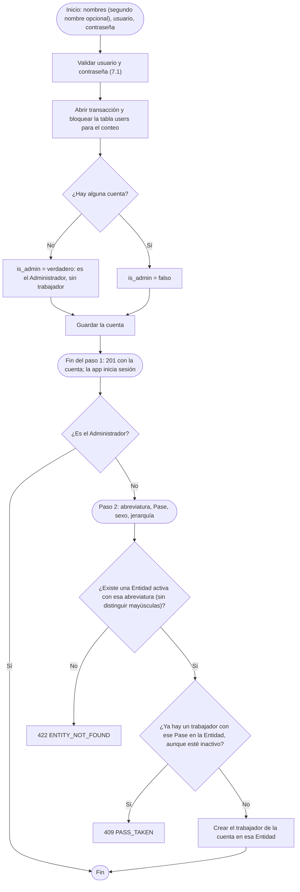
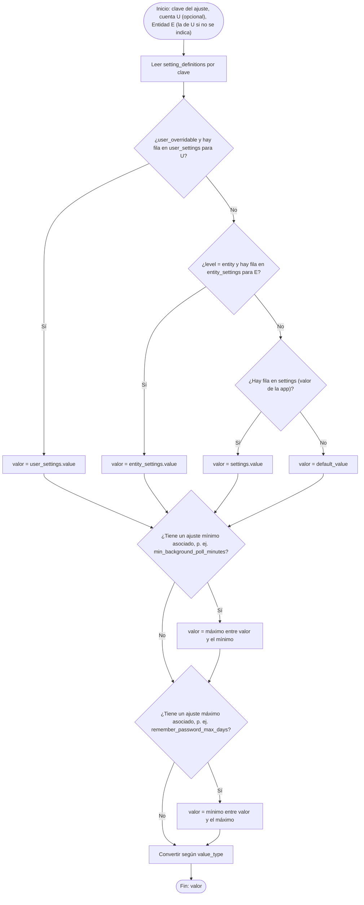
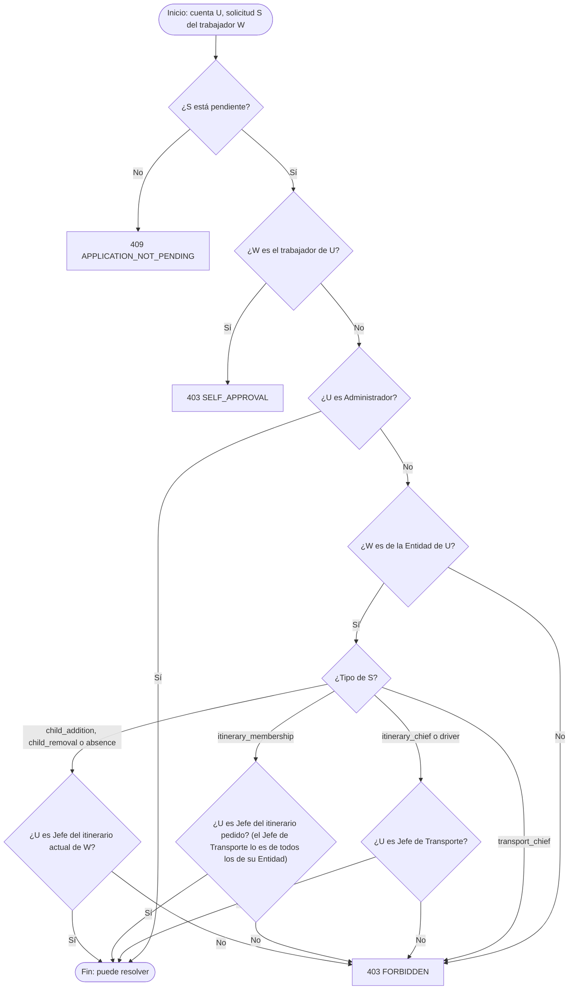
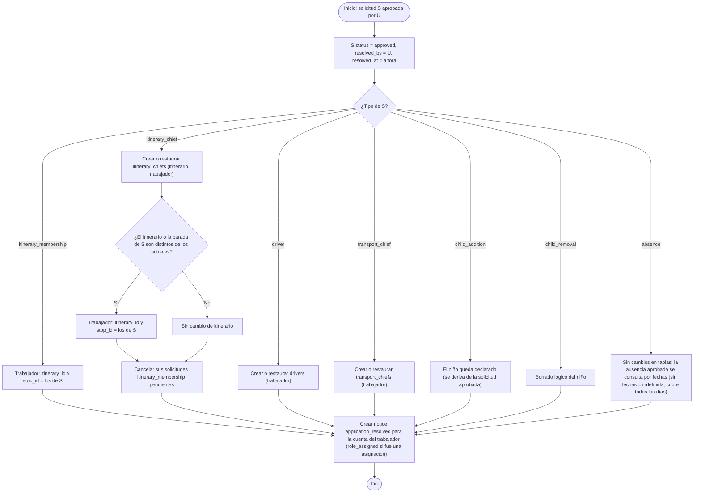
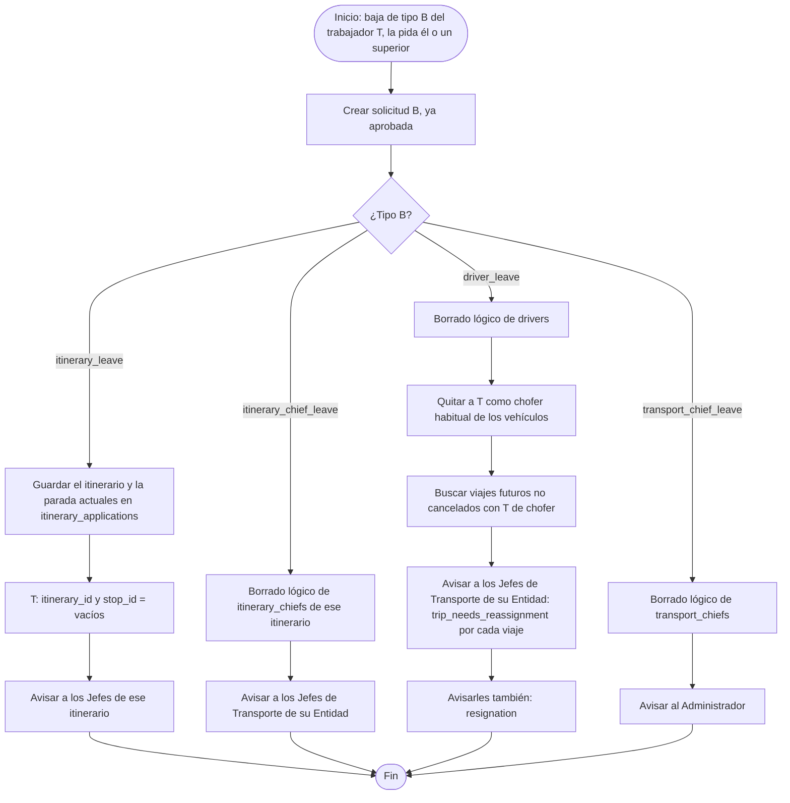
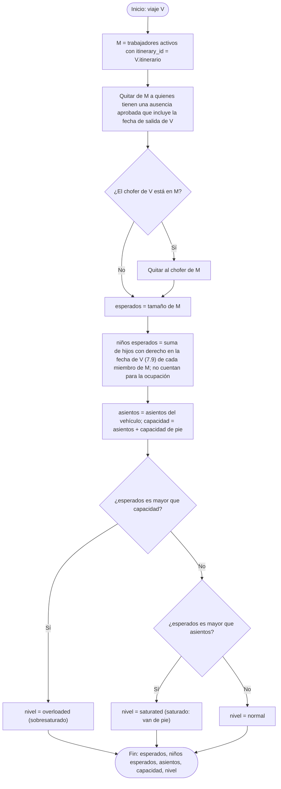
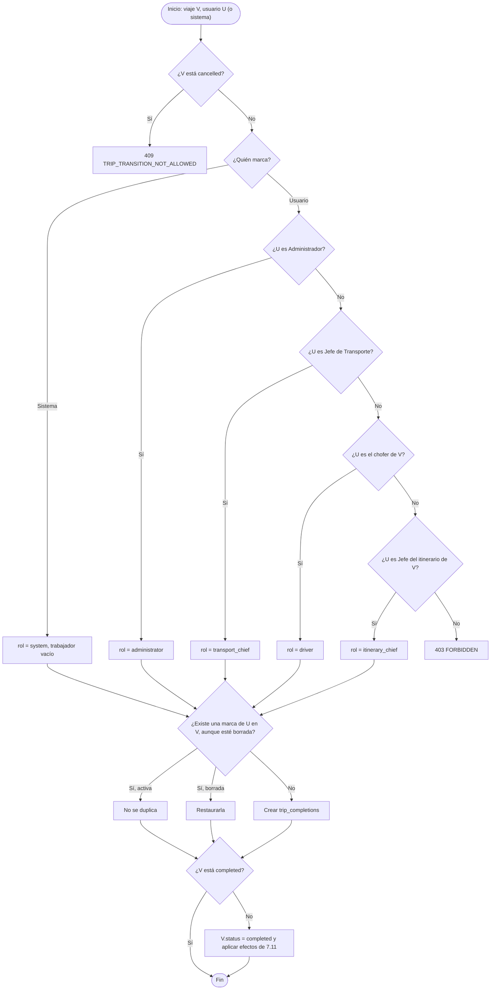
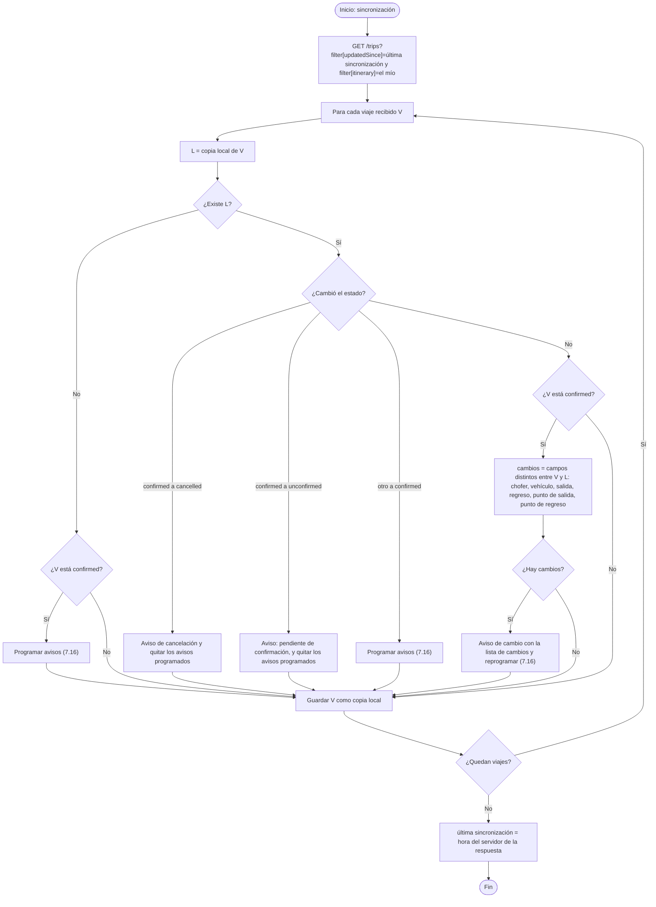

# 7. Algoritmos

Diagramas de flujo de los algoritmos que van más allá de crear, leer, modificar o borrar filas. Están ordenados por área.

**Dónde se ejecuta cada uno:**

| Algoritmo | API | App | Tarea programada |
|---|:-:|:-:|:-:|
| 7.1 Usuario y contraseña | ✔ | ✔ | |
| 7.2 Registro en dos pasos y activación | ✔ | | |
| 7.3 Inicio de sesión | ✔ | | |
| 7.4 Renovación de tokens con rotación | ✔ | | |
| 7.5 Valor efectivo de un ajuste | ✔ | ✔ | |
| 7.6 Permiso para resolver una solicitud | ✔ | | |
| 7.7 Efectos de aprobar una solicitud | ✔ | | |
| 7.8 Bajas voluntarias | ✔ | | |
| 7.9 Derecho a viajar de un niño | ✔ | ✔ | |
| 7.10 Copia de un viaje a un rango de fechas | ✔ | ✔ | |
| 7.11 Cambio de estado de un viaje | ✔ | | |
| 7.12 Solapamiento de viajes | ✔ | | |
| 7.13 Trabajadores esperados y ocupación | ✔ | ✔ | |
| 7.14 Marcar un viaje como realizado | ✔ | | ✔ |
| 7.15 Sincronización y detección de cambios | | ✔ | |
| 7.16 Programación de avisos de viaje de ida y de regreso | | ✔ | |
| 7.17 Combinación de sensores | ✔ | | |
| 7.18 Paso por paradas, paradas no realizadas y fin del trayecto | ✔ | | |
| 7.19 Eventos del recorrido: voz y lista de la próxima parada | | ✔ | |
| 7.20 Avisos de paso por paradas | | ✔ | |
| 7.21 Lista de pasajeros | ✔ | | |
| 7.22 Registro de subida | ✔ | | |
| 7.23 Subida automática | ✔ | | |
| 7.24 Parada automática del sensor | | ✔ | |
| 7.25 Línea con hitos proporcional | | ✔ | |
| 7.26 Baja automática por inactividad | | | ✔ |
| 7.27 Borrado de chats | | | ✔ |
| 7.28 Periodo de una estadística | ✔ | ✔ | |
| 7.29 Olvidé algo | ✔ | ✔ | ✔ |
| 7.30 Compartimentación por Entidad | ✔ | | |
| 7.31 Viajes atrasados y aviso de comienzo | ✔ | ✔ | ✔ |
| 7.32 Recordar contraseña | | ✔ | |
| 7.33 Desvío del recorrido de referencia | ✔ | | |
| 7.34 Lectura de la versión del APK y comprobación de actualizaciones | ✔ | ✔ | |
| 7.35 Aviso diario de caducidad de la contraseña | | | ✔ |

---

## 7.1 Usuario y contraseña


**Caducidad:** la contraseña caduca a los `password_expiry_days` días de `password_changed_at`. A partir de ahí, y tras recuperar el acceso, la API solo permite el perfil propio (`PASSWORD_CHANGE_REQUIRED`). La tarea `passwords:warn-expiry` avisa cada día durante los últimos `password_expiry_notice_days` días de cada usuario (7.35).

**Desde la versión 2.1** ya no se comprueban palabras no permitidas en el usuario, ni contraseñas comunes, ni que la contraseña contenga el usuario o los nombres. Los mensajes de error tratan de usted.

## 7.2 Registro en dos pasos y activación



**Registro por un superior** (trabajador sin teléfono): se crea la cuenta **sin usuario ni contraseña** y su trabajador, y un **código de activación** (8 caracteres sin los que se confunden, guardado como HMAC) que caduca a los `activation_code_ttl_days` días. Generar otro anula el anterior.

**Activación** ("Me registró un superior"): se busca el trabajador por Entidad y Pase; su cuenta tiene que estar sin activar y su último código, vigente, con menos de 5 intentos fallidos. Si el código no coincide se suma un intento. Si todo es correcto, se validan usuario y contraseña (7.1), se guardan, se marca el código como usado y se devuelven los tokens. Cualquier dato incorrecto responde igual: `422 ACTIVATION_INVALID`.

## 7.3 Inicio de sesión


Si la petición trae `X-Installation`, la instalación pasa a ser de esa cuenta, y sus conversaciones sin cuenta, también.

## 7.4 Renovación de tokens con rotación

Si alguien reutiliza un token de renovación ya usado, es señal de que fue robado: se revocan **todos** los tokens de la cuenta.


## 7.5 Valor efectivo de un ajuste



**Al guardar un ajuste** se valida que el valor sea del tipo correcto y esté entre `min_value` y `max_value` (o en `setting_options`); si tiene ajuste máximo asociado, tampoco puede superar su valor actual. Los valores de la app (`settings`) solo los cambia el Administrador; los de una Entidad (`entity_settings`), su Jefe de Transporte o el Administrador. Si no, `SETTING_OUT_OF_RANGE` o `FORBIDDEN`.

## 7.6 Permiso para resolver o asignar una solicitud



La **bandeja de solicitudes** (`filter[toResolve]=true`) aplica este mismo algoritmo como filtro de la consulta.

**Asignación directa:** si un superior crea una solicitud para **otro** trabajador (relación `worker`), se crea con `created_by` = el superior, se comprueba este mismo permiso y, si lo tiene, se aprueba al instante (7.7) y se avisa al trabajador con `role_assigned`. Solo se pueden asignar `itinerary_membership`, `itinerary_chief`, `driver` y `transport_chief`.

## 7.7 Efectos de aprobar una solicitud

Todo se hace dentro de una transacción. Si algún paso falla, no se aplica nada.



**Al rechazar:** el motivo (`resolution_note`) es obligatorio; se cambia el estado y se avisa al solicitante con el motivo. **Al cancelar:** solo se cambia el estado. Una solicitud `child_addition` rechazada o cancelada aplica además borrado lógico al niño, para que pueda volver a declararse.

**Al crear una solicitud** se buscan todos los usuarios que podrían resolverla (7.6) y se crea un `notice` `application_received` para cada uno.

**Varios hijos a la vez** (`children[]`): dentro de una transacción se crea una solicitud `child_addition` por hijo; la primera toma su propio id como `group_id` y las demás, el de la primera. Cada hijo se valida (7.9); si uno falla, no se crea ninguna y el error apunta a ese hijo. Se envía un único `application_received` (el de la primera). Después cada solicitud se aprueba o se rechaza por separado.

**Ausencia indefinida:** se crea sin `starts_on` ni `ends_on`. Una vez aprobada, solo el propio trabajador puede ponerle fechas (`PATCH` sin `status`); se guardan sin nueva aprobación. Si la ausencia no es indefinida o no está aprobada: `409 ABSENCE_NOT_INDEFINITE`.

## 7.8 Bajas y retiradas

Las bajas las pide el propio trabajador; las **retiradas** las hace un superior: el Administrador cualquiera; el Jefe de Transporte, en su Entidad, `itinerary_chief_leave`, `driver_leave` e `itinerary_leave`; el Jefe de itinerario, `itinerary_leave` de los de su itinerario. En una retirada, `created_by` y `resolved_by` son el superior y el trabajador recibe `role_removed`.



## 7.9 Derecho a viajar de un niño


**Ejemplos con E = 16:**
- Nacido el 10/03/2011 → L = 10/03/2027 → F = 31/08/2027.
- Nacido el 15/10/2011 → L = 15/10/2027 → F = 31/08/2028.

**Al declarar un hijo:**
1. La fecha de nacimiento no puede ser futura.
2. Se comprueba el derecho con D = hoy. Si no lo tiene: `CHILD_NOT_ELIGIBLE`.
3. **Posible duplicado:** mientras la solicitud está pendiente, si en la misma Entidad hay otro niño declarado o pendiente con la misma fecha de nacimiento, primer nombre y primer apellido, la solicitud se muestra con `possibleDuplicate = true` a quien la aprueba. No se bloquea.

## 7.10 Copia de un viaje a un rango de fechas

La app genera las operaciones y la API las ejecuta todas o ninguna.


La comprobación **dentro del mismo lote** importa cuando la duración supera un día: las copias de días consecutivos podrían solaparse entre sí.

## 7.11 Cambio de estado de un viaje


## 7.12 Solapamiento de viajes

Dos intervalos `[S1, R1]` y `[S2, R2]` se solapan si **S1 < R2** y **S2 < R1**.


Se ejecuta con una sola consulta, apoyada en los índices `(vehicle_id, status, departs_at, returns_at)` y `(driver_id, status, departs_at, returns_at)`.

## 7.13 Trabajadores esperados y ocupación



**Avisos de saturación (app):** al sincronizar, para cada viaje pendiente y futuro del alcance elegido (los suyos, o los que gestiona), si el nivel alcanza el elegido (`overloaded`, o también `saturated`): con "al cambiar", se muestra un aviso cuando el nivel cambia respecto al guardado en el teléfono; con "antes de la salida", se programa uno `saturation_notice_minutes_before` minutos antes. Si deja de cumplirse, el aviso programado se cancela.

## 7.14 Marcar un viaje como realizado



**Tarea `trips:auto-complete`** (cada minuto): busca los viajes `confirmed` con `returns_at + trip_auto_complete_delay_minutes` anterior o igual a ahora, y aplica este algoritmo con quien marca = sistema.

## 7.15 Sincronización y detección de cambios (app)



Se usa la **hora del servidor** y no la del teléfono, para no perder cambios si el reloj del teléfono está mal.

## 7.16 Programación de avisos de viaje de ida y de regreso (app)

Se ejecuta para cada viaje confirmado, una vez para el viaje de ida y otra para el de regreso.


## 7.17 Combinación de sensores

Se calcula cada vez que llega una posición y cuando alguien consulta la posición actual de un trayecto.


Se usa la **mediana** y no la media porque un teléfono con mala señal no desplaza el resultado.

## 7.18 Paso por paradas, paradas no realizadas y fin del trayecto

Se ejecuta en la API cada vez que cambia la posición combinada p de un trayecto activo. Antes se calcula la **velocidad** v desde la última posición combinada guardada en el trayecto (`last_latitude`, `last_longitude`, `last_position_at`): distancia haversine / segundos × 3,6. Los umbrales son ajustes de la Entidad: N = `stop_min_dwell_seconds`, V = `stop_pass_speed_kmh`.


- Se recorren **todas** las paradas sin paso, no solo la siguiente: si el vehículo se salta una parada, se detecta la siguiente y la saltada queda marcada como `skipped`.
- **La parada de salida** no genera incidencias: se da por detenida aunque arranque sin parar, y nunca se marca como saltada. La última se da por detenida al llegar, porque ahí termina el trayecto.
- **Incidencia:** se crea una fila en `trip_leg_incidents` (tipo, parada, coordenadas, `started_at`) y un aviso `trip_incident` (con `payload` `direction`, `type` y `stop`) para los **Jefes del itinerario y los Jefes de Transporte de la Entidad**. A los pasajeros no se les avisa.
- Después se comprueba el desvío (7.33) y se guarda p como última posición del trayecto.
- **Finalizar a mano** (`PATCH /trip-legs/{id}` con `endedAt`) pone `end_reason = manual`. Gana lo que ocurra primero.

## 7.19 Eventos del recorrido: voz y lista de la próxima parada (app)

La app compara cada nueva posición combinada con la anterior y genera estos eventos. En la voz y en la lista, "ida" y "regreso" son el viaje de ida y el viaje de regreso.


**La voz** solo se usa si el usuario es chofer, Jefe de itinerario, Jefe de Transporte o Administrador, y tiene `tts_enabled` activado. **La lista** solo la ven el chofer y los jefes.

## 7.20 Avisos de paso por paradas (app del trabajador)


## 7.21 Lista de pasajeros

No hay orden de subida (docs/08-version-2.md §8.10).

```mermaid
flowchart TD
    A(["Inicio: viaje V, parada opcional"]) --> B["Pasajeros = M de 7.13, filtrados por parada si se indicó"]
    B --> C["Para cada pasajero: niños = hijos con derecho en la fecha de V (7.9)"]
    C --> D["Clave de orden: 1. posición de su parada en el itinerario"]
    D --> E["2. primer apellido, 3. segundo apellido, 4. primer nombre, 5. segundo nombre (alfabético, sin tildes y con la ñ después de la n)"]
    E --> F["Ordenar de menor a mayor por la clave"]
    F --> Z(["Fin: lista con su posición, niños y estado de subida"])
```

## 7.22 Registro de subida

```mermaid
flowchart TD
    A(["Inicio: trayecto T, trabajador W, método, niños n, quien registra U"]) --> B{"¿T está activo?"}
    B -->|No| X1["409: el trayecto no está en curso"]
    B -->|Sí| C{"¿Método?"}
    C -->|self| D{"¿U = W?"}
    D -->|No| X2["403 FORBIDDEN"]
    C -->|manual| E{"¿U es el chofer, un Jefe del itinerario, un Jefe de Transporte o el Administrador?"}
    E -->|No| X2
    C -->|qr| F{"¿U tiene uno de esos roles?"}
    F -->|No| X2
    F -->|Sí| G["Verificar la firma y la caducidad del token del QR"]
    G --> H{"¿Válido y emitido para T?"}
    H -->|No| X3["422 BOARDING_PASS_INVALID"]
    H -->|Sí| I["W = trabajador del token"]
    C -->|automatic| J["Lo genera el servidor (7.23)"]
    D -->|Sí| K
    E -->|Sí| K
    I --> K
    J --> K{"¿W es pasajero esperado del viaje?"}
    K -->|No| X4["422: no es miembro del itinerario"]
    K -->|Sí| L["máximo = hijos con derecho de W en la fecha del viaje (7.9)"]
    L --> M{"¿n es mayor que máximo?"}
    M -->|Sí| X5["422 CHILDREN_COUNT_EXCEEDED"]
    M -->|No| N["Crear trip_boardings (T, W, método, marked_by = U, n, ahora)"]
    N --> Z(["Fin"])
```

**Token del QR** (`POST /boarding-passes`): un JWT firmado con `sub` (trabajador), `leg` (trayecto) y `exp` = ahora + `boarding_pass_ttl_seconds`. No se guarda en la base de datos y no contiene datos personales. La app lo renueva antes de que caduque mientras se muestra el QR.

**Niños de la subida:** si hay varios registros del mismo trabajador en el mismo trayecto, vale `children_count` del más reciente.

## 7.23 Subida automática

Solo funciona si el trabajador comparte su ubicación.

```mermaid
flowchart TD
    A(["Inicio: llega una posición del sensor W en el trayecto T"]) --> B{"¿W ya tiene un registro de subida en T?"}
    B -->|Sí| Z0(["Fin"])
    B -->|No| C["Tomar las últimas auto_boarding_samples posiciones de W y la posición combinada en cada momento"]
    C --> D{"¿Hay suficientes muestras?"}
    D -->|No| Z0
    D -->|Sí| E{"¿Todas están a menos de auto_boarding_distance_m de la posición combinada?"}
    E -->|No| Z0
    E -->|Sí| F{"¿La posición combinada se movió más de auto_boarding_distance_m entre la primera y la última muestra?"}
    F -->|No| Z0
    F -->|Sí| G["Registrar subida automática (7.22) con niños = todos los que tiene con derecho"]
    G --> Z(["Fin"])
```

Exigir que el vehículo **se esté moviendo** evita marcar como subido a quien solo está esperando en la parada junto al vehículo detenido.

## 7.24 Parada automática del sensor (app)

```mermaid
flowchart TD
    A(["Inicio: el teléfono comparte ubicación en el trayecto T"]) --> B{"¿Soy el chofer del viaje?"}
    B -->|Sí| C{"¿Terminó el trayecto?"}
    B -->|No| D{"¿T es de salida y el vehículo ya pasó por mi parada?"}
    D -->|Sí| E["Dejar de compartir: me bajé"]
    D -->|No| C
    C -->|Sí| F["Dejar de compartir y quitar la notificación fija"]
    C -->|No| G["Seguir enviando cada location_interval_seconds"]
    E --> F
    F --> Z(["Fin"])
    G --> Z
```

## 7.25 Línea con hitos proporcional (app)

```mermaid
flowchart TD
    A(["Inicio: itinerario, sentido del trayecto, alto de la línea en pantalla H"]) --> B["Paradas s0, s1, … sn en el orden del trayecto"]
    B --> C["Para cada tramo de si a si+1"]
    C --> D{"¿Hay trayectos realizados de este itinerario en este sentido?"}
    D -->|Sí| E["d_i = media de la distancia recorrida entre si y si+1 en los últimos trayectos"]
    D -->|No| F["d_i = distancia haversine en línea recta entre si y si+1"]
    E --> G{"¿Quedan tramos?"}
    F --> G
    G -->|Sí| C
    G -->|No| H["acumulado_0 = 0; acumulado_i = suma de d hasta i; total = acumulado_n"]
    H --> I["Posición en pantalla de si = acumulado_i / total × H"]
    I --> J["Vehículo: k = última parada pasada; avance = distancia de sk a la posición actual, con máximo d_k"]
    J --> K["Posición en pantalla del vehículo = (acumulado_k + avance) / total × H"]
    K --> Z(["Fin"])
```

## 7.26 Baja automática por inactividad

**Tarea `workers:inactivity`**, una vez al día.

```mermaid
flowchart TD
    A(["Inicio: tarea diaria"]) --> B["Para cada trabajador activo W con itinerario I"]
    B --> C["N = inactivity_days y Av = inactivity_warning_days de la Entidad de W"]
    C --> D["desde = la más reciente entre: su última subida en un viaje realizado de I, el último viaje realizado que condujo, y la fecha en que entró en I"]
    D --> E["días contados = días entre desde y hoy en los que I tuvo al menos un viaje realizado, W no tenía ausencia aprobada y no condujo un viaje realizado"]
    E --> F{"¿días contados es mayor o igual que N?"}
    F -->|Sí| G["Crear solicitud itinerary_removal, ya aprobada, con el itinerario y la parada"]
    G --> H["W: itinerary_id y stop_id = vacíos"]
    H --> I2["notice inactivity_removal para W, y avisar a los Jefes de I"]
    F -->|No| J{"¿días contados = N - Av y no se le avisó ya en este periodo?"}
    J -->|Sí| K["notice inactivity_warning para W"]
    J -->|No| L
    I2 --> L{"¿Quedan trabajadores?"}
    K --> L
    L -->|Sí| C
    L -->|No| Z(["Fin"])
```

**"La fecha en que entró en I"** es la de resolución de la última solicitud aprobada (`itinerary_membership` o `itinerary_chief`) que lo llevó a ese itinerario. Así, un trabajador recién llegado no pierde la plaza por los días anteriores.

## 7.27 Borrado de chats y avisos

```mermaid
flowchart TD
    A(["Inicio"]) --> B{"¿Qué tarea?"}
    B -->|"chats:purge-trips, cada minuto"| C["Viajes en cancelled o completed cuyo regreso fue hace más de trip_chat_retention_days días"]
    C --> D["Borrar físicamente sus trip_messages"]
    B -->|"chats:purge-expired, diaria"| E["R = conversation_retention_days; Rs = guest_conversation_retention_days"]
    E --> F["Conversaciones con cuenta con el último mensaje de hace más de R días, y sin cuenta con el último de hace más de Rs"]
    F --> G["Borrar físicamente sus conversation_messages"]
    G --> H["Borrado lógico de la conversación"]
    H --> I["Borrado lógico de los avisos leídos hace más de read_notice_retention_days días"]
    D --> Z(["Fin"])
    I --> Z
```

Con `trip_chat_retention_days = 0` el borrado de `trip_messages` también se hace en el momento del cambio de estado (7.11); la tarea cada minuto es una red de seguridad. Todas las caducidades son ajustes de la app.

## 7.28 Periodo de una estadística

```mermaid
flowchart TD
    A(["Inicio: filtros de la petición"]) --> B{"¿Cuántos tipos de periodo vienen?"}
    B -->|"Más de uno"| X["400: solo un tipo de periodo"]
    B -->|Ninguno| C["Periodo = últimos 30 días"]
    B -->|Uno| D{"¿Cuál?"}
    D -->|"from y to"| E{"¿from es anterior o igual a to?"}
    E -->|No| X2["400: rango inválido"]
    E -->|Sí| F["Días = de from a to"]
    D -->|dates| G["Días = la lista, sin repetidos y ordenada"]
    D -->|"last = N + unidad"| H{"¿Unidad?"}
    H -->|d| H1["desde = hoy - N días + 1"]
    H -->|w| H2["desde = hoy - N semanas + 1 día"]
    H -->|m| H3["desde = hoy - N meses + 1 día"]
    H -->|y| H4["desde = hoy - N años + 1 día"]
    H1 --> I["Días = de desde a hoy"]
    H2 --> I
    H3 --> I
    H4 --> I
    C --> J
    F --> J
    G --> J
    I --> J["Aplicar las restricciones del rol: itinerarios, choferes o el propio trabajador"]
    J --> Z(["Fin: conjunto de días y filtros efectivos"])
```

## 7.29 Olvidé algo

```mermaid
flowchart TD
    A(["Inicio: instalación I, qué olvidó, abreviatura, Pase, teléfono"]) --> B{"¿I está bloqueada?"}
    B -->|Sí| X1["403 INSTALLATION_BLOCKED"]
    B -->|No| C{"¿I hizo access_recovery_max_per_hour solicitudes en la última hora?"}
    C -->|Sí| X2["429 TOO_MANY_REQUESTS"]
    C -->|No| D["Buscar el trabajador por Entidad y Pase (solo si su cuenta está activada)"]
    D --> E["Cerrar las solicitudes abiertas de I"]
    E --> F["Crear la solicitud pendiente: teléfono cifrado, trabajador encontrado o vacío, caduca en access_recovery_ttl_hours"]
    F --> G["Avisar al Administrador (access_recovery_requested)"]
    G --> Z1(["201: la misma respuesta coincidan o no los datos"])
    Z1 --> H(["El Administrador verifica a la persona por su cuenta"])
    H --> J{"¿Aprueba?"}
    J -->|No| K["rejected; se borra el teléfono"]
    J -->|Sí, y hay trabajador| L["approved"]
    L --> M{"¿Olvidó la contraseña?"}
    M -->|No| N["La instalación lee el usuario y la solicitud termina"]
    M -->|Sí| O["La instalación envía la contraseña nueva (7.1): se guarda, se cierran las demás sesiones, termina y se devuelven los tokens"]
```

La tarea `access-recoveries:expire` cierra cada hora las caducadas y borra su teléfono.

## 7.30 Compartimentación por Entidad

```mermaid
flowchart TD
    A(["Inicio: petición de la cuenta U sobre el recurso R"]) --> B{"¿U es Administrador?"}
    B -->|Sí| OK(["Ve y actúa sobre todas las Entidades; filter[entity] para limitar"])
    B -->|No| C{"¿U tiene trabajador?"}
    C -->|No| X1["403 ENTITY_REQUIRED (salvo perfil, avisos y conversaciones)"]
    C -->|Sí| D["Entidad de R: la de su tabla raíz (trabajador, itinerario, parada o vehículo)"]
    D --> E{"¿Es la Entidad de U?"}
    E -->|No| X2["404, como si no existiera"]
    E -->|Sí| F{"¿Al crear o modificar, lo relacionado es de la misma Entidad?"}
    F -->|No| X3["422 ENTITY_MISMATCH"]
    F -->|Sí| OK2(["Se aplican los permisos del rol"])
```

## 7.31 Viajes atrasados y aviso de comienzo

Servicio `TripTimeliness`. H = hora planificada del tramo (`departs_at` para la ida, `returns_at` para el regreso); tol = `trip_delay_tolerance_minutes` de la Entidad del itinerario.

```mermaid
flowchart TD
    A(["Inicio: viaje V, sentido S, ahora"]) --> B{"¿V está confirmed?"}
    B -->|No| N0(["No atrasado"])
    B -->|Sí| C{"¿Ya hay trip_legs de V en el sentido S (comenzó)?"}
    C -->|Sí| D["atraso = minutos entre H y started_at"]
    D --> E{"¿atraso > tol?"}
    E -->|Sí| F(["Comenzó con atraso: delayMinutes = atraso"])
    E -->|No| G(["Comenzó a tiempo: delayMinutes = NULL"])
    C -->|No| H{"¿ahora > H + tol?"}
    H -->|No| N0
    H -->|Sí| I(["Atrasado: delayed = verdadero, delayMinutes = minutos desde H hasta ahora"])
```

La API lo expone en cada viaje como `outboundDelayed`, `returnDelayed`, `outboundDelayMinutes` y `returnDelayMinutes`; no se guarda.

**Aviso de atraso** (tarea `trips:notify-delays`, cada minuto):

```mermaid
flowchart TD
    A(["Inicio: tarea cada minuto"]) --> B["Viajes confirmed con salida entre hace 2 días y ahora"]
    B --> C["Para cada viaje V y cada sentido S"]
    C --> D{"¿V está atrasado en S?"}
    D -->|No| K
    D -->|Sí| E{"¿Ya hay un notice trip_delayed de V con direction = S?"}
    E -->|Sí| K
    E -->|No| F["Destinatarios: pasajeros esperados, chofer y Jefes del itinerario"]
    F --> G["Quitar a quien tiene trip_delay_notice_enabled desactivado, y a quien tiene ausencia ese día sin notify_during_absence"]
    G --> H["notice trip_delayed con payload direction y scheduledAt"]
    H --> K{"¿Quedan?"}
    K -->|Sí| C
    K -->|No| Z(["Fin"])
```

**Aviso de comienzo:** al iniciar un trayecto (`POST /trip-legs`) se calcula su atraso y se envía `trip_started` (payload `direction` y `delayMinutes`) a los mismos destinatarios, filtrados por `trip_start_notice_enabled`, salvo a quien lo inició. Texto: *"Comenzó el viaje de ida de Ruta Este a tiempo."* o *"… (12 min de atraso)."*

## 7.32 Recordar contraseña (app)

Sustituye al PIN propio de la app. **La contraseña nunca se guarda**: solo la fecha en que se escribió por última vez en el teléfono.

```mermaid
flowchart TD
    A(["Inicio: se abre la app con una sesión guardada"]) --> B{"¿remember_password está activado?"}
    B -->|No| P["Pedir la contraseña (estado locked; la sesión sigue y los avisos llegan)"]
    B -->|Sí| C{"¿Hay fecha de la última vez que se escribió?"}
    C -->|No| D["Guardar ahora como fecha (sesiones de versiones anteriores)"]
    D --> OK(["Entrar sin pedirla"])
    C -->|Sí| E{"¿Pasaron más de remember_password_days días? (como mucho remember_password_max_days, 7.5)"}
    E -->|No| OK
    E -->|Sí| P
    P --> F{"¿La contraseña es correcta (POST /tokens)?"}
    F -->|Sí| G["Guardar ahora como fecha de la última vez"]
    G --> OK
    F -->|No| P
```

Al iniciar sesión también se guarda la fecha; al cerrar sesión se borra. Por defecto: activado, 7 días; el Administrador fija el máximo (30).

## 7.33 Desvío del recorrido de referencia

Se ejecuta en la API tras el paso por paradas (7.18), con cada posición combinada p de un trayecto activo T. La referencia R es el trayecto que el itinerario tiene como `reference_outbound_leg_id` o `reference_return_leg_id`, según el sentido de T.

```mermaid
flowchart TD
    A(["Inicio: trayecto T, posición combinada p"]) --> B{"¿El itinerario tiene recorrido de referencia R en ese sentido y R no es T?"}
    B -->|No| Z(["Fin"])
    B -->|Sí| C["L = posiciones de R en orden, reducidas a unos 1000 puntos (polilínea)"]
    C --> D{"¿L tiene al menos 2 puntos?"}
    D -->|No| Z
    D -->|Sí| E["d = distancia de p a la polilínea L"]
    E --> F{"¿d > route_deviation_m?"}
    F -->|Sí| G{"¿T.deviating?"}
    G -->|Sí| H["Incidencia abierta: distance_m = máximo entre la guardada y d"]
    G -->|No| I["T.deviating = verdadero; incidencia deviation (coordenadas de p, distance_m = d) y aviso trip_incident a los Jefes del itinerario y de Transporte"]
    F -->|No| J{"¿T.deviating?"}
    J -->|Sí| K["T.deviating = falso; ended_at de la incidencia abierta = ahora"]
    J -->|No| Z
    H --> Z
    I --> Z
    K --> Z
```

**Distancia a la polilínea** (`Geo::distanceToPolyline`): se proyectan los puntos en un plano local equirectangular centrado en p (x = Δlongitud · cos(latitud) · R⊕, y = Δlatitud · R⊕), y para cada segmento AB se calcula la distancia de p al punto más cercano del segmento (proyección t = −(A·AB)/|AB|², limitada a [0, 1]). El resultado es la menor de todas. Es suficiente a escala de ciudad.

**Marcar la referencia:** el Jefe del itinerario o un Jefe de Transporte elige un trayecto **terminado** de un viaje de ese itinerario y del mismo sentido; si no lo es, `422 INVALID_REFERENCE_LEG`. Mientras no haya referencia no se vigilan desvíos.

## 7.34 Lectura de la versión del APK y comprobación de actualizaciones

**En la API, al publicar una versión** (`POST /app-versions`), sin extensiones de PHP (`ApkInfo`):

```mermaid
flowchart TD
    A(["Inicio: APK subidos (64 bits, 32 bits, universal), versión escrita a mano (opcional)"]) --> B["Para cada APK"]
    B --> C["Buscar el fin del directorio central del ZIP (firma PK 05 06) y en él la entrada AndroidManifest.xml"]
    C --> D["Extraerla (almacenada o deflate)"]
    D --> E["Leer el XML binario de Android: tabla de cadenas y atributos versionName y versionCode del elemento manifest"]
    E --> F{"¿Se pudo leer?"}
    F -->|No| H
    F -->|Sí| G{"¿Coincide con lo leído de los APK anteriores y con lo escrito a mano?"}
    G -->|No| X1["422 APK_VERSION_MISMATCH"]
    G -->|Sí| H{"¿Quedan APK?"}
    H -->|Sí| B
    H -->|No| I{"¿Hay versión y código?"}
    I -->|No| X2["422 VALIDATION_ERROR: no se pudo leer la versión; escríbala a mano"]
    I -->|Sí| J{"¿versionCode es mayor que el de la última versión?"}
    J -->|No| X3["422 VERSION_CODE_TOO_LOW"]
    J -->|Sí| Z(["Fin: se guarda la versión"])
```

**En la app, comprobación periódica:** la sincronización en segundo plano (`workmanager`) consulta `GET /app-versions/latest` cada `update_check_hours` horas (24 por defecto). Si hay una versión con `versionCode` mayor que la instalada y aún no se avisó de ella, muestra una notificación; al tocarla se abre la pantalla de actualización. Si es obligatoria, al abrir la app no se puede seguir sin instalarla. Además se comprueba al abrir la app y desde Ajustes.

## 7.35 Aviso diario de caducidad de la contraseña

**Tarea `passwords:warn-expiry`**, una vez al día.

```mermaid
flowchart TD
    A(["Inicio: tarea diaria"]) --> B["Para cada cuenta U con password_changed_at"]
    B --> C["caduca = password_changed_at + password_expiry_days; N = password_expiry_notice_days de U (7.5)"]
    C --> D{"¿N > 0 y ahora < caduca ≤ ahora + N días?"}
    D -->|No| K
    D -->|Sí| E{"¿Ya tiene hoy un notice password_expiring?"}
    E -->|Sí| K
    E -->|No| F["Crear notice password_expiring: Su contraseña caduca el sáb. 14/03/26. Cámbiela en Mi perfil."]
    F --> K{"¿Quedan cuentas?"}
    K -->|Sí| B
    K -->|No| Z(["Fin"])
```

Antes era un único aviso a los 15 días (ajuste de la app `password_expiry_warning_days`); ahora es uno por día durante los últimos N días, y N es un ajuste de cada usuario (15 por defecto; 0 = sin avisos).
